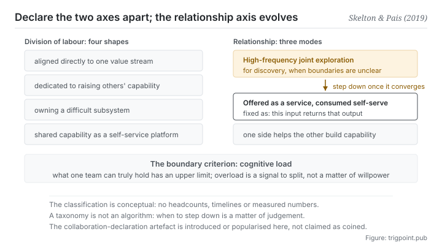

Canonical: https://trigpoint.pub/collections/software-systems-architecture/team-topologies-skelton-pais-2019  
Captured: 2026-11-02T21:27:28.018411+08:00

> Public theory reading mirror. Verification and Lab case sections remain on the website.

Should two teams explore together at high frequency, or should one offer a service the other helps itself to?

# Team topologies

Team Topologies · Skelton & Pais (2019)

Bibliography checked ✓  
Software architecture · interfaces and cognitive load  
Read first: Conway's law

## In three sentences

Relationships between teams want declaring explicitly, the way an interface is declared, rather than resting on tacit understanding. The criterion for a boundary is cognitive load: what one team can genuinely hold has an upper limit. And the relationship itself is expected to change: discovery needs high-frequency joint work, and once things converge it should step down.

<strong>Figure 1</strong> · On the left, four shapes along the axis of division of labour. On the right, three modes along the axis of relationship. The book's claim is that the two axes should be declared separately, and that the relationship axis is expected to evolve over time: high-frequency joint exploration during discovery, then a step down to consuming a service once things converge. Along the bottom is the boundary criterion: what one team can genuinely hold has an upper limit, and overload is itself a signal to split.

## 1. What happened

Whether two teams should explore closely together, or one should turn its work into a service the other helps itself to, is a question whose answer changes with the stage. This book starts where the previous page ended: if system structure mirrors the communication structure of an organisation, then <strong>deliberately designing team boundaries</strong> is itself an instrument of architecture[\[1\]](#reference-note-1).

The first thing it gives is four shapes along the axis of division of labour: teams aligned directly to a stream of value, teams whose job is raising the capability of others, teams owning a difficult subsystem, and teams that turn shared capability into a platform others help themselves to[\[1\]](#reference-note-1). Those four are not ranks. They are <strong>shapes of function</strong>.

The second is three modes along the axis of relationship: high-frequency joint exploration, turning your output into a service the other side consumes on its own, and one side helping another build a capability[\[1\]](#reference-note-1). That axis is the book's real contribution.

The third is that it asks for the relationship to be <strong>written down</strong>: each team publishes an explicit document describing how to work with us[\[1\]](#reference-note-1). The attribution of that document's name needs care: this site says only that the book put the term forward as a core practice and popularised it, and does not claim the two authors coined it[\[2\]](#reference-note-2).

The fourth is the criterion for a boundary: <strong>cognitive load</strong>. What one team can genuinely hold has an upper limit, and overload is itself a signal to split[\[1\]](#reference-note-1). In an article on the publisher's website, the two authors attribute the characterisation of the concept to Sweller's 1988 work on cognitive load[\[4\]](#reference-note-4); how the book itself cites it was not checked here.

And the item most easily skipped, which is also the most useful: <strong>interaction modes are expected to evolve</strong>[\[3\]](#reference-note-3). Joint exploration is for the discovery period, and once the boundary has been felt out, the relationship should step down to consuming a service. Stepping a relationship up and down is the organisational version of refactoring an architecture.

<strong>Attribution where due:</strong>The four shapes, the three interaction modes and the whole vocabulary of organisational design belong to Skelton and Pais (2019; second edition 2025)[\[1\]](#reference-note-1). This site marks the name of the collaboration declaration document as <strong>introduced or popularised by the book, with no coinage claimed</strong>[\[2\]](#reference-note-2). That team relationships change is stated by the authors[\[3\]](#reference-note-3). For the theoretical root of cognitive load, the two authors point to Sweller's work of 1988[\[4\]](#reference-note-4). The premise that organisation and structure are isomorphic belongs to Conway's law on the previous page and not to this book. Four separate attributions.

## 2. Why this matters to you

Swap team for each of your own lines and the page lands, whether the line has another person behind it, another of your own roles, or a model.

The first thing that transfers is that declaration document. When you work with a line, what the other side (or your future self) needs to know comes down to a few items: what this line is responsible for, what it is not responsible for, how to hand it work, and what situations require asking you first. Write those down and you have an interface document. <strong>Most friction in collaboration is not a matter of capability. It is that this document does not exist, so the terms get renegotiated every time.</strong>

The second thing that transfers is more counter-intuitive, and it is the headline on this page: <strong>collaboration is not better for being closer.</strong> Each of the three modes has its moment. At the start of something, with the boundary still unclear, you need frequent back and forth. Once it is clear, continuing to go back and forth is waste, and what belongs there instead is fixing it into given this input, return this output, after which you stop taking part in the process.

That is especially visible when working with a model. Exploring a new task, you will go twenty rounds, and the value of those twenty rounds is <strong>finding the boundary</strong>. The problem most people have is that after finding it they keep going twenty rounds, because nothing was ever fixed down. What this page says is that this is not diligence. It is a relationship that never stepped down.

The third is the cognitive load line. When you find that the scope you hold has reached the point where every switch means loading it all again, that is not a failure of will. The scope has passed its limit. The limit is a criterion, not a shortcoming.

## Common misreadings

Page verification: Bibliography checked ✓ · Content last revised 2026-10-25

- A common retelling, Team API is a term the two authors coined: this site can say only that the book put it forward and popularised it, and neither claims nor denies the coinage.
- A common retelling, this is a set of empirical laws: it is an organisational design taxonomy from an industry publisher, not peer-reviewed theory. It works as vocabulary, not as law.
- A common retelling, the four shapes are four kinds of team, so just apply them: a taxonomy is not an algorithm. When to step a relationship down from joint exploration to consuming a service remains a matter of judgement.

## References

<strong>How to read the source notes</strong> “Bibliographic details checked” means author, year, title and venue were confirmed. It does not mean the source's claims were checked. “Matched against the full text” means the claim was compared with the text of the source itself. Definitions as of 2026-09-20.

- \[1\] Skelton, M. & Pais, M. (2019). Team Topologies: Organizing Business and Technology Teams for Fast Flow. IT Revolution Press.
- \[2\] Editorial note, no external source; see note \[2\] in the text.
- \[3\] Skelton, M. & Pais, M. (2019). Team Topologies: Organizing Business and Technology Teams for Fast Flow. IT Revolution Press.
- \[4\] Skelton, M. & Pais, M. (2021). Team Cognitive Load. IT Revolution. Published 19 January 2021.
- \[5\] Skelton, M. & Pais, M. (2025). Team Topologies (2nd ed.): Organizing Business and Technology for Fast Flow of Value. IT Revolution Press.

## Knowledge graph

- [<em>Prerequisite ▸</em>Conway's law](conways-law-conway-1968.md)
- [<em>Applied in ▸</em>Microservices](microservices-lewis-fowler-2014.md)

Cite as: Trigpoint, “Team topologies”, trigpoint.pub/collections/software-systems-architecture/team-topologies-skelton-pais-2019 · © Strategitect Limited. · Content last revised 2026-10-25

## Source notes

**[1]** Skelton, M. & Pais, M. (2019-09-17). Team Topologies: Organizing Business and Technology Teams for Fast Flow. IT Revolution Press. Bibliographic details checked against the official record. First edition published 17 September 2019; second edition published 23 September 2025, with the subtitle changed to Organizing Business and Technology for Fast Flow of Value (see reference [5]). The names of the four team types and three interaction modes were checked against the two authors' website; the text of the book itself was not checked here.

**[2]** Attribution of Team API: this site says only that the book puts it forward as a core practice and popularised it; it neither claims nor denies that the two authors coined the term.

**[3]** The two authors' website states that relationships between teams will change as new goals are set and teams discover new things. This site therefore presents the relationship axis as something that can step up and down, not as a fixed arrangement.

**[4]** Skelton, M. & Pais, M. (2021-01-19). Team Cognitive Load. IT Revolution. Bibliographic details checked against the publisher's record. Claims matched against the full text. In an article on the publisher's website, the two authors attribute the characterisation of cognitive load to the psychologist Sweller's work of 1988 and build team-level cognitive load on it. How the book itself cites that theory was not checked here.

---

[繁體中文](../../../zh-Hant/collections/software-systems-architecture/team-topologies-skelton-pais-2019.md) · [简体中文](../../../zh-Hans/collections/software-systems-architecture/team-topologies-skelton-pais-2019.md)

[Index](../../README.md) · [Original page](https://trigpoint.pub/collections/software-systems-architecture/team-topologies-skelton-pais-2019) · [Citation and versions](../../../READING.md)

[Original SVG](assets/team-topologies-skelton-pais-2019.svg) · Display copy adds a white background only.
