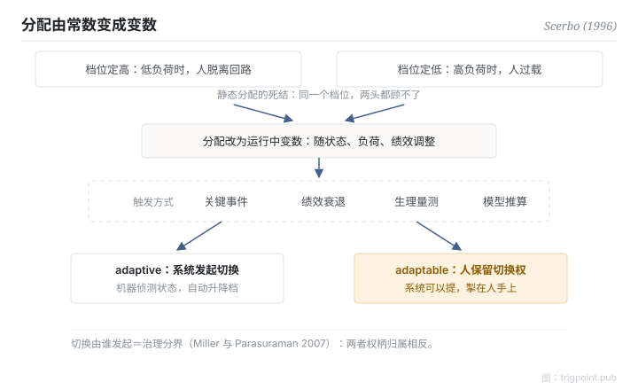

Canonical: https://trigpoint.pub/zh-Hans/collections/hai/adaptive-automation  
Captured: 2026-10-05T03:32:12.704406+08:00

> 公开理论阅读镜像。验证层及 Lab 案例请到原站阅读。

分工要在设计时定死，还是让系统在运行中自己调？

# 适应性自动化

adaptive automation · Scerbo (1996)

书目已核 ✓  
Lab 实测 ✓  
人机自动化 · 功能分配

## 三句讲透

分工不必在设计时定死：可以在运行中随负荷、状态、绩效即时升降档。  
这就是适应性自动化：负荷爆表时机器接手，闲时交回人手。  
真正的治理问题是：升降档的决定权，在系统还是在人。

<strong>图 1</strong> · 适应性自动化的触发与权柄示意。  
静态分配无法同时解决两头风险；分配改为运行中变数后，真正的治理分界在切换由谁发起。  
adaptive 是系统发起，adaptable 是人保留切换权（Miller 与 Parasuraman 2007）。

## 一、发生什么事

静态分级有个死结：档位定得高，人在低负荷时脱离回路；定得低，人在高负荷时过载。同一个档位无法同时应付两头。1996 年，Scerbo 整合出理论定式：让分配随时间变动[\[1\]](#reference-note-1)。文献常见的触发依据包括关键事件、绩效衰退、生理量测与模型推算等。Kaber 与 Endsley 其后的实证显示，等级本身仍是绩效主因；适应性切换主要影响主观负荷与次任务表现，对主任务绩效与情境觉察影响甚小。该研究的切换依预设排程，并非依操作员即时状态触发[\[2\]](#reference-note-2)。两条路线作用在不同的面。Miller 与 Parasuraman 再切开一条关键界线：adaptive 是系统发起切换，adaptable 是人保留切换权，两者的权力结构相反[\[3\]](#reference-note-3)。

<strong>署名要给对：</strong>「adaptive automation」概念前史早于 Scerbo（如 Rouse 的 adaptive aiding），Scerbo（1996）是理论整合与定式者，并非字面首创。把 adaptive 与 adaptable 之分用于委派设计、最常被引用的来源是 Miller 与 Parasuraman（2007）；这条分野在更早的文献已见（如 Oppermann 1994），各作者对 adaptive 的定义也不一致，引用时要注明用的是哪一种。

## 二、为什么这对你重要

「让系统自己判断何时接手」听起来最智能，但它同时意味着人交出了切换权。对一人工作室来说，这条界线是治理核心：自动化面可以有排程、有触发、有建议，但升降档那一下由谁来按，决定了出事时责任和觉知在哪里。判断需要人输入的环节，切换权就不应该留在系统手上。

适用边界：adaptive 指系统发起切换，adaptable 指人保留切换权，两者不可互换；会动不必然比静态好，实证中适应性切换主要影响的是主观负荷，而非主任务绩效与情境觉察；正典定义句本页引不出来。

## 修正记录

- 2026-09-27 · 原写 Kaber 与 Endsley 2004 显示「适应性调节的效果随切换周期而异」，并称「切换时机设计不当反而增加协调成本」。对照该文全文 Table 3 与结论段：切换周期对三级情境觉察皆无显著主效应，适应性切换主要影响主观负荷与次任务表现，对主任务绩效与情境觉察影响甚小；原文未见支持「增加协调成本」之结果。已改写结果句、删去该句，并补注该研究以预设排程切换。

## 参考文献

<strong>如何阅读来源注记</strong> 「书目经…核对」指作者、年份、题名与出版项已确认；不代表该来源的主张已被核对。「对照全文核实」指主张已与来源文本本身比对。「依多源一致转述」指主张建立于多份彼此一致、转述该来源的资料，而非原文件本身。 定义版本：2026-09-20。

- \[1\] Scerbo, M. W. (1996). Theoretical Perspectives on Adaptive Automation. In R. Parasuraman & M. Mouloua (Eds.), Automation and Human Performance: Theory and Applications (pp. 37–63). Mahwah, NJ: Lawrence Erlbaum Associates. https://doi.org/10.1201/9781315137957
- \[2\] Kaber, D. B., & Endsley, M. R. (2004). The Effects of Level of Automation and Adaptive Automation on Human Performance, Situation Awareness and Workload in a Dynamic Control Task. Theoretical Issues in Ergonomics Science, 5(2), 113–153. https://doi.org/10.1080/1463922021000054335
- \[3\] Miller, C. A., & Parasuraman, R. (2007). Designing for Flexible Interaction Between Humans and Automation: Delegation Interfaces for Supervisory Control. Human Factors, 49(1), 57–75. https://doi.org/10.1518/001872007779598037

## 知识图谱

- [<em>对照 ▸</em>自动化等级（LOA）](levels-of-automation.md)
- [<em>应用于 ▸</em>脱离回路失能](out-of-the-loop.md)

引用格式：Trigpoint，〈适应性自动化〉，trigpoint.pub/zh-Hans/collections/hai/adaptive-automation · © Strategitect Limited. · 内容最后修订 2026-09-28

## 来源注记

**[1]** Scerbo, M. W. (1996). Theoretical Perspectives on Adaptive Automation. In Parasuraman & Mouloua (Eds.), Automation and Human Performance: Theory and Applications (pp. 37–63). Erlbaum. 书目经多源交叉核对。要旨依多源一致转述。

**[2]** Kaber, D. B., & Endsley, M. R. (2004). The Effects of Level of Automation and Adaptive Automation on Human Performance, Situation Awareness and Workload in a Dynamic Control Task. Theoretical Issues in Ergonomics Science, 5(2), 113–153. 主张已对照全文核实。

**[3]** Miller, C. A., & Parasuraman, R. (2007). Designing for Flexible Interaction Between Humans and Automation. Human Factors, 49(1), 57–75. 书目经双源核对。adaptive 与 adaptable 之分依多源一致转述。

---

[English](../../../en/collections/hai/adaptive-automation.md) · [繁體中文](../../../zh-Hant/collections/hai/adaptive-automation.md)

[Index](../../README.md) · [Original page](https://trigpoint.pub/zh-Hans/collections/hai/adaptive-automation) · [Citation and versions](../../../READING.md)

[Original SVG](assets/adaptive-automation.svg) · Display copy adds a white background only.
