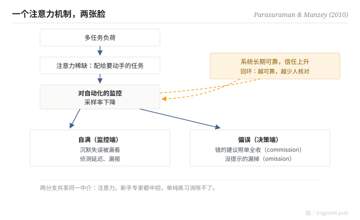

Canonical: https://trigpoint.pub/zh-Hans/collections/hai/automation-complacency  
Captured: 2026-10-05T03:32:13.521544+08:00

> 公开理论阅读镜像。验证层及 Lab 案例请到原站阅读。

监控时漏看，决策时盲从：两个现象，同一个注意力机制。

# 自动化自满与偏误

automation complacency & bias · Parasuraman & Manzey (2010)

摘要已核 ✓  
Lab 实测 ✓  
人机自动化 · 信任与依赖

## 三句讲透

自满与偏误是同一个注意力机制的两张脸：注意力从自动化输出撤走，监控端漏看沉默失误（自满），决策端盲从系统建议（偏误）。  
它来自多任务下注意力的分配方式，长期练习也消除不了。

<strong>图 1</strong> · 自满与偏误的共同注意力机制示意。  
多任务负荷令注意力稀缺，对自动化的监控采样率下降，监控端漏看沉默失误（自满），决策端盲从提示（偏误）。  
系统越可靠，信任越高，采样率跌得越快，形成自我强化回环。  
原论文另画一条负回馈（自动化失效的经历会压低自满倾向），本图从略。  
示意重绘自 Parasuraman 与 Manzey（2010）整合模型。

## 一、发生什么事

两种失误一个出在监控端、一个出在决策端，看起来毫不相干。2010 年，Parasuraman 与 Manzey 回顾多年实证研究，把两个一直分开讲的现象整合成单一模型[\[1\]](#reference-note-1)。机制链是这样：多任务负荷令注意力稀缺，人把注意力配给要动手的任务，对自动化的监控采样率随之下降。自满分支：沉默失误被漏看，侦测延迟。偏误分支：把系统提示当捷思，替代自己的资讯搜寻，错的建议照单全收（commission），没提示的就漏掉（omission）。可靠度越高的系统，信任越高，采样率跌得越狠：一个自我强化的回环。论文推定另有一条方向相反的回环：经历过自动化失效，信任与自满倾向就会回落。新手专家都中招，长时间的练习消除不了它；论文提到变动任务优先级的训练，以及亲身经历自动化失效，或许能减轻效应。

<strong>署名要给对：</strong>「automation bias」一词在文中的定义出自 Mosier 与 Skitka（1996）；Parasuraman 与 Manzey 的贡献是 2010 年的注意力整合模型。complacency 一词更早见于 NASA 航空安全通报系统的事件编码项（Billings 等，1976），Wiener（1981）曾讨论其定义；Parasuraman 与 Riley（1997）则是「自动化误用」框架的参照。三个座标分清楚，引用才给得对。

## 二、为什么这对你重要

自动化输出的品质越稳定，你核对它的频率就越低，这条曲线在你身上一样成立。有效的干预主要落在设计层：强制验证步骤、抽查机制、变动的核对节奏，或者把关键决策锁回人手。靠「提醒自己保持警惕」去对抗一个注意力结构，胜算很低。

适用边界：偏误特指不完美决策辅助下的 commission 与 omission 错误，不等于一般过度信任；本页机制以摘要核对为主，只有几处对过全文，需要精确参数的设计不能以此为据。

## 参考文献

<strong>如何阅读来源注记</strong> 「书目经…核对」指作者、年份、题名与出版项已确认；不代表该来源的主张已被核对。「与摘要一致」指主张与论文摘要相符；不含逐句对照全文。 定义版本：2026-09-20。

- \[1\] Parasuraman, R., & Manzey, D. H. (2010). Complacency and Bias in Human Use of Automation: An Attentional Integration. Human Factors: The Journal of the Human Factors and Ergonomics Society, 52(3), 381–410. https://doi.org/10.1177/0018720810376055
- \[2\] Mosier, K. L., & Skitka, L. J. (1996). Human Decision Makers and Automated Decision Aids: Made for Each Other? In R. Parasuraman & M. Mouloua (Eds.), Automation and Human Performance: Theory and Applications (pp. 201–220). Mahwah, NJ: Lawrence Erlbaum Associates. https://doi.org/10.1201/9781315137957
- \[3\] Parasuraman, R., & Riley, V. (1997). Humans and Automation: Use, Misuse, Disuse, Abuse. Human Factors, 39(2), 230–253. https://doi.org/10.1518/001872097778543886
- \[4\] Billings, C. E., Lauber, J. K., Funkhouser, H., Lyman, G., & Huff, E. M. (1976). Aviation Safety Reporting System (Technical Report TM-X-3445). Moffett Field, CA: NASA Ames Research Center. https://ntrs.nasa.gov/citations/19760026757 (as cited in Parasuraman & Manzey, 2010)
- \[5\] Wiener, E. L. (1981). Complacency: Is the term useful for air safety? In Proceedings of the 26th Corporate Aviation Safety Seminar (pp. 116–125). (as cited in Parasuraman & Manzey, 2010)

## 知识图谱

- [<em>前置 ▸</em>警觉递减](vigilance-decrement.md)

引用格式：Trigpoint，〈自动化自满与偏误〉，trigpoint.pub/zh-Hans/collections/hai/automation-complacency · © Strategitect Limited. · 内容最后修订 2026-09-28

## 来源注记

**[1]** Parasuraman, R., & Manzey, D. H. (2010). Complacency and Bias in Human Use of Automation: An Attentional Integration. Human Factors, 52(3), 381–410. 书目经官方记录核对。要旨与摘要一致。

---

[English](../../../en/collections/hai/automation-complacency.md) · [繁體中文](../../../zh-Hant/collections/hai/automation-complacency.md)

[Index](../../README.md) · [Original page](https://trigpoint.pub/zh-Hans/collections/hai/automation-complacency) · [Citation and versions](../../../READING.md)

[Original SVG](assets/automation-complacency.svg) · Display copy adds a white background only.
