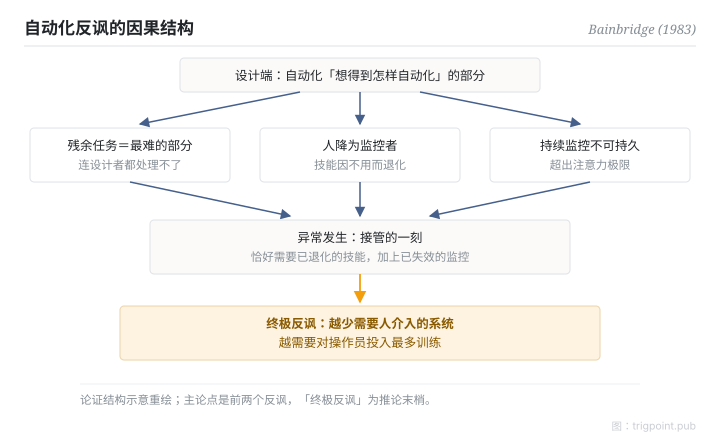

Canonical: https://trigpoint.pub/zh-Hans/collections/hai/ironies-of-automation  
Captured: 2026-10-05T03:32:13.738124+08:00

> 公开理论阅读镜像。验证层及 Lab 案例请到原站阅读。

把人排除在回路外，最难的残余工作却仍要人接手。

# 自动化反讽

ironies of automation · Bainbridge (1983)

已对照来源本身 ✓  
人机自动化 · 奠基悖论

## 三句讲透

自动化想取代不可靠的人，结果把最难、最关键的残余工作留给一个技能正在退化的人。  
自动化越成功，人的角色越吃力。

<strong>图 1</strong> · 自动化反讽的因果结构。  
设计端把「想得到怎样自动化」的部分自动化，残余的难题、退化的技能、不可能的持续监控，全部压在异常接管的一刻。  
示意重绘自 Bainbridge（1983）论证结构。

## 一、发生什么事

要让系统更可靠，最自然的做法是减少人的参与。1983 年，UCL 心理学者 Bainbridge 用一篇五页短文，戳穿了自动化设计的核心假设[\[1\]](#reference-note-1)。设计者视操作员为不可靠，想把人排除在系统之外，她指出这种态度带着两个反讽。第一，设计者自己的失误，可能就是运作问题的一大来源。第二，设计者能自动化的，只是「想得到怎样自动化」的部分：剩下的，恰好是连设计者都处理不了的难题，而这些难题全数落回操作员身上。

同时，人被降为监控者：长期不落手，操作技能随之退化；持续监控本身又超出人的注意力极限，连「侦测到该接管」这一步都靠不住。等到异常真正发生，系统同时需要已退化的技能和已失效的监控。

谈到操作员训练时，她另加一句带着「或许」的推论：越成功、越少需要人介入的自动化系统，可能反而最需要在操作员训练上投入。

<strong>署名要给对：</strong>「Ironies of Automation」由 Bainbridge 一人命名兼完成整套论证（1983），归属罕见地干净。文中「持续监控约半小时就失效」一句，Bainbridge 引的是 Mackworth（1950）的研究报告；「警觉递减」节点引的是 Mackworth 1948 年的实验论文。两处年份不同，是因为引的是不同出版物。主论点是开头两个反讽；「越成功可能越需要训练」是谈训练时带限定词的推论，引用时不要倒置。

## 二、为什么这对你重要

把工作交给 AI agent 之后，你的角色不会消失，只会变形：由执行者变成异常处理者。而异常处理恰恰要求你对这件工作保持手感。所以委派设计要问的不是「这步能不能自动化」，而是「自动化之后，留给人的那部分，人还做不做得来」。

给自己留一条定期落手的通道，不是低效，是维持接管能力的成本。全自动跑得越顺，这条通道越值钱。

适用边界：本文是因果论证，没有给出该拨到哪一档的答案；文中的半小时数字只能当量级参考。

## 参考文献

<strong>如何阅读来源注记</strong> 「书目经…核对」指作者、年份、题名与出版项已确认；不代表该来源的主张已被核对。「对照全文核实」指主张已与来源文本本身比对。「转引自」指本页未读原文，引注取自所列来源。 定义版本：2026-09-20。

- \[1\] Bainbridge, L. (1983). Ironies of Automation. Automatica, 19(6), 775–779. https://doi.org/10.1016/0005-1098(83)90046-8
- \[2\] Mackworth, N. H. (1950). Researches on the Measurement of Human Performance. 转引自 Bainbridge (1983)。

引用格式：Trigpoint，〈自动化反讽〉，trigpoint.pub/zh-Hans/collections/hai/ironies-of-automation · © Strategitect Limited. · 内容最后修订 2026-09-28

## 来源注记

**[1]** Bainbridge, L. (1983). Ironies of Automation. Automatica, 19(6), 775–779. 书目经多源交叉核对。主张已对照全文核实。

---

[English](../../../en/collections/hai/ironies-of-automation.md) · [繁體中文](../../../zh-Hant/collections/hai/ironies-of-automation.md)

[Index](../../README.md) · [Original page](https://trigpoint.pub/zh-Hans/collections/hai/ironies-of-automation) · [Citation and versions](../../../READING.md)

[Original SVG](assets/ironies-of-automation.svg) · Display copy adds a white background only.
