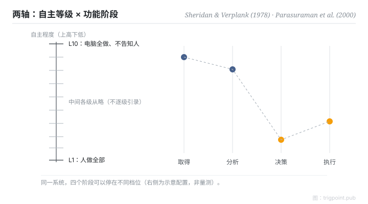

Canonical: https://trigpoint.pub/zh-Hans/collections/hai/levels-of-automation  
Captured: 2026-10-05T03:32:13.740165+08:00

> 公开理论阅读镜像。验证层及 Lab 案例请到原站阅读。

「自动化就是开或者不开」：没这么简单。

# 自动化等级

levels of automation · Sheridan & Verplank (1978) · Parasuraman, Sheridan & Wickens (2000)

书目已核 ✓  
Lab 实测 ✓  
人机自动化 · 功能分配

## 三句讲透

自动化程度是连续刻度：由「人做全部」到「机器全做、不告知人」。  
而且刻度要逐阶段分开拨：资讯取得、资讯分析、决策选择、动作执行，各自可以停在不同档位。  
单一开关的想像，正是大多数自动化设计错误的起点。

<strong>图 1</strong> · 两轴模型示意重绘：十级刻度（Sheridan & Verplank 1978）× 四阶段（Parasuraman、Sheridan 与 Wickens 2000）。  
中间各级文字从略：原报告表格位置未一手核对，不逐级引录原文。  
右侧档位为示意配置，非量测。

## 一、发生什么事

把自动化当成开关，会漏掉一件事：同一个系统的不同阶段，可以停在不同档位。1978 年，Sheridan 与 Verplank 在一份海底遥控作业研究报告中提出十级自主量表：第一级人做全部，第十级电脑全做且不告知人[\[1\]](#reference-note-1)。2000 年，Parasuraman、Sheridan 与 Wickens 补上第二条轴：自动化作用于四类资讯处理阶段（取得、分析、决策、执行），每一阶段可以独立选择等级[\[2\]](#reference-note-2)。代价面也有实证：Endsley 与 Kaber（1999）让 30 名受试者在动态控制任务中操作不同等级的自动化，发现绩效受益主要来自执行阶段的自动化，而且只限正常运作；人一旦被移出执行阶段，系统失效后的恢复表现就受损。人与电脑共同产生选项，绩效比单靠任何一方更差。决策阶段（在选项中做选择）的自动化则带来较低的负荷与较高的情境觉知，绩效只略有改善[\[3\]](#reference-note-3)。所以「自动化到哪一级」是逐阶段的权衡设计，不是越高越好。

<strong>署名要给对：</strong>十级量表出自 Sheridan 与 Verplank 的 1978 年报告，亦见引为 Sheridan 1992，引用时要给对年份。四阶段的骨架承自人类资讯处理模型传统（Wickens 为代表人物，兼 2000 年论文共同作者），并非 2000 年凭空发明；两轴整合才是 Parasuraman、Sheridan 与 Wickens 的贡献。

## 二、为什么这对你重要

给 AI agent 配权时，最有用的一个动作是把工作拆成四段再问：资讯搜集可以全自动吗？分析可以吗？决策呢？执行呢？多数场景的答案并不一致：搜集和分析可以拨到高档，决策和不可逆的执行留在低档。一刀切的「信任 AI」或「不信任 AI」，在这个框架下根本无从操作。

适用边界：往上拨是取舍。同一项实验中，执行阶段自动化在正常运作下提升绩效，却让失效后的恢复受损；人机共同产生选项也拉低绩效。十级刻度为 1978 年海底遥控作业而写，套用前先确认场景可比。

## 参考文献

<strong>如何阅读来源注记</strong> 「书目经…核对」指作者、年份、题名与出版项已确认；不代表该来源的主张已被核对。 定义版本：2026-09-20。

- \[1\] Sheridan, T. B., & Verplank, W. L. (1978). Human and Computer Control of Undersea Teleoperators. Cambridge, MA: MIT Man-Machine Systems Laboratory. https://doi.org/10.21236/ADA057655
- \[2\] Parasuraman, R., Sheridan, T. B., & Wickens, C. D. (2000). A Model for Types and Levels of Human Interaction with Automation. IEEE Transactions on Systems, Man, and Cybernetics, Part A, 30(3), 286–297. https://doi.org/10.1109/3468.844354
- \[3\] Endsley, M. R., & Kaber, D. B. (1999). Level of automation effects on performance, situation awareness and workload in a dynamic control task. Ergonomics, 42(3), 462–492. https://doi.org/10.1080/001401399185595

## 知识图谱

- [<em>对照 ▸</em>功能分配（Fitts List）](fitts-list.md)
- [<em>对照 ▸</em>适应性自动化](adaptive-automation.md)
- [<em>下游 ▸</em>脱离回路失能](out-of-the-loop.md)
- [<em>被应用 ▸</em>心智负荷（NASA-TLX）](mental-workload-nasa-tlx.md)

引用格式：Trigpoint，〈自动化等级〉，trigpoint.pub/zh-Hans/collections/hai/levels-of-automation · © Strategitect Limited. · 内容最后修订 2026-09-28

## 来源注记

**[1]** Sheridan, T. B., & Verplank, W. L. (1978). Human and Computer Control of Undersea Teleoperators. MIT Man-Machine Systems Laboratory. 书目经官方记录核对。出处经跨模型双查核实。本页不逐级引录原文。

**[2]** Parasuraman, R., Sheridan, T. B., & Wickens, C. D. (2000). A Model for Types and Levels of Human Interaction with Automation. IEEE Transactions on Systems, Man, and Cybernetics, Part A, 30(3), 286–297. 书目经官方记录核对。出处经跨模型双查核实。

**[3]** Endsley, M. R., & Kaber, D. B. (1999). Level of automation effects on performance, situation awareness and workload in a dynamic control task. Ergonomics, 42(3), 462–492. 书目经官方记录核对。出处经跨模型双查核实。实验结果句依该文摘要。

---

[English](../../../en/collections/hai/levels-of-automation.md) · [繁體中文](../../../zh-Hant/collections/hai/levels-of-automation.md)

[Index](../../README.md) · [Original page](https://trigpoint.pub/zh-Hans/collections/hai/levels-of-automation) · [Citation and versions](../../../READING.md)

[Original SVG](assets/levels-of-automation.svg) · Display copy adds a white background only.
