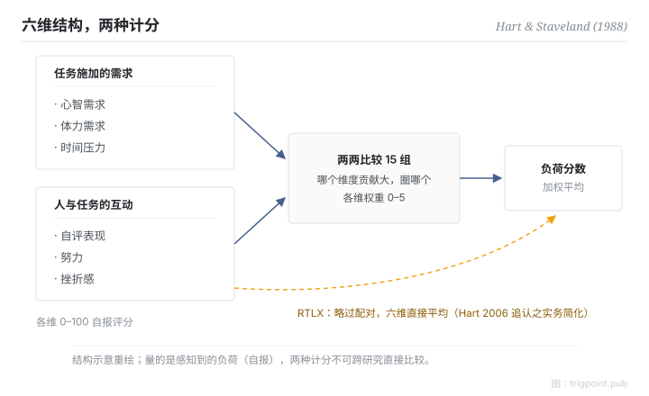

Canonical: https://trigpoint.pub/zh-Hans/collections/hai/mental-workload-nasa-tlx  
Captured: 2026-10-05T03:32:14.745835+08:00

> 公开理论阅读镜像。验证层及 Lab 案例请到原站阅读。

负荷看不见只能自评，但一个总分又看不出负荷从哪里来。

# 心智负荷

mental workload (NASA-TLX) · Hart & Staveland (1988)

书目已核 ✓  
Lab 实测 ✓  
人机自动化 · 负荷量测

## 三句讲透

NASA-TLX 把量不到的「心智负荷」拆成六个可评维度：心智需求、体力需求、时间压力、自评表现、努力、挫折感，再由受测者两两比较定出各维权重，加权合成分数。  
它量的是感知到的负荷：属自报量测，跟客观读数是两回事。  
用它的前提是承认这一点。

<strong>图 1</strong> · NASA-TLX 结构示意。  
六维分两组：任务施加的需求（心智、体力、时间压力）与人和任务的互动（自评表现、努力、挫折感）。  
原设计以十五组两两比较定权重后加权平均，后世常用简化为直接平均（RTLX）。  
六维命名经 NASA 官方手册一手核对。

## 一、发生什么事

要量一件看不见的东西，只能问经历它的人。1988 年，NASA Ames 的 Hart 与 Staveland 把三年的研究成果收成一套量表（NASA 官方手册记载为四十余个实验）[\[1\]](#reference-note-1)。出发点是单一总分太粗：掩盖负荷来源，人与人之间变异又大。改法是六维各自 0 至 100 评分，再用十五组两两比较让受测者自己定权重：哪个维度对这件任务的负荷贡献大，圈哪个。加权平均，得一个负荷分数。二十年后，Hart 回顾五百五十篇使用或评论它的研究：最常见的修改是省去配对加权、六维直接平均，即 Raw TLX；在他回顾的比较研究中，两版的敏感度结果不一致，他的看法是两者可任选[\[2\]](#reference-note-2)。

<strong>署名要给对：</strong>Hart 与 Staveland（1988）是 NASA-TLX 这套工具的原创者：六维结构和配对加权程序都出自这份章节。「mental workload」构念本身更早，不归他们名下。RTLX 是后世实务简化版，Hart（2006）回顾时追认；引用时要讲清楚用的是哪个版本。

## 二、为什么这对你重要

管理自己或团队的负荷，第一课是 TLX 的结构课：负荷是多维的，总分会骗人。时间压力爆表和挫折感爆表是两种完全不同的问题，混成一个「很累」分数就无从对症。第二课是诚实课：任何自报负荷都是主观量测，跟客观产出可以脱节，两边都要看。报分数不声明计法（加权还是直接平均），等于方法漏报。

适用边界：分数是回溯式自报，不是客观负荷读数，也推不出情境觉知；加权版与平均版不可跨研究直接比较；1988 章节本体未核。

## 参考文献

<strong>如何阅读来源注记</strong> 「书目经…核对」指作者、年份、题名与出版项已确认；不代表该来源的主张已被核对。「对照全文核实」指主张已与来源文本本身比对。 定义版本：2026-09-20。

- \[1\] Hart, S. G., & Staveland, L. E. (1988). Development of NASA-TLX (Task Load Index): Results of Empirical and Theoretical Research. In P. A. Hancock & N. Meshkati (Eds.), Human Mental Workload (pp. 139–183). Amsterdam: North-Holland. https://doi.org/10.1016/S0166-4115(08)62386-9
- \[2\] Hart, S. G. (2006). NASA-Task Load Index (NASA-TLX); 20 Years Later. Proceedings of the Human Factors and Ergonomics Society Annual Meeting, 50(9), 904–908. https://doi.org/10.1177/154193120605000909

## 知识图谱

- [<em>应用于 ▸</em>自动化等级（LOA）](levels-of-automation.md)
- [<em>对照 ▸</em>情境觉知](situation-awareness.md)

引用格式：Trigpoint，〈心智负荷〉，trigpoint.pub/zh-Hans/collections/hai/mental-workload-nasa-tlx · © Strategitect Limited. · 内容最后修订 2026-09-28

## 来源注记

**[1]** Hart, S. G., & Staveland, L. E. (1988). Development of NASA-TLX (Task Load Index): Results of Empirical and Theoretical Research. In Hancock & Meshkati (Eds.), Human Mental Workload (pp. 139–183). North-Holland. 书目经多源交叉核对。已对照官方手册核实。

**[2]** Hart, S. G. (2006). NASA-Task Load Index (NASA-TLX); 20 Years Later. Proceedings of the Human Factors and Ergonomics Society Annual Meeting, 50(9), 904–908. 书目经多源交叉核对。

---

[English](../../../en/collections/hai/mental-workload-nasa-tlx.md) · [繁體中文](../../../zh-Hant/collections/hai/mental-workload-nasa-tlx.md)

[Index](../../README.md) · [Original page](https://trigpoint.pub/zh-Hans/collections/hai/mental-workload-nasa-tlx) · [Citation and versions](../../../READING.md)

[Original SVG](assets/mental-workload-nasa-tlx.svg) · Display copy adds a white background only.
