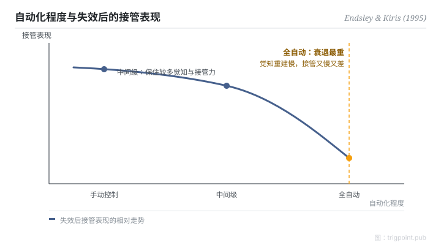

Canonical: https://trigpoint.pub/zh-Hans/collections/hai/out-of-the-loop  
Captured: 2026-10-05T03:32:14.861117+08:00

> 公开理论阅读镜像。验证层及 Lab 案例请到原站阅读。

导航任务中自动化失效，全自动组的人接管得最差。

# 脱离回路

out-of-the-loop performance problem · Endsley & Kiris (1995)

摘要已核 ✓  
人机自动化 · 情境觉知

## 三句讲透

自动化把人从操作者变成旁观者，情境觉知和手感同时流失。  
一切正常时，这个损耗看不见，也没有成本。  
直到系统出错需要接管：情境理解下降、失效后的决策变慢，这就是脱离回路绩效问题。

<strong>图 1</strong> · 自动化程度与失效后接管表现的相对走势。  
Endsley 与 Kiris 的实验显示，全自动组的接管衰退最重，中间级别保住较多觉知与接管能力。  
示意走势重绘；一手数据未核，只标相对走势，不标数值。

## 一、发生什么事

自动化运作正常时，旁边的人只需要看；一旦失效，就要立刻接手。1995 年，Endsley 与 Kiris 用受控实验把这个问题钉实：同一个导航决策任务，控制层级分五级操弄，然后让自动化失效，量接管表现[\[1\]](#reference-note-1)。结果：全自动组的接管衰退最重，中间级别反而保住较多觉知和接管能力。更重要的是机制。依 Endsley 1996 年书章对该实验的转述，各组的显示资讯并未改变，警觉与监控的效应也不足以解释觉知的下降；作者认为最可能的肇因，是人由主动处理变成被动接收这件事本身。把 doer 换成 observer，这个动作自己就降觉知。

<strong>署名要给对：</strong>「人离开回路后侦测故障变慢」属这个概念的定义与前史。Endsley 1996 年书章把 Young（1969）、Wickens 与 Kessel（1979）、Ephrath 与 Young（1981）、Kessel 与 Wickens（1982）并列为此前的相关研究，各篇本页未逐项核对，结果方向依任务复杂度而异。Endsley 与 Kiris（1995）的贡献是命名形式化，加上以控制层级为变项的受控实验；该实验量到的是理解下降与失效后决策耗时增加，侦测变慢不是它的量测项。

## 二、为什么这对你重要

「有事我随时接手」是自动化工作流最常见的自我安慰。接手的前提是你对现场还有理解，而理解正是被全自动偷走的东西。所以高自动化的工作线只有两条诚实的路：刻意保留人参与决策的环节（中间级别），或者接受接管会又慢又差，并为此预留缓冲。两样都不做，等于把系统可靠性押在一个已经离场的人身上。

适用边界：结论不是「自动化越少越好」，而是人是否留在主动决策回路；本页对 1995 年正文只到结论级，需要原文措辞或页码者请自行取得全文。

## 参考文献

<strong>如何阅读来源注记</strong> 「书目经…核对」指作者、年份、题名与出版项已确认；不代表该来源的主张已被核对。「与摘要一致」指主张与论文摘要相符；不含逐句对照全文。 定义版本：2026-09-20。

- \[1\] Endsley, M. R., & Kiris, E. O. (1995). The Out-of-the-Loop Performance Problem and Level of Control in Automation. Human Factors: The Journal of the Human Factors and Ergonomics Society, 37(2), 381–394. https://doi.org/10.1518/001872095779064555
- \[2\] Endsley, M. R. (1996). Automation and Situation Awareness. In R. Parasuraman & M. Mouloua (Eds.), Automation and Human Performance: Theory and Applications (pp. 163–181). Mahwah, NJ: Lawrence Erlbaum Associates. https://doi.org/10.1201/9781315137957

## 知识图谱

- [<em>前置 ▸</em>情境觉知](situation-awareness.md)
- [<em>前置 ▸</em>自动化等级（LOA）](levels-of-automation.md)
- [<em>被应用 ▸</em>适应性自动化](adaptive-automation.md)

引用格式：Trigpoint，〈脱离回路〉，trigpoint.pub/zh-Hans/collections/hai/out-of-the-loop · © Strategitect Limited. · 内容最后修订 2026-09-28

## 来源注记

**[1]** Endsley, M. R., & Kiris, E. O. (1995). The Out-of-the-Loop Performance Problem and Level of Control in Automation. Human Factors, 37(2), 381–394. 书目经多源交叉核对。要旨与摘要一致。核心结论经同作者 1996 年书章一手比对佐证。

---

[English](../../../en/collections/hai/out-of-the-loop.md) · [繁體中文](../../../zh-Hant/collections/hai/out-of-the-loop.md)

[Index](../../README.md) · [Original page](https://trigpoint.pub/zh-Hans/collections/hai/out-of-the-loop) · [Citation and versions](../../../READING.md)

[Original SVG](assets/out-of-the-loop.svg) · Display copy adds a white background only.
