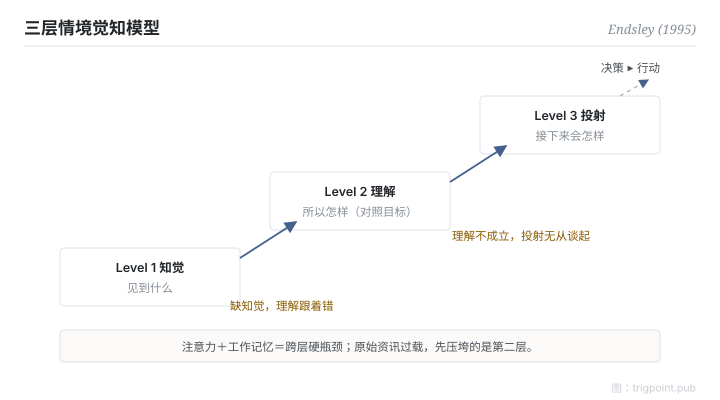

Canonical: https://trigpoint.pub/zh-Hans/collections/hai/situation-awareness  
Captured: 2026-10-05T03:32:14.870380+08:00

> 公开理论阅读镜像。验证层及 Lab 案例请到原站阅读。

看清状况和做出决定是两种能力，前者只是后者的输入。

# 情境觉知

situation awareness · Endsley (1995)

书目已核 ✓  
Lab 实测 ✓  
人机自动化 · 情境觉知

## 三句讲透

情境觉知分三层：知觉（发生了什么）、理解（所以怎样）、投射（接下来会怎样）。  
三层是递进的觉知层级，并非严格的线性阶段。  
它是决策的输入：态势不清，判断力再好也是空转。

<strong>图 1</strong> · Endsley 三层模型示意重绘。  
知觉、理解、投射是逐层递进的觉知层级，并非严格的线性阶段；注意力与工作记忆对新手是最明显的跨层瓶颈，专家以心智模型与样式比对缓解。  
情境觉知是决策的输入，与决策本身分离。

## 一、发生什么事

知道状况，不等于知道怎么做。Endsley 把散落在航空人因研究里的「知道现在什么状况」，形式化成可操作的三层模型；三层的定义一般溯至她 1988 年的研究（据作者后期自述，本页未读 1988 原文），1995 年那篇把它扩成完整理论，纳入注意、工作记忆、心智模型与目标驱动的处理[\[1\]](#reference-note-1)。第一层知觉：侦测环境中相关元素的状态。第二层理解：把元素整合成对照目标的意义。第三层投射：基于理解，预测近未来。三层是递进的层级，越高层觉知越完整，但并非严格的线性阶段：第一层有缺，理解容易跟着出错；然而凭目标驱动的处理与心智模型的预设，第一层不完整时仍可能有第二、三层的觉知。整个结构受注意力和工作记忆限制，新手最明显，专家则以心智模型与样式比对缓解；所以原始资讯灌得越多，第二层反而越容易被压垮。

<strong>署名要给对：</strong>「situation awareness」一词早于 Endsley，军事航空语境里用了几十年。Endsley 的贡献是三层模型的形式化：把一个口语词变成可量测、可设计的构念；1995 年那篇是其完整理论。引用时说「Endsley 三层模型」，不要说「Endsley 提出 SA 概念」。

## 二、为什么这对你重要

管多条并行的 AI 工作线，你的瓶颈很少是「资讯不够」，几乎都是「态势拼不起来」。仪表板给你第一层的原料，但第二层的理解和第三层的预判要靠设计：状态要对照目标呈现，过期要显式标记，下一步要可以直接读出来。把 agent 输出全部倒给自己看，等于用第一层的量压死第二层。

适用边界：觉知是决策的输入，不能用决策对错反推觉知高低；三层是递进的层级，只量第一层命中率不代表有觉知；模型描述停在教科书级一致，未经一手逐句核对。

## 参考文献

<strong>如何阅读来源注记</strong> 「书目经…核对」指作者、年份、题名与出版项已确认；不代表该来源的主张已被核对。 定义版本：2026-09-20。

- \[1\] Endsley, M. R. (1995). Toward a Theory of Situation Awareness in Dynamic Systems. Human Factors: The Journal of the Human Factors and Ergonomics Society, 37(1), 32–64. https://doi.org/10.1518/001872095779049543

## 知识图谱

- [<em>对照 ▸</em>心智负荷（NASA-TLX）](mental-workload-nasa-tlx.md)
- [<em>下游 ▸</em>脱离回路失能](out-of-the-loop.md)

引用格式：Trigpoint，〈情境觉知〉，trigpoint.pub/zh-Hans/collections/hai/situation-awareness · © Strategitect Limited. · 内容最后修订 2026-09-28

## 来源注记

**[1]** Endsley, M. R. (1995). Toward a Theory of Situation Awareness in Dynamic Systems. Human Factors, 37(1), 32–64. 书目经多源交叉核对。

---

[English](../../../en/collections/hai/situation-awareness.md) · [繁體中文](../../../zh-Hant/collections/hai/situation-awareness.md)

[Index](../../README.md) · [Original page](https://trigpoint.pub/zh-Hans/collections/hai/situation-awareness) · [Citation and versions](../../../READING.md)

[Original SVG](assets/situation-awareness.svg) · Display copy adds a white background only.
