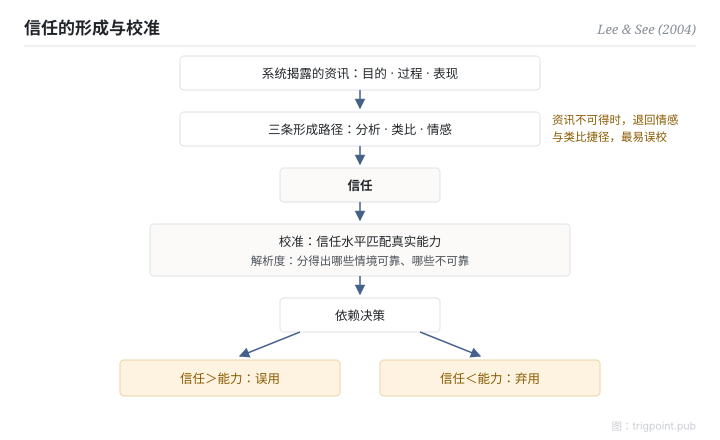

Canonical: https://trigpoint.pub/zh-Hans/collections/hai/trust-in-automation  
Captured: 2026-10-05T03:32:14.907971+08:00

> 公开理论阅读镜像。验证层及 Lab 案例请到原站阅读。

「信任越高越好」：错。

# 自动化信任

trust in automation · Lee & See (2004)

书目已核 ✓  
人机自动化 · 信任与依赖

## 三句讲透

人靠信任决定用不用自动化，而信任可以错配：信过头，系统失能时照样依赖；信不足，能用的工具被闲置。  
设计目标从来不是把信任推高，是把信任校准到系统的真实能力。

<strong>图 1</strong> · 信任形成与校准的机制示意。  
系统揭露的资讯经三条心理路径形成信任；信任对照真实能力做校准与解析，决定依赖行为。  
两个失配极：信过头是误用，信不足是弃用。  
示意重绘自 Lee 与 See（2004）框架。

## 一、发生什么事

设计人机系统时，很自然会想让用户多信任一点。2004 年，Lee 与 See 整合了散落各处的信任研究，给出这个领域的统一框架[\[1\]](#reference-note-1)。衡量信任是否恰当，框架中两个核心概念是校准（信任水平匹配真实能力）和解析度（信任能分辨系统在哪些情境可靠、哪些不可靠）。信任由三类资讯喂养：系统的目的、过程、表现（这组三维在二人之前已有出处，二手文献多归 Lee 与 Moray 1992，祖源本页未一手核）；经三条心理路径形成：分析、类比、情感。介面揭露什么资讯，决定信任往哪里走。本页推论：资讯不可得时，人较可能退回情感和类比捷径，误校的风险随之升高。

<strong>署名要给对：</strong>Lee 与 See（2004）的角色是整合者：信任研究在此之前散见各处，三维资讯在其前已有出处（二手文献多归 Lee 与 Moray 1992，祖源未一手核），校准加解析度、三维资讯加三条路径的统一框架，才是二人的统合贡献。引用时归属框架，不必归属「信任」一词。

## 二、为什么这对你重要

「怎样令用户更信任 AI」是一条走错方向的问题。过度信任制造的事故，和信任不足浪费的产能，同样真实。可操作的问法是：这个系统在什么情境下可靠、什么情境下不可靠，用户分不分得出？分不出，就在介面上把过程和表现亮出来。信任是校准出来的；谷高出来的，叫盲信。

适用边界：目标是校准不是拔高，且要分得出系统在哪些情境可靠；信任是动态状态而非人格特质；本页框架为二手确认级，未经一手逐句核对。

## 参考文献

<strong>如何阅读来源注记</strong> 「书目经…核对」指作者、年份、题名与出版项已确认；不代表该来源的主张已被核对。「依多源一致转述」指主张建立于多份彼此一致、转述该来源的资料，而非原文件本身。 定义版本：2026-09-20。

- \[1\] Lee, J. D., & See, K. A. (2004). Trust in Automation: Designing for Appropriate Reliance. Human Factors: The Journal of the Human Factors and Ergonomics Society, 46(1), 50–80. https://doi.org/10.1518/hfes.46.1.50_30392

## 知识图谱

- [<em>对照 ▸</em>警觉递减](vigilance-decrement.md)

引用格式：Trigpoint，〈自动化信任〉，trigpoint.pub/zh-Hans/collections/hai/trust-in-automation · © Strategitect Limited. · 内容最后修订 2026-09-28

## 来源注记

**[1]** Lee, J. D., & See, K. A. (2004). Trust in Automation: Designing for Appropriate Reliance. Human Factors, 46(1), 50–80. 书目经多源交叉核对。框架要旨依多源一致转述。

---

[English](../../../en/collections/hai/trust-in-automation.md) · [繁體中文](../../../zh-Hant/collections/hai/trust-in-automation.md)

[Index](../../README.md) · [Original page](https://trigpoint.pub/zh-Hans/collections/hai/trust-in-automation) · [Citation and versions](../../../READING.md)

[Original SVG](assets/trust-in-automation.svg) · Display copy adds a white background only.
