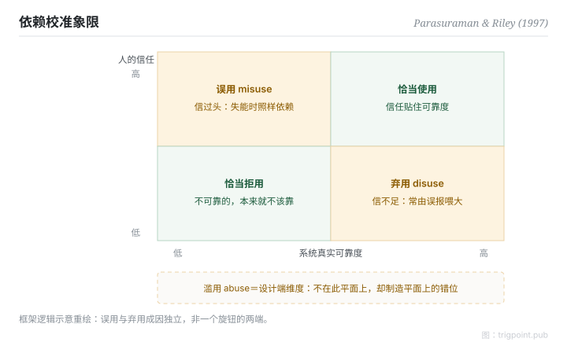

Canonical: https://trigpoint.pub/zh-Hans/collections/hai/use-misuse-disuse-abuse  
Captured: 2026-10-05T03:32:15.660013+08:00

> 公开理论阅读镜像。验证层及 Lab 案例请到原站阅读。

过度依赖和不肯用，成因各自独立。

# 使用、误用、弃用、滥用

use, misuse, disuse, abuse · Parasuraman & Riley (1997)

书目已核 ✓  
Lab 实测 ✓  
人机自动化 · 信任与依赖

## 三句讲透

人和自动化的关系分四种：恰当使用之外，另有三种失调：误用（过度依赖）、弃用（不信而闲置）、滥用（设计端不顾人因硬上）。  
三种失调各有成因，互为因果。  
最常见的管理错觉，是把误用和弃用当成同一个旋钮的两端。

<strong>图 1</strong> · 依赖校准象限示意：信任对照真实可靠度，错配出两个方向。  
误用（信过头）与弃用（信不足）成因独立，非一个旋钮的两端。  
滥用是设计端维度，不在此平面上，却制造平面上的错位。  
示意重绘自 Parasuraman 与 Riley（1997）框架。

## 一、发生什么事

有人过度依赖自动化，有人干脆不用；两者常被当成同一个问题的两个方向。1997 年，Parasuraman 与 Riley 把「自动化失败」从「人和机器谁更可靠」的争论，改写成「依赖是否恰当」的问题，并定出四词分类[\[1\]](#reference-note-1)。误用来自信任高于真实可靠度：监控松懈、盲从输出。弃用来自信任低于真实可靠度，最常见的推手是误报率过高的警报；而误报率高，往往因为设计时没算清楚待测事件的基础率。滥用则把镜头转回设计和管理端：不顾人因后果强推自动化，正是制造前两者的上游。最反直觉的一点（本页由分类推论，非原文结论）：压低误报去救弃用，可能反手推高误用。两个问题成因独立，不共用一个旋钮。

<strong>署名要给对：</strong>四词分类的概念与命名同出一源：Parasuraman 与 Riley（1997），本页未见需要拆分的前置造词者。

## 二、为什么这对你重要

工作流里的自动警示被人「自动略过」，第一反应通常是怪人。四象限的读法相反：先查警报的误报率和基础率（设计问题），再查依赖有没有校准到真实可靠度（关系问题），最后才轮到人的纪律。还有一条常被跳过的问题：这个自动化本身该不该上（滥用）？把四个问题分开问，修正才不会互相打架。

适用边界：四词是失调分类法，不是成熟度量表；误用与弃用成因独立，可同时存在；四词逐字定义未经一手核对。

## 参考文献

<strong>如何阅读来源注记</strong> 「书目经…核对」指作者、年份、题名与出版项已确认；不代表该来源的主张已被核对。「依多源一致转述」指主张建立于多份彼此一致、转述该来源的资料，而非原文件本身。 定义版本：2026-09-20。

- \[1\] Parasuraman, R., & Riley, V. (1997). Humans and Automation: Use, Misuse, Disuse, Abuse. Human Factors: The Journal of the Human Factors and Ergonomics Society, 39(2), 230–253. https://doi.org/10.1518/001872097778543886

引用格式：Trigpoint，〈使用、误用、弃用、滥用〉，trigpoint.pub/zh-Hans/collections/hai/use-misuse-disuse-abuse · © Strategitect Limited. · 内容最后修订 2026-09-28

## 来源注记

**[1]** Parasuraman, R., & Riley, V. (1997). Humans and Automation: Use, Misuse, Disuse, Abuse. Human Factors, 39(2), 230–253. 书目经官方记录核对。四词定义依多源一致转述。

---

[English](../../../en/collections/hai/use-misuse-disuse-abuse.md) · [繁體中文](../../../zh-Hant/collections/hai/use-misuse-disuse-abuse.md)

[Index](../../README.md) · [Original page](https://trigpoint.pub/zh-Hans/collections/hai/use-misuse-disuse-abuse) · [Citation and versions](../../../READING.md)

[Original SVG](assets/use-misuse-disuse-abuse.svg) · Display copy adds a white background only.
