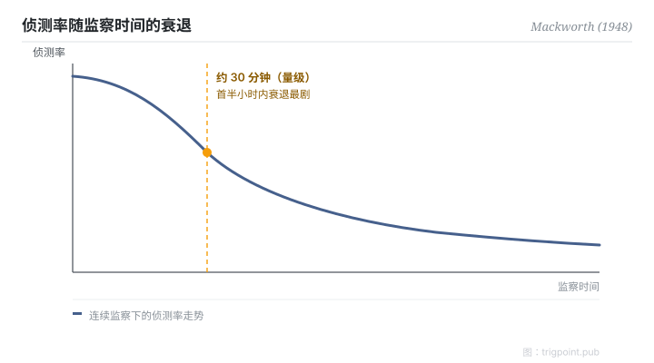

Canonical: https://trigpoint.pub/zh-Hans/collections/hai/vigilance-decrement  
Captured: 2026-10-05T03:32:15.776477+08:00

> 公开理论阅读镜像。验证层及 Lab 案例请到原站阅读。

受试者盯住一个偶尔跳两格的钟面，没多久就开始漏看。

# 警觉递减

vigilance decrement · Mackworth (1948)

书目已核 ✓  
Lab 实测 ✓  
人机自动化 · 监控

## 三句讲透

人类持续盯住一个少变化的讯号源，侦测率在约三十分钟内显著衰退。  
所以，把「叫人盯住自动化」当作唯一安全机制的设计，必然失败。  
这不是纪律问题，是人因极限：解法在设计层，不在「更小心」。

<strong>图 1</strong> · 持续监察作业的侦测率衰退走势。  
Mackworth 的雷达钟面实验显示，侦测率在首三十分钟内显著下跌，此后缓慢续降。  
示意走势重绘；一手数据未核，故只标走势，不标数值刻度。

## 一、发生什么事

二战期间，英国皇家空军海岸司令部的机载雷达操作员在值班后段漏掉潜艇讯号。Mackworth 用一个「会跳格的钟面」复制了这件事：受试者盯住指针，捕捉偶发的双倍跳格。结果稳定得可怕：侦测率在观察开始后约三十分钟内（量级，经二手转述）就显著下跌[\[1\]](#reference-note-1)。

<strong>署名要给对：</strong>「vigilance」作为神经学概念更早见于 Henry Head（1923）；Mackworth 1948 的贡献是首个系统性实验与量化曲线。前人是前人，实验是实验。

## 二、为什么这对你重要

把 AI agent 的输出交给「人盯住就好」，等于把系统可靠性押在一条三十分钟就开始漏水的曲线上。你的专注会耗损。所以任何「人类监督」的设计，如果只是叫人看着，它不是安全机制，是安全剧场。

正确的问法不是「谁来盯」，而是「监控面怎样设计，才能在人必然松懈的前提下仍然接得住」：轮换、抽查、把异常主动推到人面前，而不是等人去发现。

适用边界：「约三十分钟」是量级不是常数，经二手转述而来，写进值班规格前要用自己场景的数据校准；本页不提供曲线的数值形状。

## 参考文献

<strong>如何阅读来源注记</strong> 「书目经…核对」指作者、年份、题名与出版项已确认；不代表该来源的主张已被核对。 定义版本：2026-09-20。

- \[1\] Mackworth, N. H. (1948). The breakdown of vigilance during prolonged visual search. Quarterly Journal of Experimental Psychology, 1(1), 6–21. https://doi.org/10.1080/17470214808416738
- \[2\] Head, H. (1923). The conception of nervous and mental energy (II): 'Vigilance'; a physiological state of the nervous system. British Journal of Psychology, 14, 126–147. https://doi.org/10.1111/j.2044-8295.1923.tb00122.x
- \[3\] Parasuraman, R., & Manzey, D. H. (2010). Complacency and bias in human use of automation. Human Factors, 52(3), 381–410. https://doi.org/10.1177/0018720810376055

## 知识图谱

- [<em>对照 ▸</em>自动化信任](trust-in-automation.md)
- [<em>下游 ▸</em>自动化自满与偏误](automation-complacency.md)

引用格式：Trigpoint，〈警觉递减〉，trigpoint.pub/zh-Hans/collections/hai/vigilance-decrement · © Strategitect Limited. · 内容最后修订 2026-09-28

## 来源注记

**[1]** Mackworth, N. H. (1948). The breakdown of vigilance during prolonged visual search. Quarterly Journal of Experimental Psychology, 1(1), 6–21. 书目经多源交叉核对。

---

[English](../../../en/collections/hai/vigilance-decrement.md) · [繁體中文](../../../zh-Hant/collections/hai/vigilance-decrement.md)

[Index](../../README.md) · [Original page](https://trigpoint.pub/zh-Hans/collections/hai/vigilance-decrement) · [Citation and versions](../../../READING.md)

[Original SVG](assets/vigilance-decrement.svg) · Display copy adds a white background only.
