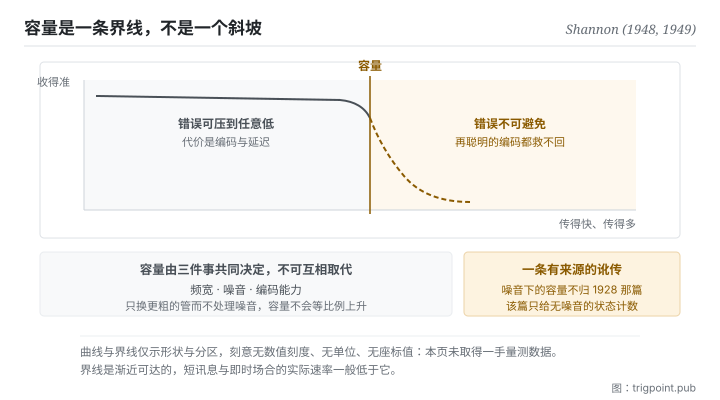

Canonical: https://trigpoint.pub/zh-Hans/collections/information-theory/channel-and-capacity  
Captured: 2026-11-02T21:27:36.282142+08:00

> 公开理论阅读镜像。验证层及 Lab 案例请到原站阅读。

塞得进去的量，与噪音下能可靠还原的量，是两个数。

# 通道与容量

Channel and Capacity · Shannon (1948, 1949)

书目已核 ✓  
Lab 实测 ✓  
资讯理论 · 传输极限  
先读：讯号与噪音  
先读：熵

## 三句讲透

通道是任何让资讯流动的载体，不只是电线与无线电，也包括语言、注意力与记忆。  
容量不是你能塞进去多少，是在噪音存在下对方最多能可靠还原多少。  
两者的差额不会报错，它只是安静地变成误解。

<strong>图 1</strong> · 速率与可靠性的取舍示意：横轴往右是传得更快更多，纵轴往上是收得更准。  
容量是一条界线，界线以左可以靠编码把错误压到任意低，越过界线错误就不可避免。  
本图刻意无数值刻度与单位。

## 一、发生什么事

能送进通道的量，与另一端在噪音下能可靠还原的量，常被当成同一个数；后者有一道硬上限。1948 年那篇证明了一件反直觉的事：在有噪音的通道上，错误率并不是只能靠加大功率来慢慢压低。只要传输速率低于某个门槛，就存在一种编码方式，能把错误率压到任意接近零；一旦越过那个门槛，错误就无可避免[\[1\]](#reference-note-1)。那个门槛就是容量。隔年那篇以几何方式重新证明了这个结果[\[2\]](#reference-note-2)。

这个结果的形状值得停一下。它不是说「越快越容易错」这种连续的取舍，而是一条<strong>界线</strong>：界线以左，可靠性是编码设计的问题；界线以右，可靠性是不可能的问题。工程上要再过数十年，才有编码方法实际逼近这条界线，但界线本身在 1948 年就定死了。

容量由三件事共同决定：通道能承载的频宽、噪音的强度、以及你的编码能力。三者不可互相取代。加粗管子而不处理噪音，容量不会等比例上升；同理，再精巧的编码也不能突破由频宽与噪音决定的上限。

归属有两处要说清楚。第一，噪音下的容量不归 1928 年那篇。那篇只谈可区分选择的数目，未涉及讯号与噪音，把噪音下的容量归给它是一条可以追溯来源的引注讹传[\[3\]](#reference-note-3)[\[5\]](#reference-note-5)。第二，同一时期另有多位研究者各自导出相近的式子，1948 年那篇点名提及其中三位。其中 Tuller 的贡献长期少被提及，但他的推导以可区分振幅级数作粗估[\[4\]](#reference-note-4)；2014 年那篇专文证明，这类式子作为容量成立的是均匀噪音、振幅受限的通道，与 1948 年那篇定理处理的高斯噪音、功率受限通道是不同的设定[\[5\]](#reference-note-5)。

<strong>署名要给对：</strong>以可区分选择数目的对数衡量资讯，归 Hartley（1928）[\[3\]](#reference-note-3)。噪音下的容量归 Shannon，出处是 1948 年那篇的定理 17 与 1949 年那篇的几何证明[\[1\]](#reference-note-1)[\[2\]](#reference-note-2)。同一时期 Tuller 以粗估独立导出相近的式子，1949 年刊出，1948 年那篇曾点名提及[\[4\]](#reference-note-4)；2014 年有专文主张以两人并称，并考证前述讹传的来源[\[5\]](#reference-note-5)。三段要分开署名：把噪音下的容量压成「Hartley 公式」会一次弄错范围与作者，这是本站有明文更正的一条。

## 二、为什么这对你重要

把「通道」这个词从电线扩大到你自己的工作流，这页就开始有用。

你和模型之间的那段脉络是一条通道。它有频宽（一次能放进去多少）、有噪音（无关的内容、过期的规格、互相矛盾的指示）、有编码能力（你怎么组织那些内容）。多数人只调第一项：塞更多、写更长、把所有可能有关的东西都附上。这在本页的框架下是一个可以命名的错误：<strong>提高的是输入量，降的是讯噪比，而容量管的是后者。</strong>

同一件事在人身上更明显。一份交接文件、一次会议、一封信，它们的容量不由你写了多少决定，由对方能可靠还原多少决定。而这里有个残酷的地方：超过容量的传输<strong>不会报错</strong>。对方不会说「我这里溢出了」，他会给你一个看起来合理的回应，只是它建立在被截断的输入上。这种失败是安静的，所以你只能靠事前设计去防，不能靠事后侦测。

实务上这页给的是三个可以直接问的问题。这条通道的噪音是什么，也就是有哪些内容其实不改变任何判断。我在调的是输入量还是讯噪比。以及，如果对方只还原得了一半，我希望是哪一半。第三个问题会直接把你带到本书架的段三。

## 常见误读

所属页核验：书目已核 ✓ · 内容最后修订 2026-10-27

- 常见转述「噪音下的容量公式来自 Hartley 1928」：错。1928 年那篇只谈可区分选择的数目，先假设外来干扰不存在，未以讯号对噪音的比值立式。噪音下的容量出自 1948 年那篇的定理 17，1949 年那篇给出几何证明。据 2014 年一篇专文考证，可查最早把相关式子归给 Hartley 的似为 1965 年一本广泛采用的教科书。
- 常见转述「容量就是频宽」：频宽只是决定容量的其中一个因素，另外两个是噪音与编码能力。只换更粗的管而不处理噪音，容量不会等比例上升。

## 修正记录

- 同一时期另有多位研究者各自导出相近的式子，Tuller 是其中之一，Shannon 1948 年那篇曾点名提及他。他的贡献长期少被提及；但他的推导以可区分振幅级数作粗估；据 2014 年专文，这类式子作为容量成立的是均匀噪音、振幅受限的通道，与 1948 年那篇定理处理的高斯噪音、功率受限通道是不同的设定。两件都要说：既不抹去，也不抬高。

## 参考文献

<strong>如何阅读来源注记</strong> 「书目经…核对」指作者、年份、题名与出版项已确认；不代表该来源的主张已被核对。「对照全文核实」指主张已与来源文本本身比对。 定义版本：2026-09-20。

- \[1\] Shannon, C. E. (1948). A Mathematical Theory of Communication. Bell System Technical Journal, 27(3), 379–423; 27(4), 623–656.
- \[2\] Shannon, C. E. (1949). Communication in the Presence of Noise. Proceedings of the IRE, 37(1), 10–21.
- \[3\] Hartley, R. V. L. (1928). Transmission of Information. Bell System Technical Journal, 7(3), 535–563.
- \[4\] Tuller, W. G. (1949). Theoretical Limitations on the Rate of Transmission of Information. Proceedings of the IRE, 37(5), 468–478.
- \[5\] Rioul, O., & Magossi, J. C. (2014). On Shannon's Formula and Hartley's Rule: Beyond the Mathematical Coincidence. Entropy, 16(9), 4892–4910.

引用格式：Trigpoint，〈通道与容量〉，trigpoint.pub/zh-Hans/collections/information-theory/channel-and-capacity · © Strategitect Limited. · 内容最后修订 2026-10-27

## 来源注记

**[1]** Shannon, C. E. (1948). A Mathematical Theory of Communication. Bell System Technical Journal, 27(3), 379–423; 27(4), 623–656. 书目经官方记录核对。主张已对照全文核实。出处经跨模型双查核实。定理 17 给出频宽受限、受白色热噪音干扰且平均发射功率受限之通道的容量。同篇在该定理之后点名提及 Wiener、Tuller 与 Sullivan 各自发展过相近的式子。

**[2]** Shannon, C. E. (1949). Communication in the Presence of Noise. Proceedings of the IRE, 37(1), 10–21. DOI 10.1109/JRPROC.1949.232969. 书目经官方记录核对。出处经跨模型双查核实。以几何方式重新证明噪音下的容量公式。

**[3]** Hartley, R. V. L. (1928). Transmission of Information. Bell System Technical Journal, 7(3), 535–563. 书目经官方记录核对。出处经跨模型双查核实。以可区分选择数目的对数衡量资讯，未涉及讯号与噪音。把噪音下的容量归给本篇是一条引注讹传。

**[4]** Tuller, W. G. (1949). Theoretical Limitations on the Rate of Transmission of Information. Proceedings of the IRE, 37(5), 468–478. DOI 10.1109/JRPROC.1949.232323. 书目经官方记录核对。出处经跨模型双查核实。同作者 1948 年 MIT 博士（Sc.D.）论文之期刊版。推导以可区分振幅级数作粗估，得出与噪音下容量相近的式子。据 2014 年专文（第 5 节定理 1），这个式子作为容量成立的情形，是均匀噪音、振幅受限且振幅限制与噪音上界之比为整数的通道，与 1948 年那篇定理 17 处理的高斯噪音、平均功率受限通道是不同的设定。

**[5]** Rioul, O., & Magossi, J. C. (2014). On Shannon's Formula and Hartley's Rule: Beyond the Mathematical Coincidence. Entropy, 16(9), 4892–4910. DOI 10.3390/e16094892. 书目经官方记录核对。主张已对照全文核实。考证「Hartley 法则」的归属：1928 年那篇未以讯号对噪音的比值立式，可查最早把该式归给 Hartley 的似为 1965 年一本广泛采用的教科书（Wozencraft 与 Jacobs）。文中并证明该式恰为均匀噪音、振幅受限通道的容量，主张以 Tuller-Shannon 并称。

---

[English](../../../en/collections/information-theory/channel-and-capacity.md) · [繁體中文](../../../zh-Hant/collections/information-theory/channel-and-capacity.md)

[Index](../../README.md) · [Original page](https://trigpoint.pub/zh-Hans/collections/information-theory/channel-and-capacity) · [Citation and versions](../../../READING.md)

[Original SVG](assets/channel-and-capacity.svg) · Display copy adds a white background only.
