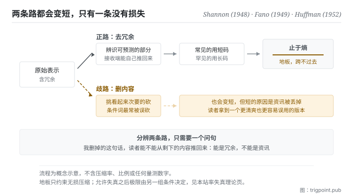

Canonical: https://trigpoint.pub/zh-Hans/collections/information-theory/coding-and-compression  
Captured: 2026-11-02T21:27:36.575325+08:00

> 公开理论阅读镜像。验证层及 Lab 案例请到原站阅读。

「压缩就是删掉一些」：错。

# 编码与压缩

Coding and Compression · Shannon (1948) / Fano (1949) / Huffman (1952)

摘要已核 ✓  
Lab 实测 ✓  
资讯理论 · 表示与压缩  
先读：熵  
先读：资讯量

## 三句讲透

压缩不是删内容，是换一种更短的方式表示同样的内容。  
可压缩的部分叫冗余，也就是接收端本来就能推得出来的那些；把它们拿掉不损失任何东西。  
而这件事有一道地板：无损压缩的平均长度不可能低于熵。

<strong>图 1</strong> · 压缩的正路与歧路示意：正路是辨识规律、以更短的表示承载同样的内容，终点是熵这道地板；歧路是直接删内容，它确实会变短，但变短的原因是资讯被丢掉，不是冗余被去掉。

## 一、发生什么事

先分清楚两个常被混用的词。编码是把内容转成某种符号系统，本身不必然变短；压缩是编码的一种优化目标，利用内容里的规律，把可预测的部分用更短的方式表示。关键在<strong>可预测</strong>：一段接收端本来就猜得到的内容，用长篇幅去写是纯粹的浪费，这个浪费就叫冗余。

由此推出一条分配原则：常出现的东西用短码，罕见的东西用长码。这条原则的两个经典实作分别在 1949 与 1952 年出现。前者是由上而下的启发式作法，后者证明了由下而上的建构能保证平均码长最小[\[2\]](#reference-note-2)[\[3\]](#reference-note-3)。两者的差别不只是效率，是<strong>保证</strong>：一个是「通常不错」，一个是「可证明最优」。

而无论用什么方法，都有一道跨不过去的线。1948 年那篇的定理 9 给出无损压缩的平均码长下界，那个下界就是熵[\[1\]](#reference-note-1)。这条线有两个实务含意，都值得记住。其一，压缩能力的上限由资料本身的机率结构决定，不由你的技术决定；其二，当你逼近那条线，继续压下去的每一步都不再是去冗余，而是在丢资讯。

无损与有损由此分岔。无损要求完整还原，受熵的地板约束；有损允许失真以换取更低的长度，它有另一套完全不同的理论极限，是本书架下一页的主题。

<strong>署名要给对：</strong>无损压缩的下界归 Shannon（1948），出处是该篇第 9 节的定理 9[\[1\]](#reference-note-1)。由上而下的启发式编码法通称以 Shannon 与 Fano 并称，正式发表处是 Fano 1949 年的技术报告[\[2\]](#reference-note-2)。保证最小平均码长的建构法归 Huffman（1952）[\[3\]](#reference-note-3)，其结果的地位与前者不同：一个是启发式，一个是可证明最优，两者不可互相代称。

## 二、为什么这对你重要

多数人做摘要时做的是删减，而不是压缩。两者的差别可以用一个问题分开：<strong>我删掉的这句话，读者能不能从剩下的内容推回来</strong>。能，那是冗余，删得对；不能，那是资讯，你只是把文件变短了。

这个判准会立刻改变你怎么写交接与说明。真正该砍的往往不是细节，而是那些<strong>读者的既有知识已经涵盖的铺陈</strong>：背景介绍、通则覆述、前提重申。而最不该砍的常常长得像可以砍的，也就是那些带着条件的句子。「除非」「取决于」「只有在」「必须」这类词承载的是因果与边界，它们不能从其他句子推回来，砍掉之后读者会得到一个看起来更清爽、但实际上更容易误用的版本。这件事在本书架下一页会有更精确的说法。

第二个推论是关于「解码端」。压缩的前提是双方共用同一套规律；如果接收端没有那套规律，你的短码对他就是密码。所以同一份内容给不同对象要用不同的压缩率，这不是体贴，是这套理论的直接后果。给熟手的简报和给新人的说明不能共用一份，不是因为新人需要更多资讯，是因为他们少了让你的压缩成立的那本码表。

第三个推论最反直觉：<strong>压不下去有时候是好消息</strong>。它意味着你手上的材料里冗余已经不多，剩下的都是不能推导出来的部分。这时候该做的是承认长度，不是继续削。

## 常见误读

所属页核验：摘要已核 ✓ · 内容最后修订 2026-10-25

- 常见转述「压缩就是删掉不重要的部分」：无损压缩不删任何内容，它只换一种更短的表示方式，原件可以完整还原。会删东西的是有损压缩，那是另一套理论，本站另有专页。把两者混为一谈，会让人以为所有压缩都要付出失真代价。
- 常见转述「压缩率取决于演算法好坏」：演算法决定你离极限多远，但极限本身由资料的机率结构决定。同一个演算法在不同资料上的压缩率差距，多半来自资料而非演算法。

## 参考文献

<strong>如何阅读来源注记</strong> 「书目经…核对」指作者、年份、题名与出版项已确认；不代表该来源的主张已被核对。「与摘要一致」指主张与论文摘要相符；不含逐句对照全文。「对照全文核实」指主张已与来源文本本身比对。 定义版本：2026-09-20。

- \[1\] Shannon, C. E. (1948). A Mathematical Theory of Communication. Bell System Technical Journal, 27(3), 379–423; 27(4), 623–656.
- \[2\] Fano, R. M. (1949). The Transmission of Information. MIT RLE Technical Report No. 65.
- \[3\] Huffman, D. A. (1952). A Method for the Construction of Minimum-Redundancy Codes. Proceedings of the IRE, 40(9), 1098–1101.

引用格式：Trigpoint，〈编码与压缩〉，trigpoint.pub/zh-Hans/collections/information-theory/coding-and-compression · © Strategitect Limited. · 内容最后修订 2026-10-25

## 来源注记

**[1]** Shannon, C. E. (1948). A Mathematical Theory of Communication. Bell System Technical Journal, 27(3), 379–423; 27(4), 623–656. 书目经官方记录核对。主张已对照全文核实。出处经跨模型双查核实。第 9 节（无噪音通道的基本定理）之定理 9：来源的熵决定经无噪音通道传送所需的最低平均速率，可任意逼近，不可超越；这就是无损压缩的平均码长下界。

**[2]** Fano, R. M. (1949). The Transmission of Information (Technical Report No. 65). Research Laboratory of Electronics, Massachusetts Institute of Technology. 书目经出版社记录核对。主张已对照全文核实。Shannon-Fano 编码法的发表处：把讯息依机率排序后，反复切成机率尽量相等的两组。

**[3]** Huffman, D. A. (1952). A Method for the Construction of Minimum-Redundancy Codes. Proceedings of the IRE, 40(9), 1098–1101. DOI 10.1109/JRPROC.1952.273898. 书目经官方记录核对。要旨与摘要一致。由下而上的最优前缀码建构法，保证最小平均码长。

---

[English](../../../en/collections/information-theory/coding-and-compression.md) · [繁體中文](../../../zh-Hant/collections/information-theory/coding-and-compression.md)

[Index](../../README.md) · [Original page](https://trigpoint.pub/zh-Hans/collections/information-theory/coding-and-compression) · [Citation and versions](../../../READING.md)

[Original SVG](assets/coding-and-compression.svg) · Display copy adds a white background only.
