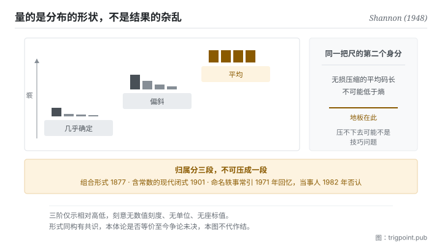

Canonical: https://trigpoint.pub/zh-Hans/collections/information-theory/entropy  
Captured: 2026-11-02T21:27:37.032381+08:00

> 公开理论阅读镜像。验证层及 Lab 案例请到原站阅读。

「熵就是混乱」：是误读。

# 熵

Entropy · Shannon (1948)

书目已核 ✓  
资讯理论 · 核心量度  
先读：资讯量

## 三句讲透

熵不是混乱，是不可预测性的量化。  
它是每个可能结果的资讯量，按各自的机率加权平均起来的那个数。  
分布越平均越难猜，熵越高；而同一个数还有第二个身分，它是无损压缩的地板。

<strong>图 1</strong> · 熵随分布形状变化的阶梯示意：分布越集中越好猜，熵越低；越平均越难猜，熵越高。  
右侧标出同一把尺的第二个身分，无损压缩的平均码长不可能低于它。  
本图刻意无数值刻度与单位。

## 一、发生什么事

前一页讲单一事件的资讯量：越不可能的事发生，带的资讯越多。但单一事件的量没法用来描述一个系统，因为系统还没揭晓。1948 年那篇给出的量，等于做了一个简单而关键的动作：把每个可能结果的资讯量，按它自己的机率加权，平均起来[\[1\]](#reference-note-1)。得到的数就是熵，它回答的是「揭晓之前，我平均要面对多少不确定」。

这个构造有一个立刻可感的性质。分布越集中，熵越低，因为你几乎猜得到；分布越平均，熵越高，因为每个结果都同样可能。极端情形是确定事件，熵为零。注意这里量的是<strong>分布的形状</strong>，不是结果本身有多杂乱，这就是「熵等于混乱」这个直觉失准的地方：它漏掉了机率结构这一项。

同一篇论文还给了熵第二个身分，而这个身分让它从一个描述量变成一条硬边界：<strong>无损压缩的平均码长不可能低于熵</strong>[\[1\]](#reference-note-1)。也就是说，你能把一份资料压多小，不取决于你的演算法多聪明，取决于这份资料的机率结构。这条下界是本书架段三整段的前提。

形式上的同源关系也在同一篇被点明。Shannon 在第 6 节逐字写下这个 H 就是 Boltzmann H 定理里的那个 H[\[2\]](#reference-note-2)。这句话开启了一场延续至今的争论，本页在验证层处理。要先更正一件常被搞错的事：热力学里那条含常数的著名公式，原文并不出自 1877 年那篇，该篇只有组合形式；现代形式与那个常数一般归于 Planck，在 1900 至 1901 年写出；据转述，他自己在 1920 年的诺贝尔演讲中也说过，Boltzmann 从未引入该常数[\[3\]](#reference-note-3)[\[4\]](#reference-note-4)。

<strong>署名要给对：</strong>作为资讯量期望值的熵，以及它作为无损压缩下界这个身分，归 Shannon（1948）[\[1\]](#reference-note-1)。统计力学中的组合机率量归 Boltzmann（1877），但<strong>含常数的现代闭式一般归 Planck（1900 至 1901）</strong>，两段不可压成一段[\[3\]](#reference-note-3)[\[4\]](#reference-note-4)。把最大熵确立为推理原则、并把统计力学视为统计推论之一种形式的，是 Jaynes（1957）[\[5\]](#reference-note-5)；主张资讯量度与热力学熵不能直接划等号的当代论述，可见 Ben-Naim（2017）[\[6\]](#reference-note-6)。至于 von Neumann 建议命名的那则轶事，最常被引的出处是 1971 年的个人回忆[\[7\]](#reference-note-7)（另有记述指更早已有人讲过），且<strong>当事人之一于 1982 年在录音访谈中否认</strong>[\[8\]](#reference-note-8)，本站不将其列为史实。

## 二、为什么这对你重要

熵给你的第一件东西，是一个判断「压不下去」的诊断工具。

你把一份材料反复精简，到某个点之后怎么改都觉得损失了东西，这时候通常会归咎于自己表达能力不足。这页说有另一种可能：你撞到了地板。这份材料的机率结构决定了它的最短平均长度，越过那个点的每一次删减都不再是去冗余，而是真的在丢资讯。两者的差别是可以问出来的：<strong>我删掉的那一句，读者能不能从剩下的内容推回来</strong>。能，就是冗余；不能，就是资讯。

第二件东西更反直觉一点。既然熵取决于分布，那么<strong>同一份内容对不同读者的可压缩程度不同</strong>。对已经掌握脉络的人，你的大半铺陈都是高机率、可预测的内容，可以压掉；对陌生的人，同样那些内容承载了真正的不确定性削减，压掉就断了。所以「这份文件应该多长」没有一般答案，只有「对谁」的答案。这也解释了为什么给模型的脉络与给人的说明不能共用一份。

第三件是关于这个词本身。「对抗熵增」在日常语境里多半是修辞，指系统放着不管就会变糟。这页的熵不是那个意思，它是一个关于分布的量。两者不是同一回事，但也不是毫无关系，而那个关系到底有多实在，正是本书架最后一页要处理的问题。在那之前，请把它们当成两个词。

## 常见误读

所属页核验：书目已核 ✓ · 内容最后修订 2026-10-25

- 常见转述「S = k log W 是 Boltzmann 1877 年写的」：他 1877 年的原文只含组合形式的机率量，并未写出含常数 k 的闭式。现代形式与该常数一般归于 Planck，在 1900 至 1901 年写出。维也纳中央公墓那座墓碑于 1933 年揭幕（据二手记述），公式刻在其上，是 Boltzmann 身后多年的事；形式是 Planck 的。
- 常见转述「von Neumann 建议 Shannon 把这个量叫做熵，理由是没人真正知道熵是什么」：这段话最常被引的出处是 1971 年一篇科普文章里的个人回忆，距那次谈话约十年，且 von Neumann 已于 1957 年过世；另有记述指同一位回忆者更早已在 1964 年的一本纪念文集中讲过。更关键的是 Shannon 本人在 1982 年的口述历史访谈中否认此事。这则轶事流传极广，本站列为未经证实。
- 常见转述「资讯熵与热力学熵是同一回事」：数学形式同构有共识，两者在什么意义上是同一回事则至今仍有争论。本页分层并陈，不挑一边当定论。

## 参考文献

<strong>如何阅读来源注记</strong> 「书目经…核对」指作者、年份、题名与出版项已确认；不代表该来源的主张已被核对。「与摘要一致」指主张与论文摘要相符；不含逐句对照全文。「对照全文核实」指主张已与来源文本本身比对。「依多源一致转述」指主张建立于多份彼此一致、转述该来源的资料，而非原文件本身。 定义版本：2026-09-20。

- \[1\] Shannon, C. E. (1948). A Mathematical Theory of Communication. Bell System Technical Journal, 27(3), 379–423; 27(4), 623–656.
- \[2\] Shannon, C. E. (1948). A Mathematical Theory of Communication. Bell System Technical Journal, 27(3), 379–423; 27(4), 623–656.
- \[3\] Boltzmann, L. (1877). Wiener Berichte, 76, 373–435.
- \[4\] Planck, M. (1901). Ueber das Gesetz der Energieverteilung im Normalspectrum. Annalen der Physik, 309(3), 553–563.
- \[5\] Jaynes, E. T. (1957). Information Theory and Statistical Mechanics. Physical Review, 106(4), 620–630; 108(2), 171–190.
- \[6\] Ben-Naim, A. (2017). Entropy, Shannon's Measure of Information and Boltzmann's H-Theorem. Entropy, 19(2), 48.
- \[7\] Tribus, M. & McIrvine, E. C. (1971). Energy and Information. Scientific American, 225(3), 179–188.
- \[8\] Price, R. (1982/1984). Claude E. Shannon oral history. IEEE History Center Interview 423; IEEE Communications Magazine, 22(5), 123–126.
- \[9\] Shannon, C. E. (1956). The Bandwagon. IRE Transactions on Information Theory, IT-2(1), 3.

引用格式：Trigpoint，〈熵〉，trigpoint.pub/zh-Hans/collections/information-theory/entropy · © Strategitect Limited. · 内容最后修订 2026-10-25

## 来源注记

**[1]** Shannon, C. E. (1948). A Mathematical Theory of Communication. Bell System Technical Journal, 27(3), 379–423; 27(4), 623–656. DOI 10.1002/j.1538-7305.1948.tb01338.x. 书目经官方记录核对。主张已对照全文核实。定义 H = −Σ p log p（即各结果之 log(1/p) 按机率加权的平均），并在第 9 节（无噪音通道的基本定理，定理 9）定下无损编码的极限。

**[2]** Shannon 1948 第 6 节原文：「H is then, for example, the H in Boltzmann's famous H theorem」。

**[3]** Boltzmann, L. (1877). Wiener Berichte, 76, 373–435. 书目经双源核对。本文不含 k 闭式之说依多源一致转述。以可排列数（组合形式的机率量）建立熵的机率基础；含常数 k 的闭式不见于本文，一般归于 Planck。

**[4]** Planck, M. (1901). Ueber das Gesetz der Energieverteilung im Normalspectrum. Annalen der Physik, 309(3), 553–563. DOI 10.1002/andp.19013090310. 书目经官方记录核对。Planck 1920 年演讲之自述依多源一致转述。一般认为含常数 k 的现代闭式与该常数之引入出自本文。据转述，Planck 在 1920 年的诺贝尔演讲中说：该常数常被称为 Boltzmann 常数，但据他所知 Boltzmann 本人从未引入它。

**[5]** Jaynes, E. T. (1957). Information Theory and Statistical Mechanics. Physical Review, 106(4), 620–630; Information Theory and Statistical Mechanics. II. Physical Review, 108(2), 171–190. 书目经官方记录核对。要旨与摘要一致。把统计力学视为统计推论的一种形式：以最大熵原则建立机率分布，对缺失的资讯不作多余承诺；统计力学的常用规则因此不必另靠物理假设，作者称之为「主观的」统计力学。

**[6]** Ben-Naim, A. (2017). Entropy, Shannon's Measure of Information and Boltzmann's H-Theorem. Entropy, 19(2), 48. DOI 10.3390/e19020048. 书目经官方记录核对。要旨与摘要一致。主张 Shannon 的资讯量度适用于任何机率分布，热力学熵只定义在其中一类特殊分布上，两者不能直接划等号；并据此认为 Boltzmann 的 H 函数是资讯量度，不是熵。

**[7]** Tribus, M. & McIrvine, E. C. (1971). Energy and Information. Scientific American, 225(3), 179–188. DOI 10.1038/scientificamerican0971-179. 书目经官方记录核对。轶事内容及其年份依多源一致转述。von Neumann 命名轶事最常被引的出处，性质为约十年后的个人回忆。

**[8]** Price, R. (1982). Claude E. Shannon, an oral history conducted by Robert Price, 28 July 1982. IEEE History Center, Interview #423. Published as: A Conversation with Claude Shannon, IEEE Communications Magazine, 22(5), 123–126 (1984). 书目经双源核对。主张已对照全文核实。Shannon 在访谈中否认此事：「I'm quite sure that it didn't happen between von Neumann and me」。常见转述之「1984 年访谈」应为 1982 年受访、1984 年刊出。

---

[English](../../../en/collections/information-theory/entropy.md) · [繁體中文](../../../zh-Hant/collections/information-theory/entropy.md)

[Index](../../README.md) · [Original page](https://trigpoint.pub/zh-Hans/collections/information-theory/entropy) · [Citation and versions](../../../READING.md)

[Original SVG](assets/entropy.svg) · Display copy adds a white background only.
