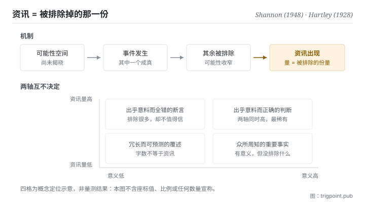

Canonical: https://trigpoint.pub/zh-Hans/collections/information-theory/information-and-uncertainty  
Captured: 2026-11-02T21:27:37.299889+08:00

> 公开理论阅读镜像。验证层及 Lab 案例请到原站阅读。

「资讯就是内容」：是两回事。

# 资讯与不确定性

Information and Uncertainty · Shannon (1948) / Hartley (1928)

已对照来源本身 ✓  
资讯理论 · 基本定义

## 三句讲透

资讯不是内容，是不确定性的削减量。  
一件事带多少资讯，取决于它排除掉多少原本可能发生的情况，而不是它讲了多长、多深、多重要。  
所以「资讯量」与「有没有意义」是两把不同的尺，量出来的东西互不决定。

<strong>图 1</strong> · 资讯出现的机制示意：先有一个可能性空间，事件发生后排除掉其中一部分，被排除的份量就是资讯。  
下方两轴说明同一句话可以在资讯量与意义上落在完全不同的位置，两轴互不决定。

## 一、发生什么事

1948 年那篇奠基论文开宗明义做了一件现在看来仍然反直觉的事：它把「意义」从问题里拿掉[\[1\]](#reference-note-1)。原文说得很直接，通讯的语义层面与工程问题无关。这不是回避，是划界：要让资讯变成可计算、可传输、可比较的量，就必须先放弃追问它在说什么。隔年那本书收入 Weaver 的导论，把通讯问题分成技术、语义、效果三层，并承认这套理论表面上只适用于第一层；不过他同时主张，它对另两层也有帮助与启发[\[3\]](#reference-note-3)。

拿掉意义之后，剩下什么可以量？剩下<strong>可能性的排除</strong>。设想一个尚未揭晓的局面，它有一组可能的结果；当其中一个成真，其余全部被排除，而被排除的份量就是这件事带来的资讯。这个定义有个立刻可验的后果：同一句话在不同处境下的资讯量不同。对已经知道明天下雨的人，「明天会下雨」几乎不带资讯；对所有预报都说晴天的人，同一句话资讯量极高。变的不是句子，是它排除掉的东西。

再往前一步就分出两个层级。单一事件排除了多少，是那个事件的资讯量；整个局面平均而言有多难猜，是这个系统的熵。两者常被混为一谈，但它们回答的是不同的问题：一个问「这次揭晓让我知道了多少」，一个问「揭晓之前我有多不确定」。本站接下来两页分别处理。

对数结构的雏形其实更早。1928 年那篇把讯息量与可区分状态的数量连起来，替后来的形式化铺了路[\[2\]](#reference-note-2)。要注意它处理的是无噪音情形，把噪音下的容量归给它是后来才产生的引注讹传。

<strong>署名要给对：</strong>对数结构的雏形归 Hartley（1928），但他处理的是无噪音情形的状态计数，不含噪音下的容量[\[2\]](#reference-note-2)。把资讯定义为不确定性的削减、并明文把语义排除在工程问题之外的，是 Shannon（1948）[\[1\]](#reference-note-1)。技术、语义、效果三层的分法出自 Weaver 为 1949 年那本所写的导论，不是 Shannon 本人的原文；Weaver 也没有把理论限在第一层，他主张它对另两层同样有帮助[\[3\]](#reference-note-3)。三者要分开署名：压成「Shannon 提出资讯理论并区分了三个层次」会同时弄错雏形出处与三层分法的作者。

## 二、为什么这对你重要

你每天都在用「资讯」这个词，但用的是它的日常语感：资讯多＝讲得多、讲得细、讲得专业。这套理论说那是另一回事，而这个差别会直接改变你怎么判断手上的东西。

一份三千字的会议纪录，如果它记下的全部是你事前就能预测的内容，那它的资讯量接近零，尽管它的字数不是。一份模型输出读起来条理分明、术语齐备，也可能因为它只是把你的提问重新排列而几乎没有排除任何可能性。判断的问题不该是「这段内容够不够丰富」，而是「它排除了什么我原本以为可能的东西」。前一个问题没有答案，后一个有。

这条界线还有一个更难接受的推论：<strong>资讯量高不代表对</strong>。一句断言越是出乎意料，它排除的可能性越多，资讯量就越高，而它是否为真完全是另一把尺的事。模型给出一个大胆而具体的判断，它在这套理论下确实是高资讯量的输出，这件事本身不构成任何相信它的理由。把两把尺分开，是使用这套语言的第一个代价，也是它给你的第一个好处。

## 常见误读

所属页核验：已对照来源本身 ✓ · 内容最后修订 2026-10-25

- 常见转述「资讯量高代表内容有价值」：两者是独立的两轴。一句完全错误的话可以有极高资讯量，一句极有意义的话也可以几乎没有资讯量。本理论只量前者，对后者不发一言。
- 常见转述「Hartley 提出了资讯的容量公式」：Hartley 1928 给的是无噪音情形下可区分状态的计数，不是噪音功率下的容量。后者属 1948 年那篇。这条讹传有流传，本站另有专页处理。

## 参考文献

<strong>如何阅读来源注记</strong> 「书目经…核对」指作者、年份、题名与出版项已确认；不代表该来源的主张已被核对。「对照全文核实」指主张已与来源文本本身比对。 定义版本：2026-09-20。

- \[1\] Shannon, C. E. (1948). A Mathematical Theory of Communication. Bell System Technical Journal, 27(3), 379–423; 27(4), 623–656.
- \[2\] Hartley, R. V. L. (1928). Transmission of Information. Bell System Technical Journal, 7(3), 535–563.
- \[3\] Shannon, C. E. & Weaver, W. (1949). The Mathematical Theory of Communication. University of Illinois Press.

引用格式：Trigpoint，〈资讯与不确定性〉，trigpoint.pub/zh-Hans/collections/information-theory/information-and-uncertainty · © Strategitect Limited. · 内容最后修订 2026-10-25

## 来源注记

**[1]** Shannon, C. E. (1948). A Mathematical Theory of Communication. Bell System Technical Journal, 27(3), 379–423; 27(4), 623–656. DOI 10.1002/j.1538-7305.1948.tb01338.x. 书目经官方记录核对。主张已对照全文核实。出处经跨模型双查核实。引言处明文把语义问题排除在工程问题之外：通讯的语义层面与工程问题无关。

**[2]** Hartley, R. V. L. (1928). Transmission of Information. Bell System Technical Journal, 7(3), 535–563. DOI 10.1002/j.1538-7305.1928.tb01236.x. 书目经官方记录核对。主张已对照全文核实。以可区分状态的计数建立资讯的对数结构雏形。该篇明言先假设没有外来干扰，不含噪音功率下的容量；把后者归给 Hartley 是引注讹传（见本站「通道与容量」页）。

**[3]** Shannon, C. E. & Weaver, W. (1949). The Mathematical Theory of Communication. Urbana: University of Illinois Press. 书目经出版社记录核对。主张已对照全文核实。出处经跨模型双查核实。Weaver 导论把通讯问题分为技术、语义、效果三层；他承认这套数学理论表面上只适用于第一层，同时主张它对另两层也有帮助与启发。

---

[English](../../../en/collections/information-theory/information-and-uncertainty.md) · [繁體中文](../../../zh-Hant/collections/information-theory/information-and-uncertainty.md)

[Index](../../README.md) · [Original page](https://trigpoint.pub/zh-Hans/collections/information-theory/information-and-uncertainty) · [Citation and versions](../../../READING.md)

[Original SVG](assets/information-and-uncertainty.svg) · Display copy adds a white background only.
