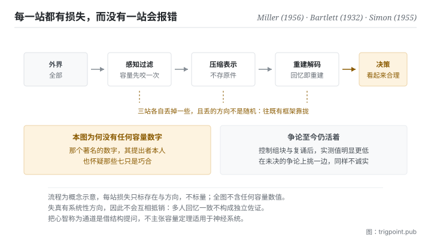

Canonical: https://trigpoint.pub/zh-Hans/collections/information-theory/information-theory-and-cognition  
Captured: 2026-11-02T21:27:37.583442+08:00

> 公开理论阅读镜像。验证层及 Lab 案例请到原站阅读。

复述陌生文化的故事时，受试者把看不懂的细节改得合理。

# 资讯理论与认知科学

Information Theory and Cognitive Science · Miller (1956) / Bartlett (1932) / Simon (1955)

书目已核 ✓  
资讯理论 · 跨域接口  
先读：通道与容量  
先读：编码与压缩

## 三句讲透

心智是一个在容量限制与噪音下运作的资讯处理系统。  
它不储存原始资料，它压缩；回忆不是读取，是用压缩后的线索重建。  
所以理解会有损失、记忆会走样，这是机制的常态。

<strong>图 1</strong> · 讯息从外界走到决策的流程示意：每一站都有容量限制与噪音，因此每一站都有损失。  
图上刻意不标任何容量数字，理由见本页验证层：那个著名的数字本身正在争议中。

## 一、发生什么事

一则陌生文化的故事经受试者复述，不熟悉的细节换成了他们觉得说得通的版本。把前面几页的概念搬到人身上，会得到一个相当一致的图像。注意力、工作记忆、处理速度全部有上限，因此输入必须被过滤；被留下的部分不是原样存起来，而是被压缩成某种结构；日后要用时，是拿那个结构去<strong>重建</strong>，而不是把原件调出来。每一站都有噪音，每一站都有损失。

记忆是重建而非记录，这一点在 1932 年那本书里就有实验支持[\[4\]](#reference-note-4)：受试者复述一则陌生文化的故事时，会把不熟悉、不理解的细节改成自己觉得合理的版本。这正是压缩加重建的典型后果：<strong>损失发生在编码端，错误出现在解码端，而中间没有任何一步会报错</strong>。

有限理性是同一个图像在决策上的版本[\[5\]](#reference-note-5)：人不是最优化机器，因为最优化需要的计算与资讯都超出可用的容量，所以实际的决策是在有限容量下寻找「够好」的解。这个说法常被误读成人不理性，但它的原意刚好相反，它说的是在给定约束下的合理行为。

至于容量到底有多大，这一页必须停下来说清楚，因为那个数字是本页最有名也最被误用的部分。1956 年那篇提出的通行数字确实存在且影响深远，但<strong>它的作者本人在篇末就保留判断，怀疑那些反复出现的七只是巧合</strong>[\[1\]](#reference-note-1)；2001 年那篇把它读为粗略估计与修辞装置，不是一个真正的容量上限，并指出在控制了组块与复诵之后，测得的数字明显更低[\[2\]](#reference-note-2)。这个争论至今仍然活着。另有一条研究线把组块重新定义为「最大程度压缩之后的单位」，让容量的问题与本书架段三接上[\[3\]](#reference-note-3)。

<strong>署名要给对：</strong>记忆为重建而非记录，归 Bartlett（1932）[\[4\]](#reference-note-4)。有限理性的早期表述归 Simon（1955）[\[5\]](#reference-note-5)。工作记忆容量的通行数字归 Miller（1956），但<strong>其性质为历史与修辞锚，非既定极限：作者本人已怀疑那些七只是巧合，「修辞装置」则是后续研究的解读</strong>[\[1\]](#reference-note-1)[\[2\]](#reference-note-2)；控制组块与复诵后的修正研究归 Cowan（2001）[\[2\]](#reference-note-2)，以压缩观点重述组块的研究归 Mathy 与 Feldman（2012）[\[3\]](#reference-note-3)。当代以预测误差最小化统摄知觉与行动的表述另有一线[\[6\]](#reference-note-6)，本站未对其争议面核对，故不作为本页任何主张的依据。这一页的署名纪律比其他页更严：<strong>引用那个数字时，必须同时引用它的争议</strong>，否则就是把一个作者自己保留的说法当成结论。

## 二、为什么这对你重要

第一个推论，也是最实用的一个：<strong>你交出去的东西，能不能被用，取决于对方的容量，不是你的完整性</strong>。

写的人天然会往完整那边优化，因为完整是可以自我检查的，而对方的容量看不见。结果是一份没有错误、涵盖周全、对方读不完的文件。本书架段二说过，超过容量的传输不会报错；这一页补上另一半：接收端也不知道自己溢出了，他会给你一个建立在被截断的输入上的合理回应。两边都不会发现。

第二个推论：<strong>压缩不是体贴，是必要条件</strong>。既然接收端一定会压缩，那么问题只是由谁来压。你不压，对方就会压，而对方压的时候用的是他的框架、他的先验，你无法控制他会丢掉哪一部分。你先压，至少你能决定失真落在哪里，这正是本书架段三那条规矩的理由。

第三个推论关于记忆的可靠性，而它对协作有直接影响：<strong>当事人记得的版本与当时发生的事不同，这是常态，不是谁不诚实</strong>。既然回忆是重建，那么任何依赖事后回忆的流程都在使用一个有系统性偏差的来源。可行的对策不是要求大家记清楚，是在当下留下记录，让后来的重建有东西可以校准。

第四点是关于这一页自己：把心智称为通道，是一个有启发性的类比。它让你问对问题，但它不授权你套用任何数值。这一页刻意不给任何容量数字，理由见下节。

## 常见误读

所属页核验：书目已核 ✓ · 内容最后修订 2026-10-25

- 常见转述「工作记忆容量是七加减二，这是心理学的定论」：那篇论文本身是经典且确实存在，但作者在篇末就对那些反复出现的七保留判断，怀疑只是巧合；后续研究把它读为粗略估计与修辞装置，并在控制组块与复诵之后测得明显更低的数字。这个争论到今天仍然活着。把它当定论引用，是把一个被作者自己保留的说法当成结论。
- 常见转述「记忆会失真是因为不够专心」：记忆本来就不是记录，是压缩之后的重建。失真是这个机制的常态产物，不是注意力不足的症状。

## 参考文献

<strong>如何阅读来源注记</strong> 「书目经…核对」指作者、年份、题名与出版项已确认；不代表该来源的主张已被核对。「与摘要一致」指主张与论文摘要相符；不含逐句对照全文。「对照全文核实」指主张已与来源文本本身比对。「依多源一致转述」指主张建立于多份彼此一致、转述该来源的资料，而非原文件本身。 定义版本：2026-09-20。

- \[1\] Miller, G. A. (1956). The Magical Number Seven, Plus or Minus Two: Some Limits on Our Capacity for Processing Information. Psychological Review, 63(2), 81–97.
- \[2\] Cowan, N. (2001). The Magical Number 4 in Short-Term Memory: A Reconsideration of Mental Storage Capacity. Behavioral and Brain Sciences, 24(1), 87–114.
- \[3\] Mathy, F. & Feldman, J. (2012). What's Magic about Magic Numbers? Chunking and Data Compression in Short-Term Memory. Cognition, 122(3), 346–362.
- \[4\] Bartlett, F. C. (1932). Remembering: A Study in Experimental and Social Psychology. Cambridge: Cambridge University Press.
- \[5\] Simon, H. A. (1955). A Behavioral Model of Rational Choice. Quarterly Journal of Economics, 69(1), 99–118.
- \[6\] Friston, K. (2010). The Free-Energy Principle: A Unified Brain Theory? Nature Reviews Neuroscience, 11(2), 127–138. 书目经官方记录核对。要旨与摘要一致。仅作脉络提及，本站未核对其争议面，刻意不作为本页任何主张之依据。

引用格式：Trigpoint，〈资讯理论与认知科学〉，trigpoint.pub/zh-Hans/collections/information-theory/information-theory-and-cognition · © Strategitect Limited. · 内容最后修订 2026-10-25

## 来源注记

**[1]** Miller, G. A. (1956). The Magical Number Seven, Plus or Minus Two: Some Limits on Our Capacity for Processing Information. Psychological Review, 63(2), 81–97. DOI 10.1037/h0043158. 书目经官方记录核对。主张已对照全文核实。通行数字的出处。作者在篇末对那些反复出现的七保留判断，自言怀疑只是巧合。

**[2]** Cowan, N. (2001). The Magical Number 4 in Short-Term Memory: A Reconsideration of Mental Storage Capacity. Behavioral and Brain Sciences, 24(1), 87–114. DOI 10.1017/S0140525X01003922. 书目经官方记录核对。主张已对照全文核实。在阻断复诵、不让项目重组为更大组块的条件下，各类资料指向一个明显低于通行数字的容量上限。文中把 1956 年那个数字读为粗略估计与修辞装置，而非真正的容量上限；这是本文的解读，不是原作者的话。

**[3]** Mathy, F. & Feldman, J. (2012). What's Magic about Magic Numbers? Chunking and Data Compression in Short-Term Memory. Cognition, 122(3), 346–362. DOI 10.1016/j.cognition.2011.11.003. 书目经官方记录核对。要旨与摘要一致。以压缩观点重述组块：一个组块即一个最大程度压缩后的编码单位。

**[4]** Bartlett, F. C. (1932). Remembering: A Study in Experimental and Social Psychology. Cambridge: Cambridge University Press. 书目经出版社记录核对。要旨与摘要一致。记忆为重建而非记录之经典来源：受试者复述一则陌生文化的鬼故事时，会把不理解的细节改掉。

**[5]** Simon, H. A. (1955). A Behavioral Model of Rational Choice. Quarterly Journal of Economics, 69(1), 99–118. DOI 10.2307/1884852. 书目经官方记录核对。本文在有限理性概念史上的位置依多源一致转述。常被视为有限理性概念的早期表述：以生物实际拥有的资讯与计算能力，取代全知的最优化假设。

**[6]** Friston, K. (2010). The Free-Energy Principle: A Unified Brain Theory? Nature Reviews Neuroscience, 11(2), 127–138. DOI 10.1038/nrn2787. 书目经官方记录核对。要旨与摘要一致。自由能原理：把知觉、行动与学习统摄为对「意外」（预测误差）的最小化。本站未对其争议面另做核对，仅作为脉络列出。

---

[English](../../../en/collections/information-theory/information-theory-and-cognition.md) · [繁體中文](../../../zh-Hant/collections/information-theory/information-theory-and-cognition.md)

[Index](../../README.md) · [Original page](https://trigpoint.pub/zh-Hans/collections/information-theory/information-theory-and-cognition) · [Citation and versions](../../../READING.md)

[Original SVG](assets/information-theory-and-cognition.svg) · Display copy adds a white background only.
