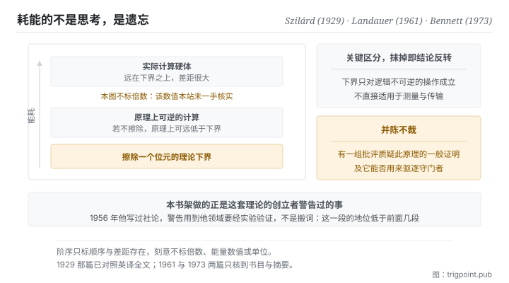

Canonical: https://trigpoint.pub/zh-Hans/collections/information-theory/information-theory-and-thermodynamics  
Captured: 2026-11-02T21:27:37.955150+08:00

> 公开理论阅读镜像。验证层及 Lab 案例请到原站阅读。

做计算与擦掉资料，热力学的帐要分开记；下界落在后者。

# 资讯理论与热力学

Information Theory and Thermodynamics · Szilárd (1929) / Landauer (1961) / Bennett (1973)

摘要已核 ✓  
资讯理论 · 跨域接口  
先读：熵

## 三句讲透

资讯不是纯粹的抽象。  
把一个位元擦掉，物理上必须付出热量，这是热力学给计算划下的硬边界。  
所以「维持秩序需要持续投入能量」在这一页不是比喻，它有一个下界，而且可以量。

<strong>图 1</strong> · 计算能耗的阶序示意：最底下是理论下界，也就是擦除资讯必须付出的热量；实际硬体远在其上。  
图上刻意不标任何倍数与能量数值，只标阶序与差距存在。

## 一、发生什么事

计算本身和把资料擦掉，耗能的帐不能并在一起算：本页讲的下界只落在擦除上。这条线的起点不是计算机，是一个思想实验。十九世纪有人设想一个能分辨快慢分子的守门者，借此在不做功的情况下制造温差，看起来直接违反热力学第二定律。1929 年那篇提出了关键的一步：<strong>守门者要分辨，就得取得资讯，而取得资讯这件事本身要计入熵的帐</strong>[\[1\]](#reference-note-1)。悖论的出口从此不在物理系统，而在观察者身上。

1961 年那篇把帐算得更清楚，也更违反直觉：真正必须付出热的不是计算，是<strong>擦除</strong>[\[2\]](#reference-note-2)。理由是逻辑不可逆的操作会把多个可能的输入状态压成同一个输出状态，这个压缩必须在环境里以热的形式补回去。1973 年那条线再推一步，证明计算在逻辑上可以做到每一步都可逆，并据此指出：不擦除的计算，原理上可以把每一步的耗散压到远低于那个下界的量级[\[3\]](#reference-note-3)。三步合起来给出一个很干净的结论：<strong>耗能的不是思考，是遗忘。</strong>

要注意这条线不是没有反对意见。有一组哲学与物理的批评认为，前述原理的一般性证明并不成立：例如有批评指出，那些证明把存有不同资料的记忆装置不当地当成同一个统计系综；而用它来一般性地驱逐守门者，现有的论证也不足[\[4\]](#reference-note-4)。这场争论至今活着，本站并陈不裁。

最后，形式同源这件事要放在正确的位置。资讯熵与统计力学的熵在数学形式上同源，这一点没有争议；但两者的单位、诠释与本体地位是否相同，至今仍有争论、未有定论，本站在熵那一页已经分层处理过。

<strong>署名要给对：</strong>把观察者取得资讯与熵变正式连起来的早期关键一步，归 Szilárd（1929）[\[1\]](#reference-note-1)。擦除必然伴随热耗散的下界归 Landauer（1961）[\[2\]](#reference-note-2)；计算在逻辑上可以每一步都可逆、原理上可远低于该下界，归 Bennett（1973）[\[3\]](#reference-note-3)。对前述原理的哲学批评有其独立传统，本站并陈不裁[\[4\]](#reference-note-4)。而对整条跨域外推的公开警告，出自这套理论的创立者本人（1956）[\[5\]](#reference-note-5)。三段要分开署名，特别是第二段与第三段：把「计算耗能」与「擦除耗能」混为一谈，会让整条线的结论反转。

## 二、为什么这对你重要

本书架前面十一页讲的都是限制与取舍；这一页讲的是为什么那些限制不是人的问题。

<strong>维持一个有序的系统需要持续投入，而且那个投入有物理下界。</strong>这句话在日常里通常是励志文的口吻，但在这一页它是一个可以量的陈述：清掉旧状态、覆盖过期的记录、把散落的东西收回结构里，这些动作在最抽象的层次上都是擦除，而擦除有代价。你的知识库、你的专案、你的工作流不会自己维持在有序状态，不是因为你不够自律，是因为维持有序<strong>本来就是一项持续支出</strong>，停止支出，秩序就开始崩解。

第二件事是关于「遗忘比记住贵」这个反直觉的结论。它在人的层面有一个对应：<strong>决定丢掉什么，比决定留下什么难得多</strong>。留下不需要判断，丢掉需要。所以任何一个持续累积的系统，真正的瓶颈从来不在收集，在删减，而删减之所以拖延，不是懒，是它的单位成本确实比较高。知道这一点之后，正确的做法是替删减安排固定的预算，而不是期待它在有空的时候发生。

第三件事是把这条线与整个书架接起来。段一定义了资讯，段二说它传不过去，段三说怎么压缩，段四说怎么量相关与错，段五说谁在承受这些限制。这一页给出最后一个承受者：<strong>物理世界本身</strong>。前面所有的限制都不是约定，它们最终落在能量上。

## 常见误读

所属页核验：摘要已核 ✓ · 内容最后修订 2026-10-25

- 常见转述「资讯熵与热力学熵是同一回事」：两者的数学形式同源，本体论上是否等价至今仍有争论、未有定论。本站在熵那一页与本页都分层并陈，不挑一边。
- 常见转述「计算本身要耗能」：据前述原理，耗能来自逻辑不可逆的操作，尤其是擦除；原理上可逆的计算不受同样下界的约束。这个区分是整条线的关键，抹掉它会得到相反的结论。
- 常见转述「所以资讯有质量／资讯是物理的」：本页支持的是一个较窄的命题，擦除资讯有能量下界。从这里跳到更强的形上学结论，需要本页没有提供的论证。

## 参考文献

<strong>如何阅读来源注记</strong> 「书目经…核对」指作者、年份、题名与出版项已确认；不代表该来源的主张已被核对。「与摘要一致」指主张与论文摘要相符；不含逐句对照全文。「对照全文核实」指主张已与来源文本本身比对。 定义版本：2026-09-20。

- \[1\] Szilárd, L. (1929). Über die Entropieverminderung in einem thermodynamischen System bei Eingriffen intelligenter Wesen. Zeitschrift für Physik, 53(11–12), 840–856. English translation: Behavioral Science, 9(4), 301–310 (1964).
- \[2\] Landauer, R. (1961). Irreversibility and Heat Generation in the Computing Process. IBM Journal of Research and Development, 5(3), 183–191.
- \[3\] Bennett, C. H. (1973). Logical Reversibility of Computation. IBM Journal of Research and Development, 17(6), 525–532.
- \[4\] Norton, J. D. (2005). Eaters of the lotus: Landauer's principle and the return of Maxwell's demon. Studies in History and Philosophy of Modern Physics, 36(2), 375–411. 书目经官方记录核对。要旨与摘要一致。列为对前述原理之批评的代表文献。
- \[5\] Shannon, C. E. (1956). The Bandwagon. IRE Transactions on Information Theory, IT-2(1), 3.

引用格式：Trigpoint，〈资讯理论与热力学〉，trigpoint.pub/zh-Hans/collections/information-theory/information-theory-and-thermodynamics · © Strategitect Limited. · 内容最后修订 2026-10-25

## 来源注记

**[1]** Szilárd, L. (1929). Über die Entropieverminderung in einem thermodynamischen System bei Eingriffen intelligenter Wesen. Zeitschrift für Physik, 53(11–12), 840–856. DOI 10.1007/BF01341281. English translation: On the decrease of entropy in a thermodynamic system by the intervention of intelligent beings. Behavioral Science, 9(4), 301–310 (1964). 书目经官方记录核对。主张已对照全文核实。文中论证：若非测量本身必然伴随熵的产生，测量所凭的那种记忆能力就可能造成熵的永久减少；算出的熵产生恰好足以完全抵销。英译版的编者按称它为最早、或最早之一的此类论文。

**[2]** Landauer, R. (1961). Irreversibility and Heat Generation in the Computing Process. IBM Journal of Research and Development, 5(3), 183–191. DOI 10.1147/rd.53.0183. 书目经官方记录核对。要旨与摘要一致。没有单值反函数的逻辑操作（逻辑不可逆，如擦除）必然伴随最低限度的热产生。

**[3]** Bennett, C. H. (1973). Logical Reversibility of Computation. IBM Journal of Research and Development, 17(6), 525–532. DOI 10.1147/rd.176.0525. 书目经官方记录核对。要旨与摘要一致。证明通用计算机可以做到每一步在逻辑上都可逆；作者据此认为，每一步耗散远低于该下界量级的热力学可逆计算机是可能的。

**[4]** Norton, J. D. (2005). Eaters of the lotus: Landauer's principle and the return of Maxwell's demon. Studies in History and Philosophy of Modern Physics, 36(2), 375–411. DOI 10.1016/j.shpsb.2004.12.002. 书目经官方记录核对。要旨与摘要一致。对前述原理的批评之一：作者认为它只对一类特定的擦除过程成立，其一般性证明有赖把存有随机资料的记忆装置不当地当成同一个统计系综；并认为现有理论不足以一般性地驱逐守门者。Earman、Norton 与 Shenker 等人另有相关批评。属活的哲学争论，本站并陈不裁。

**[5]** Shannon, C. E. (1956). The Bandwagon. IRE Transactions on Information Theory, IT-2(1), 3. DOI 10.1109/TIT.1956.1056774. 书目经官方记录核对。主张已对照全文核实。编者社论。文中列出当时正在套用这套理论的领域（生物、心理、语言学、基础物理、经济等），并警告：理论的基本结果针对一个很特定的方向；用到其他领域不是把词语搬过去就算数，而要经过假设与实验验证的缓慢过程。

---

[English](../../../en/collections/information-theory/information-theory-and-thermodynamics.md) · [繁體中文](../../../zh-Hant/collections/information-theory/information-theory-and-thermodynamics.md)

[Index](../../README.md) · [Original page](https://trigpoint.pub/zh-Hans/collections/information-theory/information-theory-and-thermodynamics) · [Citation and versions](../../../READING.md)

[Original SVG](assets/information-theory-and-thermodynamics.svg) · Display copy adds a white background only.
