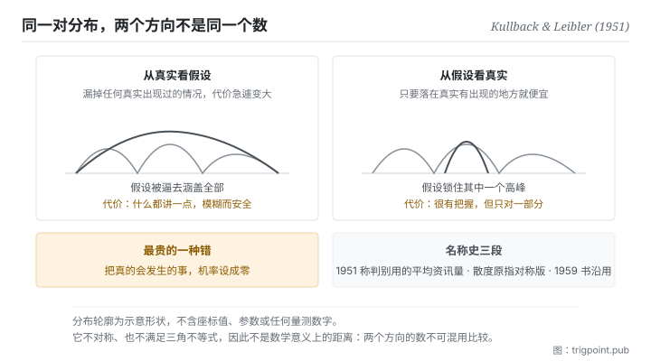

Canonical: https://trigpoint.pub/zh-Hans/collections/information-theory/kl-divergence  
Captured: 2026-11-02T21:27:38.270153+08:00

> 公开理论阅读镜像。验证层及 Lab 案例请到原站阅读。

模型该涵盖所有出现过的情况，还是锁住一个高峰？

# 相对熵

Kullback-Leibler Divergence · Kullback & Leibler (1951)

书目已核 ✓  
资讯理论 · 分布之间  
先读：熵  
先读：互信息

## 三句讲透

这个量回答一个很实际的问题：你用错的模型去编码真实的资料，每一笔平均要多付多少。  
它永远不小于零，只有在你的模型完全正确时才等于零。  
但它不是距离：从你看真相与从真相看你，是两个不同的数。

<strong>图 1</strong> · 方向选择造成的两种行为示意：从真实看假设，会逼假设去涵盖所有真实出现过的情况，代价是模糊；从假设看真实，会逼假设锁住其中一个高峰，代价是漏掉其他。  
同一对分布，两个方向给出不同的数与不同的最优解。

## 一、发生什么事

拿模型去逼近真实资料时，有一个常在不自觉中做掉的取舍：涵盖所有真实出现过的情况，或锁住其中一个高峰。前面几页讲过，最省的编码方式由资料的真实机率结构决定：常出现的用短码，罕见的用长码。现在假设你搞错了那个结构，你以为某些情况很常见，实际上很罕见。你仍然可以编码，只是码长分配错了，于是平均下来每一笔都会比最省的方案多付一点。<strong>这一页量的就是那个多付的量。</strong>

从这个角度看，它的几个性质都变得自然。它<strong>永远非负</strong>，因为你不可能比最省的方案更省；它<strong>只有在你的假设完全正确时等于零</strong>。它衡量的不是两个分布长得像不像，是<strong>用其中一个去替代另一个要付的代价</strong>。

而代价这个框架直接解释了它最著名的性质：<strong>不对称</strong>。我用你的分布去编我的资料，和你用我的分布去编你的资料，这两件事的成本没有理由相同。加上它也不满足三角不等式，所以它在数学上不是距离，尽管它常被这样称呼。

不对称不只是技术细节，它会造成两种完全不同的行为。一个方向会逼你的模型去<strong>涵盖</strong>所有真实出现过的情况，因为漏掉任何一个真实出现的情况，代价会急遽变大；结果是模型变得保守而模糊，什么都涵盖一点。另一个方向会逼你的模型去<strong>锁住</strong>其中一个高峰，把其余部分放弃；结果是模型很有把握，但只对了一部分。这两种行为在实务上都看得到，而选了哪个方向往往不是有意识的决定。

还有一个容易踩到的边界：如果真实会发生的某种情况，在你的假设下机率被设成零，那么代价是无限大。直觉上很合理，你的模型宣称那件事不可能，而它发生了。实务上这意味着任何「绝不可能」的断言都极其昂贵。

至于名字，要分两段记：1951 年那篇称它为「用于判别的平均资讯量」[\[1\]](#reference-note-1)；当时的「散度」一词指的是两个方向相加的对称化版本，1959 年那本书沿用[\[2\]](#reference-note-2)。

<strong>署名要给对：</strong>这个量归 Kullback 与 Leibler（1951），原文称之为「用于判别的平均资讯量」[\[1\]](#reference-note-1)。「散度」一词原指两个方向相加的对称化版本，Kullback（1959）那本书沿用[\[2\]](#reference-note-2)；单向的那个量后来才被普遍以两人之名称呼。非负性由 Gibbs 不等式给出，属教科书层标准结果，本站未对其出处另做核对，故不列入参考文献[\[3\]](#reference-note-3)。名称与量分开记帐，是本页与本书架其他几页共有的纪律。

## 二、为什么这对你重要

这一页把「我的判断错了」从一句话变成一个有结构的量，而结构的部分才是有用的。

第一件事：<strong>错误的代价与错误的方向有关</strong>。当你和现实不一致，重点不只是差多少，还有你是往哪个方向错。你的模型过度自信地排除了某些可能，与你的模型太保守地涵盖了太多可能，是两种不同的错，代价结构不同，该用的修正也不同。多数人在检讨判断失准时只问「差多少」，这一页说还要问「往哪边」。

第二件事最实用：<strong>任何「绝不可能」的断言都是最贵的一种错</strong>。你的模型只要在某处把机率设成零，而那件事真的发生了，代价就爆掉。这给了一条可以直接套用的纪律：在你的判断里保留非零的可能性给你认为不会发生的事，尤其是在资讯不足的时候。这条纪律的成本很低，它防的损失却没有上界。

第三件事关于模型的行为。你会在使用模型时看到两种倾向：一种是什么都讲一点、什么都不排除，读起来安全但没有用；另一种是很有把握地给出一个具体答案，但漏掉了其他同样可能的情况。这一页提供的框架是：这两种倾向对应的是不同的优化方向，不是「好模型」与「坏模型」的差别。知道这一点，你会改问另一个问题：<strong>在我这件事上，哪一种错误比较贵</strong>。答案决定你该逼它往哪边走。

## 常见误读

所属页核验：书目已核 ✓ · 内容最后修订 2026-10-25

- 常见转述「这是两个分布之间的距离」：它不对称，也不满足三角不等式，因此不是数学意义上的距离。要用真正的距离，得换别的度量。这条误称相当普遍。
- 常见转述「这个概念叫做 KL 散度，出自 1951 年那篇」：1951 年那篇称它为「用于判别的平均资讯量」；那时的「散度」一词，指的是两个方向相加的对称化版本。名称与量的历史要分开记。
- 常见转述「数值越大代表两个分布差越多」：方向不同数值不同，比较前必须先讲清楚是哪一个方向。同一对分布换个方向，大小关系可能反转。

## 参考文献

<strong>如何阅读来源注记</strong> 「书目经…核对」指作者、年份、题名与出版项已确认；不代表该来源的主张已被核对。「依多源一致转述」指主张建立于多份彼此一致、转述该来源的资料，而非原文件本身。 定义版本：2026-09-20。

- \[1\] Kullback, S. & Leibler, R. A. (1951). On Information and Sufficiency. Annals of Mathematical Statistics, 22(1), 79–86.
- \[2\] Kullback, S. (1959). Information Theory and Statistics. New York: Wiley; London: Chapman & Hall.
- \[3\] 编辑注，无外部来源；内容见正文注 \[3\]。

引用格式：Trigpoint，〈相对熵〉，trigpoint.pub/zh-Hans/collections/information-theory/kl-divergence · © Strategitect Limited. · 内容最后修订 2026-10-25

## 来源注记

**[1]** Kullback, S. & Leibler, R. A. (1951). On Information and Sufficiency. Annals of Mathematical Statistics, 22(1), 79–86. DOI 10.1214/aoms/1177729694. 书目经官方记录核对。原文的用语依多源一致转述。原文把单向的那个量称为「用于判别的平均资讯量」；同文的「散度」指的是两个方向相加的对称化版本，不是今天称为 KL 散度的单向量。

**[2]** Kullback, S. (1959). Information Theory and Statistics. New York: Wiley; London: Chapman & Hall. 书目经多源交叉核对。书中用语与后来的称呼依多源一致转述。书中沿用「散度」称对称化的版本，两个方向各自的量称为「有向散度」；单向的那个量后来才被普遍以两人之名称呼。

**[3]** 非负性由 Gibbs 不等式给出，等号成立当且仅当两分布相同。属教科书层标准结果，本站未对其出处另做核对。

---

[English](../../../en/collections/information-theory/kl-divergence.md) · [繁體中文](../../../zh-Hant/collections/information-theory/kl-divergence.md)

[Index](../../README.md) · [Original page](https://trigpoint.pub/zh-Hans/collections/information-theory/kl-divergence) · [Citation and versions](../../../READING.md)

[Original SVG](assets/kl-divergence.svg) · Display copy adds a white background only.
