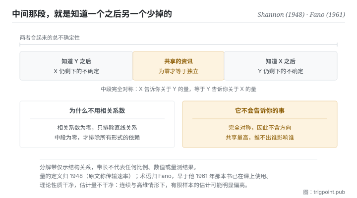

Canonical: https://trigpoint.pub/zh-Hans/collections/information-theory/mutual-information  
Captured: 2026-11-02T21:27:38.516579+08:00

> 公开理论阅读镜像。验证层及 Lab 案例请到原站阅读。

「相关系数是零就是没关系」：错。

# 互信息

Mutual Information · Shannon (1948) / Fano (1961)

书目已核 ✓  
资讯理论 · 分布之间  
先读：熵

## 三句讲透

互信息量的是：知道其中一个之后，另一个的不确定性少了多少。  
它为零才等于真正的独立，而且抓得到相关系数看不见的非线性依赖。  
代价是它完全对称，因此它告诉你「有关」，永远不告诉你「谁影响谁」。

<strong>图 1</strong> · 两个变数的不确定性分解示意：整条带是两者合起来的总不确定性，中间那段是知道其中一个之后、另一个少掉的部分，也就是共享的资讯。  
两侧各自是知道对方之后仍然剩下的部分。  
带长仅示结构关系，不代表任何比例。

## 一、发生什么事

前面几页量的都是单一对象的不确定性。这一页开始量<strong>两个之间</strong>。做法很直接：先看其中一个原本有多不确定，再看知道另一个之后它还剩多少不确定，两者的差就是它们共享的资讯量。

这个构造有几个干净的性质。它<strong>永远非负</strong>，也就是知道一件事不会让你对另一件事更不确定，至少平均而言不会。它<strong>完全对称</strong>：X 告诉你关于 Y 的量，等于 Y 告诉你关于 X 的量。而最有用的一条是：<strong>它为零，当且仅当两者统计独立</strong>。

最后这条是它与相关系数的关键差别。相关系数只捕捉线性关系，因此相关系数为零并不排除两者有强烈的依赖，只是那个依赖不是直线形状的。互信息没有这个盲点，任何形式的统计依赖都会让它大于零。代价是计算成本：在连续变数与高维情形下，从有限样本估计它相当困难，实务上得靠各种代理方法，而那些方法各有自己的偏差。

这个量也是通道容量的核心：容量正是在所有可能的输入分布上，让这个共享资讯量最大的那个值[\[1\]](#reference-note-1)。也就是说，本书架段二那条硬边界，量的正是这一页的东西。

还有一条标准推论值得记住，它处理的是资讯在流程中的走向：一条资讯经过任何加工之后，它与原始来源的共享量只会减少或持平，<strong>不会增加</strong>。加工可以让资讯更好用、更易读，但不能无中生有。这条推论属教科书层，本站未对其出处另做核对，因此不挂引注标号，仅作为方向性提示。

至于名字，要分两段记：这个<strong>量</strong>归 1948 年那篇，原文称之为传输速率[\[1\]](#reference-note-1)；「互信息」这个<strong>术语</strong>归 Fano，不归 Shannon[\[2\]](#reference-note-2)。

<strong>署名要给对：</strong>这个量的定义归 Shannon（1948），原文称之为传输速率，并在同一篇中被用来建立通道容量[\[1\]](#reference-note-1)。「互信息」这个术语归 Fano：常被引用的出处是他 1961 年的书，但据学术史记述，他更早已在课上使用这个词[\[2\]](#reference-note-2)。量与词要分开记帐：把两者一并归给 1948 年那篇是常见写法，但那会抹去一段真实的术语史。至于它与分布差异度量的等价关系，见本站相关专页；把两者当成同一个概念是另一种常见的压缩过度。

## 二、为什么这对你重要

本书架段二说讯号是「能稳定降低不确定性的输入」，但没有给量。这一页给了：<strong>共享资讯量就是那个量</strong>。

实务上你不会真的去计算它，但它提供的提问方式可以直接用：<strong>如果拿掉这一项，我的结论会不会不同</strong>。这个问句是共享资讯量的日常版本，因为它问的正是「知道这件事之后，我对结论的不确定性有没有变」。用它去审一份给模型的脉络，多数段落会当场出局，这不是因为它们错，是因为它们不改变任何东西。

第二个用处是拆穿一个很常见的误判。有人拿相关系数说两件事无关，然后停止调查。这一页说那个结论太强了：相关系数为零只排除直线关系，而现实里的依赖常常是有转折的、有阈值的、分段的。<strong>要主张独立，需要比相关系数更强的证据。</strong>

第三个用处带着警告。这个量完全对称，所以它永远不会告诉你方向。两件事共享很多资讯，可能是甲影响乙、乙影响甲、或两者都被第三件事影响。看到高共享量就推论因果，是把一个对称的量当成有向的量用。要处理方向需要另一族含时序的变体，本书架因其技术密度未收。

## 常见误读

所属页核验：书目已核 ✓ · 内容最后修订 2026-10-25

- 常见转述「相关系数为零代表两者无关」：只代表没有线性关系。本页这个量为零才等于统计独立，而它抓得到非线性与非单调的依赖。用相关系数当独立性检定，是把一个较弱的条件当成较强的来用。
- 常见转述「这个术语出自 Shannon 1948」：他定义了那个量，原文称之为传输速率，没有用「互信息」一词；这个术语归 Fano。量与词要分开记帐。
- 常见转述「互信息越高代表因果关系越强」：它完全对称，不含方向，因此不能用来判断谁造成谁。要处理方向需要另一族含时序的变体，本书架未收。

## 参考文献

<strong>如何阅读来源注记</strong> 「书目经…核对」指作者、年份、题名与出版项已确认；不代表该来源的主张已被核对。「对照全文核实」指主张已与来源文本本身比对。「依多源一致转述」指主张建立于多份彼此一致、转述该来源的资料，而非原文件本身。 定义版本：2026-09-20。

- \[1\] Shannon, C. E. (1948). A Mathematical Theory of Communication. Bell System Technical Journal, 27(3), 379–423; 27(4), 623–656.
- \[2\] Fano, R. M. (1961). Transmission of Information: A Statistical Theory of Communications. Cambridge, MA: MIT Press.

引用格式：Trigpoint，〈互信息〉，trigpoint.pub/zh-Hans/collections/information-theory/mutual-information · © Strategitect Limited. · 内容最后修订 2026-10-25

## 来源注记

**[1]** Shannon, C. E. (1948). A Mathematical Theory of Communication. Bell System Technical Journal, 27(3), 379–423; 27(4), 623–656. 书目经官方记录核对。主张已对照全文核实。原文以「传输速率」之名定义这个量（来源的熵减去收到讯号后仍剩的条件熵），并以它对所有输入来源取最大值来定义通道容量。全文没有使用「mutual information」一词。

**[2]** Fano, R. M. (1961). Transmission of Information: A Statistical Theory of Communications. Cambridge, MA: MIT Press. 书目经多源交叉核对。术语早于本书的使用依多源一致转述。「互信息」一词归 Fano。有学术史记述指出，他在 MIT 的课上已使用这个词（引其 1952 年的课程讲义），早于本书；本页因此只把本书当作常被引用的出处，不当作术语首见。

---

[English](../../../en/collections/information-theory/mutual-information.md) · [繁體中文](../../../zh-Hant/collections/information-theory/mutual-information.md)

[Index](../../README.md) · [Original page](https://trigpoint.pub/zh-Hans/collections/information-theory/mutual-information) · [Citation and versions](../../../READING.md)

[Original SVG](assets/mutual-information.svg) · Display copy adds a white background only.
