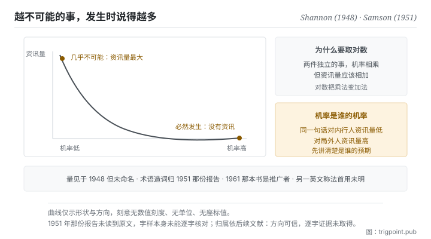

Canonical: https://trigpoint.pub/zh-Hans/collections/information-theory/self-information  
Captured: 2026-11-02T21:27:39.005380+08:00

> 公开理论阅读镜像。验证层及 Lab 案例请到原站阅读。

同一件事的资讯量，要按知情者还是局外人的机率算？

# 资讯量

Self-Information · Shannon (1948) / Samson (1951)

书目已核 ✓  
资讯理论 · 核心量度  
先读：资讯与不确定性

## 三句讲透

一件事带多少资讯，取决于它原本有多不可能发生。  
必然发生的事发生了，等于什么也没告诉你；几乎不可能的事发生了，带的资讯量最大。  
所以资讯量量的是它推翻了多少你原本的预期。

<strong>图 1</strong> · 资讯量与机率的关系示意：机率越低，该事件发生时带的资讯量越高；当一件事几乎必然发生，它发生时几乎没有告诉你任何事。  
右侧说明为何要取对数，两个独立事件的资讯量才加得起来。  
本图刻意无数值刻度与单位。

## 一、发生什么事

替一个事件算资讯量之前，要先做一个选择：用掌握内情者的机率，还是局外人的机率。把资讯定义为不确定性的削减之后，下一步是替单一事件定出一个数。答案其实已经藏在 1948 年那篇里：熵是每个结果的 log(1/p) 按机率加权的平均，论文也用同一个量界定单一讯息所需的码长[\[1\]](#reference-note-1)。把它单独拿出来看，结论简洁到有点反直觉：一个事件的资讯量，只由它的机率决定，机率越低资讯量越高。必然发生的事，资讯量为零。

为什么要取对数，而不是直接用机率的倒数？因为要让资讯量<strong>加得起来</strong>。两件互不相干的事同时发生，它们合起来带的资讯，直觉上应该是各自资讯量的和；而两件独立事件同时发生的机率是两个机率相乘。要把乘法变成加法，对数是唯一自然的选择。这个看似技术性的决定，让资讯变成一个可以累计、可以比较、可以当单位用的量，整套理论的实用性都建立在这上面。

这里有个容易滑过去的细节：<strong>机率是谁的机率</strong>。同一件事，对掌握内情的人机率高、资讯量低，对局外人机率低、资讯量高。理论本身不规定机率从哪里来，它只要求你先讲清楚是谁的预期。这就是为什么「这句话资讯量大不大」没有绝对答案，只有「对谁」的答案。

至于名字，有两件事要分开记。这个<strong>量</strong>出自 1948 年那篇的框架，但论文没有替它命名[\[1\]](#reference-note-1)；「surprisal」这个<strong>词</strong>的造词优先权，后续文献归于 1951 年一份空军研究报告，1961 年那本书使它流通但非首创[\[2\]](#reference-note-2)[\[3\]](#reference-note-3)；而英文里另一个常见称法不见于 1948 年那篇，本站未查到可靠的首用出处，故不归给任何一位[\[4\]](#reference-note-4)。

<strong>署名要给对：</strong>这个量出自 Shannon（1948）的框架，但论文没有单独为它定义或命名[\[1\]](#reference-note-1)。「surprisal」一词的造词优先权，后续文献归 Samson（1951）[\[2\]](#reference-note-2)，Tribus（1961）为推广者而非首创[\[3\]](#reference-note-3)；英文中另一个常见称法不见于 1948 年那篇，本站未查到可靠的首用出处[\[4\]](#reference-note-4)。量与词要分开记帐：把两者一起归给 Shannon 是常见的简化，但那会同时抹去一位有优先权的作者与一段真实的术语史。

## 二、为什么这对你重要

这一页给你的是一个可以直接套用的阅读动作：<strong>读任何一段内容，先问它推翻了你哪一项预期</strong>。

这个动作能立刻分辨两种读起来很像的东西。一种是把你已经相信的事，用更完整、更有条理的方式重讲一遍；另一种是告诉你某件你以为如此的事其实不然。前者读起来很舒服，资讯量接近零；后者读起来不舒服，资讯量高。<strong>舒适感与资讯量在这里是负相关的</strong>，这对挑选阅读材料是一条很锋利的判准。

用在模型输出上更直接。一份回应如果完全落在你的预期分布里，无论它多长多完整，它对你的不确定性没有削减。真正有用的输出通常有一个共同特征：其中至少有一项是你事前会赌它不是这样的。所以与其问「这个回答好不好」，不如问「它有没有任何一处让我意外」。没有，那这次呼叫的产出接近零，不管它产生了多少字。

反过来也成立，而且这是一个实用的自我检查：<strong>当你写的东西让所有人都点头，你可能什么也没说</strong>。共识性的陈述机率高、资讯量低。这不代表它们没有价值，铺陈与对齐有它们的功能，但要清楚那部分不是你在传递资讯，是你在对齐机率分布。两件事要分开计。

## 常见误读

所属页核验：书目已核 ✓ · 内容最后修订 2026-10-25

- 常见转述「Shannon 提出了 surprisal 这个概念与名称」：1948 年那篇用到了那个量，但没有替它造词。造词优先权据后续文献属 1951 年一份空军研究报告，1961 年那本书使它流通。至于中文常见的「自资讯」对应的英文术语，不见于 1948 年那篇，本站未查到可靠的首用出处。
- 常见转述「资讯量取决于事件是否重要」：不取决于重要性，只取决于它原本有多不可能。这条在直觉上很难接受，但它正是整套理论能量化的前提。

## 参考文献

<strong>如何阅读来源注记</strong> 「书目经…核对」指作者、年份、题名与出版项已确认；不代表该来源的主张已被核对。「对照全文核实」指主张已与来源文本本身比对。「依多源一致转述」指主张建立于多份彼此一致、转述该来源的资料，而非原文件本身。 定义版本：2026-09-20。

- \[1\] Shannon, C. E. (1948). A Mathematical Theory of Communication. Bell System Technical Journal, 27(3), 379–423; 27(4), 623–656.
- \[2\] Samson, E. W. (1951). Fundamental Natural Concepts of Information Theory. AFCRC Report E5079.
- \[3\] Tribus, M. (1961). Thermostatics and Thermodynamics. Van Nostrand.
- \[4\] 编辑注，无外部来源；全文见正文注 \[4\]。

引用格式：Trigpoint，〈资讯量〉，trigpoint.pub/zh-Hans/collections/information-theory/self-information · © Strategitect Limited. · 内容最后修订 2026-10-25

## 来源注记

**[1]** Shannon, C. E. (1948). A Mathematical Theory of Communication. Bell System Technical Journal, 27(3), 379–423; 27(4), 623–656. DOI 10.1002/j.1538-7305.1948.tb01338.x. 书目经官方记录核对。主张已对照全文核实。论文用到这个量：熵是各结果的 log(1/p) 按机率加权的平均，单一讯息所需码长的界也以 log(1/p) 表示。但论文没有把它单独定义为单一事件的资讯量，也没有替它命名；全文不见 self-information、surprisal、mutual information 这几个词。

**[2]** Samson, E. W. (1951). Fundamental Natural Concepts of Information Theory. AFCRC Report E5079. 书目经双源核对。「surprisal」一词之造词归属依多源一致转述。后续文献把「surprisal」一词的造词优先权归于本报告。本站未读到报告原文，该词是否出现在报告内未能逐字核对。

**[3]** Tribus, M. (1961). Thermostatics and Thermodynamics. Van Nostrand. 书目经双源核对。本书推广该词之说依多源一致转述。使「surprisal」一词流通，属推广而非首创。

**[4]** 「self-information」一词不见于 1948 年那篇；本站未查到可靠的首用出处，故不归给任何一位。

---

[English](../../../en/collections/information-theory/self-information.md) · [繁體中文](../../../zh-Hant/collections/information-theory/self-information.md)

[Index](../../README.md) · [Original page](https://trigpoint.pub/zh-Hans/collections/information-theory/self-information) · [Citation and versions](../../../READING.md)

[Original SVG](assets/self-information.svg) · Display copy adds a white background only.
