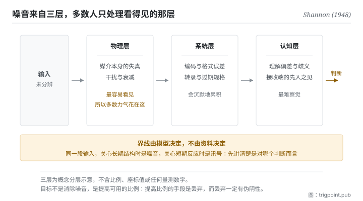

Canonical: https://trigpoint.pub/zh-Hans/collections/information-theory/signal-and-noise  
Captured: 2026-11-02T21:27:39.277471+08:00

> 公开理论阅读镜像。验证层及 Lab 案例请到原站阅读。

看长期结构，还是短期反应？讯号与噪音会因此换边。

# 讯号与噪音

Signal and Noise · Shannon (1948)

书目已核 ✓  
Lab 实测 ✓  
资讯理论 · 传输极限  
先读：资讯量  
先读：熵

## 三句讲透

讯号是能稳定降低不确定性的那部分输入，其余是噪音。  
两者的界线不在资料本身，在你用来读它的模型：换一个模型，同一段输入可能换一边。  
所以要下功夫的，是把可用的比例拉高。

<strong>图 1</strong> · 噪音的三个来源层示意：同一段输入在抵达判断之前，会依序经过物理、系统与认知三层干扰。  
下方指出一个常被忽略的性质，讯号与噪音的界线由你当下用的模型决定，换一个模型同一段输入可能换一边。

## 一、发生什么事

一段输入该当讯号还是噪音，要先选定拿它回答哪个判断：长期结构，或短期反应。1948 年那篇的一个关键动作，是把噪音正式写进通讯模型里[\[1\]](#reference-note-1)。噪音从此成为模型的一部分，于是「在干扰存在下仍能可靠传输多少」变成一个可以分析、可以求极限的问题。这个转向的重要性在于：它承认噪音不会消失，然后去问在它存在的前提下能做到什么。

从这个角度看，讯号的定义变得很窄：<strong>只有能稳定改变你的机率分布的输入才是讯号</strong>。能改变，指它削减了不确定性；稳定，指它不是这次改变、下次又反过来的随机扰动。不满足这两条的部分，无论它看起来多像资料，都是噪音。

噪音来自至少三层，而它们往往同时作用。物理层是传输媒介本身的失真；系统层是编码、格式、转录过程中引入的误差；认知层是理解偏差、术语歧义、以及接收端自己的先入之见。多数人只处理第一层，因为它最容易看见。

还有一个性质常被忽略，而它是本页最实用的一句：<strong>讯号与噪音是相对于模型而言的</strong>。同一段输入，在你关心长期结构时是噪音，在你关心短期反应时是讯号。这不是模棱两可，是这对概念的定义本来就带着参照系。所以任何「这是不是讯号」的讨论，如果没先讲清楚是对哪个判断而言，都不会有结论。

<strong>署名要给对：</strong>把噪音正式纳入通讯模型、使干扰下的可靠传输成为可分析问题的，是 Shannon（1948）；白噪音下的容量公式也已见于同一篇[\[1\]](#reference-note-1)，1949 年那篇另以几何方式处理同一问题[\[2\]](#reference-note-2)。到 1948 年，讯噪比已是通讯工程的实用量：该篇开篇第一句就提到当时以频宽换取讯噪比的 PCM、PPM 等调变方法[\[1\]](#reference-note-1)；更早的使用史与署名，本站未另做核对，故不作具体署名。其他工程史人物的归属本页同样未核，因此不列入本节。

## 二、为什么这对你重要

多数人处理资讯过载的方式是加闸门：订更多来源，做更多摘要，建更多分类。这一页说那多半是在错的变数上用力。

要看的量是比例，不是总量。你收到的东西变多，如果其中能改变判断的比例没有跟着变，你的处境没有改善，只是变忙。更糟的是，总量增加通常会让比例下降，因为新增的来源普遍比既有的更边缘。<strong>输入量与讯噪比是两个可以反向移动的量</strong>，而只有后者影响你判断得多准。

这在使用模型时特别致命，因为喂进去的脉络有一个安静的失败模式。你把所有可能相关的东西都附上，模型不会告诉你其中八成是噪音，它会照单全收然后产出一个看起来合理的回应。你以为你在提供更完整的背景，实际上你在稀释。判准很简单：<strong>这段内容如果拿掉，我的结论会不会不同</strong>。不会，它就是噪音，附上去的成本不是零。

第三件事是关于时间尺度。把短期波动当成趋势，是把噪音误判为讯号的标准形态，而且它有一个很难摆脱的特征：波动总是最新的、最生动的、最容易被解读成「情况正在变化」。防这件事没有巧妙的办法，只能事前定好在哪个尺度上看、要看多久才算数，然后不要在中途改。

## 常见误读

所属页核验：书目已核 ✓ · 内容最后修订 2026-10-25

- 常见转述「先把噪音去掉，再来分析」：多数情况下噪音不可消除，可调整的是讯号与噪音的比例。把目标设成消除噪音，通常会导致过度过滤，连讯号一起滤掉。
- 常见转述「讯号与噪音是资料的固有属性」：不是。同一段输入在不同的模型与时间尺度下可以分属两边。判断之前要先讲清楚是哪个模型、哪个尺度。

## 参考文献

<strong>如何阅读来源注记</strong> 「书目经…核对」指作者、年份、题名与出版项已确认；不代表该来源的主张已被核对。「对照全文核实」指主张已与来源文本本身比对。 定义版本：2026-09-20。

- \[1\] Shannon, C. E. (1948). A Mathematical Theory of Communication. Bell System Technical Journal, 27(3), 379–423; 27(4), 623–656.
- \[2\] Shannon, C. E. (1949). Communication in the Presence of Noise. Proceedings of the IRE, 37(1), 10–21.

引用格式：Trigpoint，〈讯号与噪音〉，trigpoint.pub/zh-Hans/collections/information-theory/signal-and-noise · © Strategitect Limited. · 内容最后修订 2026-10-25

## 来源注记

**[1]** Shannon, C. E. (1948). A Mathematical Theory of Communication. Bell System Technical Journal, 27(3), 379–423; 27(4), 623–656. DOI 10.1002/j.1538-7305.1948.tb01338.x. 书目经官方记录核对。主张已对照全文核实。把噪音正式纳入通讯模型（第二部分〈有噪音的离散通道〉），使「在干扰下仍可靠传输」成为可分析的问题；白噪音下的通道容量公式见第 24 节定理 17。开篇第一句提到当时以频宽换取讯噪比的 PCM、PPM 等调变方法。

**[2]** Shannon, C. E. (1949). Communication in the Presence of Noise. Proceedings of the IRE, 37(1), 10–21. DOI 10.1109/JRPROC.1949.232969. 书目经官方记录核对。以几何方式处理噪音下的传输；1948 年那篇已预告本文，并引用它作白噪音几何性质的论述出处。噪音下的容量本站另有专页。

---

[English](../../../en/collections/information-theory/signal-and-noise.md) · [繁體中文](../../../zh-Hant/collections/information-theory/signal-and-noise.md)

[Index](../../README.md) · [Original page](https://trigpoint.pub/zh-Hans/collections/information-theory/signal-and-noise) · [Citation and versions](../../../READING.md)

[Original SVG](assets/signal-and-noise.svg) · Display copy adds a white background only.
