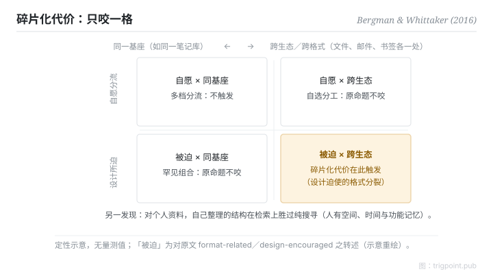

Canonical: https://trigpoint.pub/zh-Hans/collections/pkm/bergman-whittaker-2016-pim  
Captured: 2026-10-05T03:32:15.797105+08:00

> 公开理论阅读镜像。验证层及 Lab 案例请到原站阅读。

「工具越少越好」：错在结构。

# 个人资讯管理

Personal Information Management · Bergman & Whittaker (2016)

摘要已核 ✓  
个人知识管理 · 实证科学

## 三句讲透

个人资讯管理是一门实证科学，不是生产力鸡汤。  
两个核心发现：搜寻主导公共资讯，但用于个人资讯时效果较差，作者主张的「使用者主观取向」并不取代资料夹；碎片化有明确边界，只涵盖被系统设计所迫的跨工具分裂。  
「工具越少越好」恰好把这条边界读漏了。

<strong>图 1</strong> · 碎片化代价的适用边界定性示意：两轴为「分裂是否被系统设计所迫」与「是否跨生态／格式」；代价只在被迫且跨生态的一格触发。  
同一基座内的自愿多档分流不在此列。  
「被迫」为对原文 format-related／design-encouraged 的转述。  
示意重绘，非原书图表。

## 一、发生什么事

Bergman 与 Whittaker 2016 年在 MIT Press 出版的专著，综合了个人资讯管理的研究[\[1\]](#reference-note-1)。资料夹常被批评：资讯藏在层层资料夹里，要记住确切位置，资讯科学家因此主张搜寻更灵活。但作者的看法不同：搜寻、标签等对公共资讯最有效，用于个人资讯时效果较差，他们主张的使用者主观取向并不取代资料夹。碎片化命题同样被修窄：所谓碎片化，一项经典界定（CHI 2006）是同一专案的资料分存于依格式分开的集合（20 人研究显示是否碎片化取决于介面设计的鼓励），文件一处、邮件一处、书签又一处[\[2\]](#reference-note-2)。问题出在系统设计迫使的分裂，不是「多档案」本身。

<strong>署名要给对：</strong>「被迫（involuntary）」是对原文 format-related／design-encouraged 的合理转述，非原书逐字用语；资料夹批评句是书介的近似转述。碎片化问题的一项经典界定见 Bergman、Beyth-Marom 与 Nachmias 2006 年的 CHI 论文[\[2\]](#reference-note-2)；2016 年专著是实证综合的里程碑，引用时分开这两层。

## 二、为什么这对你重要

两条设计推论。一，个人知识库的「整理」不是浪费时间：你在为自己的记忆建索引，这正是搜寻替代不了的部分。二，判断「要不要合并工具」之前先过边界测试：跨生态、被格式所迫的分裂才落入这种碎片化的界定，同一基座内的多档分流（例如同一笔记库内按用途分多个档案）不在这条定义之内。把设计主张当万能，会让你为不存在的代价重组系统；把边界读对，「工具多少才算多」就从口味之争变成可判定的问题。要补一句诚实的边界：这条定义只涵盖跨工具那一种，不代表系统内部怎么分都免费。

## 参考文献

<strong>如何阅读来源注记</strong> 「书目经…核对」指作者、年份、题名与出版项已确认；不代表该来源的主张已被核对。「与摘要一致」指主张与论文摘要相符；不含逐句对照全文。 定义版本：2026-09-20。

- \[1\] Bergman, O., & Whittaker, S. (2016). The Science of Managing Our Digital Stuff. Cambridge, MA: MIT Press. https://doi.org/10.7551/mitpress/9780262035170.001.0001
- \[2\] Bergman, O., Beyth-Marom, R., & Nachmias, R. (2006). The project fragmentation problem in personal information management. CHI 2006, 271–274. https://doi.org/10.1145/1124772.1124813

引用格式：Trigpoint，〈个人资讯管理〉，trigpoint.pub/zh-Hans/collections/pkm/bergman-whittaker-2016-pim · © Strategitect Limited. · 内容最后修订 2026-10-01

## 来源注记

**[1]** Bergman, O., & Whittaker, S. (2016). The Science of Managing Our Digital Stuff. Cambridge, MA: MIT Press. ISBN 9780262035170. 书目经多源交叉核对。要旨与摘要一致。folder 批评句为书介近似转述非逐页引文。

**[2]** Bergman, O., Beyth-Marom, R., & Nachmias, R. (2006). The project fragmentation problem in personal information management. CHI 2006, 271–274. DOI 10.1145/1124772.1124813. 书目经多源交叉核对。要旨与摘要一致。碎片化问题的一项经典界定（同一专案资料分存于依格式分开的集合；20 人研究）。

---

[English](../../../en/collections/pkm/bergman-whittaker-2016-pim.md) · [繁體中文](../../../zh-Hant/collections/pkm/bergman-whittaker-2016-pim.md)

[Index](../../README.md) · [Original page](https://trigpoint.pub/zh-Hans/collections/pkm/bergman-whittaker-2016-pim) · [Citation and versions](../../../READING.md)

[Original SVG](assets/bergman-whittaker-2016-pim.svg) · Display copy adds a white background only.
