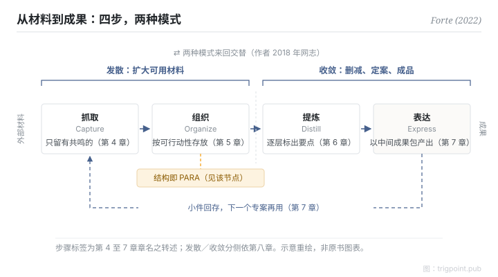

Canonical: https://trigpoint.pub/zh-Hans/collections/pkm/code-tiago-forte-2022  
Captured: 2026-10-05T03:32:15.861789+08:00

> 公开理论阅读镜像。验证层及 Lab 案例请到原站阅读。

「四步走完一次就交货」：没这么简单。

# CODE 四步法

CODE Method · Forte (2022)

书目已核 ✓  
个人知识管理 · 工作流程  
先读：PARA 组织法

## 三句讲透

收回来的材料，要经过四步才会变成成果：抓取只留有共鸣的，组织按可行动性存放，提炼逐层标出要点，表达以中间成果包组装成品。  
书的第八章再把四步分成两种模式：抓取与组织属发散，提炼与表达属收敛。  
收集只是前半程，成品要靠后两步收窄与定案。

<strong>图 1</strong> · 四步由左至右把外部材料逐步变成成果：抓取、组织属发散，提炼、表达属收敛；表达时做出的小件回存，供下一个专案重用。  
组织一步的结构即 PARA。  
步骤标签为书第 4 至 7 章章名之转述；两种模式来回交替，出自作者 2018 年网志。  
示意重绘，非原书图表。

## 一、发生什么事

以为四步走完一次就交货，会漏掉书中两处结构。Tiago Forte 在 2022 年出版的《Building a Second Brain》把方法核心写成四步，第 4 至 7 章各讲一步[\[1\]](#reference-note-1)。抓取（Capture）只保留触动自己的材料；组织（Organize）按可行动性而非主题存放，所用的结构就是同书的 PARA；提炼（Distill）用渐进式归纳，分层标出重点，让日后一眼取用；表达（Express）以中间成果包（Intermediate Packets）为单位产出，成品由既有的小件组装，小件回存后可在下一个专案再用[\[1\]](#reference-note-1)。

第八章〈The Art of Creative Execution〉再把四步分成两种工作模式：抓取与组织属发散，负责扩大可用材料；提炼与表达属收敛，负责删减、定案、做出成品[\[1\]](#reference-note-1)。作者在 2018 年的网志中描述两种模式来回交替，并自述这套模型取自 Design Thinking[\[2\]](#reference-note-2)。

<strong>署名要给对：</strong>CODE 出自 Tiago Forte 2022 年的《Building a Second Brain》，引用「2022」指书。名称所见最早为 2019 年 1 月的作者推文，课程 2017 年开办时单元名不同，三个年份分开标。发散与收敛两词另有来源：技术用语见 Guilford 1956 年，设计流程形状见 Design Council 的双钻石（另有一说追至 1970 年的 Jones，未核）；本书的贡献是把 CODE 四步分派到两侧。作者自述模型取自 Design Thinking，这是网志的说法。

## 二、为什么这对你重要

笔记系统常见的停滞点在收集之后：材料越存越多，成品迟迟不出。CODE 把「存」与「交」拆成四个各有任务的步骤，每一步都可以单独检查：这份材料提炼过了没有？提炼过的要点，有没有用进一件成品？第八章的分法再提供一个判断：还在扩大可选范围，属发散；开始删减和定案，属收敛。

一条边界要记住：CODE 讲材料怎样变成成果；组织一步把东西放在哪里，由 PARA 回答，本页不重述，请见 PARA 节点。

## 参考文献

<strong>如何阅读来源注记</strong> 「书目经…核对」指作者、年份、题名与出版项已确认；不代表该来源的主张已被核对。「对照原站核实」指主张已与该项目的原始网站比对。「依多源一致转述」指主张建立于多份彼此一致、转述该来源的资料，而非原文件本身。 定义版本：2026-09-20。

- \[1\] Forte, T. (2022). Building a Second Brain: A Proven Method to Organize Your Digital Life and Unlock Your Creative Potential. New York: Atria Books / Simon & Schuster. https://www.simonandschuster.com/books/Building-a-Second-Brain/Tiago-Forte/9781982167387 书目经多源交叉核对。第八章发散与收敛段落（约 p.178–180）之两侧对应依多源一致转述。
- \[2\] Forte Labs blog. Divergence and Convergence: The Two Fundamental Stages of the Creative Process (2022-05-16); Just-In-Time PM #8: Divergence and Convergence (2018-05-23). https://fortelabs.com/blog/ 书目经官方记录核对。网志两项自述与 CODE 缩写之时点已对照原站核实。
- \[3\] Guilford, J. P. (1956). The structure of intellect. Psychological Bulletin, 53(4), 267–293. https://doi.org/10.1037/h0040755 书目经出版社记录核对。「1956 年为已知最早刊出之技术用语」一说依多源一致转述。
- \[4\] Design Council (UK). History of the Double Diamond. https://www.designcouncil.org.uk/ 书目经官方记录核对。2003／2004 年份与两词用法已对照原站核实。

引用格式：Trigpoint，〈CODE 四步法〉，trigpoint.pub/zh-Hans/collections/pkm/code-tiago-forte-2022 · © Strategitect Limited. · 内容最后修订 2026-10-01

## 来源注记

**[1]** Forte, T. (2022). Building a Second Brain. Atria Books / Simon & Schuster. ISBN 9781982167387. 书目经多源交叉核对。第八章发散与收敛段落（约 p.178–180）之两侧对应依多源一致转述。

**[2]** Forte Labs. 书目经官方记录核对。网志两项自述与 CODE 缩写之时点已对照原站核实。作者网志（fortelabs.com）与 @fortelabs 推文。两种模式「来回交替」及「取自 Design Thinking」之自述，均出自网志，非书中文字。

---

[English](../../../en/collections/pkm/code-tiago-forte-2022.md) · [繁體中文](../../../zh-Hant/collections/pkm/code-tiago-forte-2022.md)

[Index](../../README.md) · [Original page](https://trigpoint.pub/zh-Hans/collections/pkm/code-tiago-forte-2022) · [Citation and versions](../../../READING.md)

[Original SVG](assets/code-tiago-forte-2022.svg) · Display copy adds a white background only.
