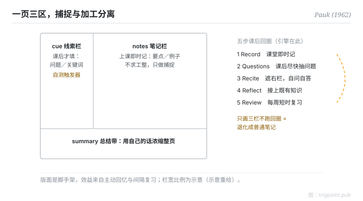

Canonical: https://trigpoint.pub/zh-Hans/collections/pkm/cornell-note-taking-pauk-1962  
Captured: 2026-10-05T03:32:16.511991+08:00

> 公开理论阅读镜像。验证层及 Lab 案例请到原站阅读。

「笔记抄得整齐就记得住」：错在结构。

# 康乃尔笔记法

Cornell Note-Taking System · Pauk (1962)

书目已核 ✓  
个人知识管理 · 笔记法

## 三句讲透

康乃尔笔记法把一页纸分成三区：右栏上课即时记，左栏课后抽问题，底带用自己的话总结。  
设计核心不是版面，是把「捕捉」与「加工」在时间上分开，再用遮盖自测与每周复习对抗遗忘。  
只画三栏而不做课后回圈，它就退化成普通笔记。

<strong>图 1</strong> · 三区版面示意：右栏上课即时记，左窄栏课后抽问题与关键词，底带用自己的话总结；配合遮盖自测与每周复习的课后回圈。  
示意重绘，非原书图版。

## 一、发生什么事

Pauk 是康乃尔大学阅读与学习技巧中心主任，1962 年在《How to Study in College》把这套方法系统化，方法名取自校名[\[1\]](#reference-note-1)。它要解的问题：单纯抄录不等于学习，笔记若无后续加工，很快被遗忘吃掉。三区各司其职：右栏上课只做即时捕捉，不求工整；左窄栏课后尽快反推问题与关键词；底带用自己的话浓缩整页。然后是复习回圈：遮住右栏，看左栏线索出声自答，再追问它与既有知识的关系，每周固定至少十分钟复习，对抗遗忘[\[2\]](#reference-note-2)。

<strong>署名要给对：</strong>方法名取自校名，不是 Pauk 自冠姓名；方法 1950 年代已在校内渐成，1962 年专书定式，「1962」是出版年不是发明时点。官方页列五步（Record–Questions–Recite–Reflect–Review，自述改编自 Pauk 第 7 版），流传版本另有以 Reduce 取代 Questions 的写法；流传的 6R 多了 Recapitulate，未确证出自原书，引用时要标明版本。

## 二、为什么这对你重要

用它之前先认清它的设计领域：单次输入的消化（讲座、阅读、会议），不是跨笔记的想法网络。它与网状笔记法不是竞争，是分工：康乃尔强在输入端的复习，弱在跨节点连结；先用它消化单次输入，精炼出的概念再升格进永久笔记系统。

还有一个常被漏掉的位：版面只是脚手架，学习效益全部来自课后的主动回忆与间隔复习。这两个机制在认知科学里独立成立；Pauk 的贡献是把它们操作化成一套可执行的版面与流程，而不是提出机制本身。所以评价这套方法，看的是你有没有跑回圈，不是抄得整不整齐。

## 参考文献

<strong>如何阅读来源注记</strong> 「书目经…核对」指作者、年份、题名与出版项已确认；不代表该来源的主张已被核对。「对照原站核实」指主张已与该项目的原始网站比对。 定义版本：2026-09-20。

- \[1\] Pauk, W. (1962). How to Study in College (1st ed.).
- \[2\] Cornell University Learning Strategies Center. The Cornell Note Taking System. https://lsc.cornell.edu/notes.html

引用格式：Trigpoint，〈康乃尔笔记法〉，trigpoint.pub/zh-Hans/collections/pkm/cornell-note-taking-pauk-1962 · © Strategitect Limited. · 内容最后修订 2026-10-01

## 来源注记

**[1]** Pauk, W. (1962). How to Study in College. 书目经多源交叉核对。（初版；现行第 11 版）。三区版面与五个步骤经康乃尔大学学习策略中心官方页与多源交叉核对，未逐页引录原书。

**[2]** Cornell University Learning Strategies Center. The Cornell Note Taking System. 书目经官方记录核对。五步名称与课后整理时点已对照原站核实。（lsc.cornell.edu）。官方页步骤名为 Record–Questions–Recite–Reflect–Review，页面自述改编自 Pauk, How to Study in College 第 7 版（2001）；流传版本写作 Record–Reduce–Recite–Reflect–Review，两者并存。官方页第二步时限为 as soon after class as possible，每周复习至少十分钟。

---

[English](../../../en/collections/pkm/cornell-note-taking-pauk-1962.md) · [繁體中文](../../../zh-Hant/collections/pkm/cornell-note-taking-pauk-1962.md)

[Index](../../README.md) · [Original page](https://trigpoint.pub/zh-Hans/collections/pkm/cornell-note-taking-pauk-1962) · [Citation and versions](../../../READING.md)

[Original SVG](assets/cornell-note-taking-pauk-1962.svg) · Display copy adds a white background only.
