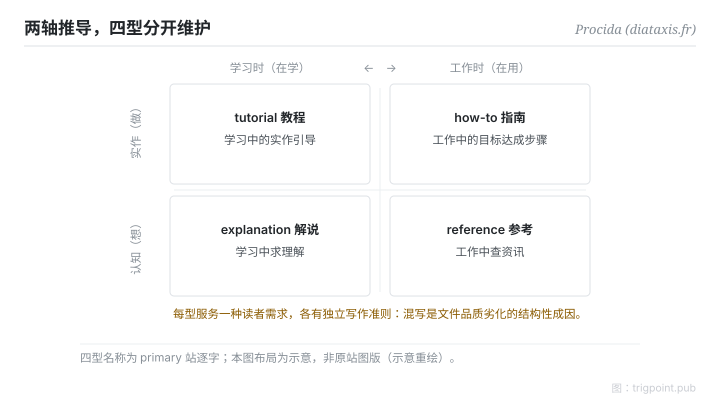

Canonical: https://trigpoint.pub/zh-Hans/collections/pkm/diataxis-procida  
Captured: 2026-10-05T03:32:16.656528+08:00

> 公开理论阅读镜像。验证层及 Lab 案例请到原站阅读。

「一份文件全部讲完就好」：没这么简单。

# Diátaxis 文件四型

Diátaxis · Procida

已对照来源本身 ✓  
个人知识管理 · 文件学

## 三句讲透

文件写不好，多数不是文笔问题，是四种读者需求被塞进同一份文件。  
Diátaxis 用两条轴拆开：读者在做还是在想、在学还是在用，推出四型：tutorial、how-to、reference、explanation。  
核心纪律只有一条：四型分开维护，不混写。

<strong>图 1</strong> · 两轴推导四型示意：实作对认知（做还是想）× 学习对应用（在学还是在用），落出 tutorial、how-to、reference、explanation 四格，各服务一种读者需求。  
示意重绘，布局非原站图版。

## 一、发生什么事

Procida 在 Divio 任职期间（2014 至 2021）发表过这套想法的早期版本，他后来自认其中部分看错，其后独立为 diataxis.fr 持续打磨[\[1\]](#reference-note-1)。推导不是任意分类：读者处境沿两条轴分化，实作（knowing-how）对认知（knowing-that），学习时对工作时，二乘二落出四型，每型服务一种需求、各有独立写作准则。tutorial 是学习中的实作引导，how-to 是工作中的达成步骤，reference 是工作中查资讯，explanation 是学习中求理解。混写的失败形态每个人都见过：一份「教学」开头教操作、中段变参数表、结尾写设计哲学，每种读者都要跳读。

<strong>署名要给对：</strong>框架没有单一首发年：早期版本发表于 Divio 时期，「2021」指 Software Sustainability Institute fellowship，勿当「2021 年提出」引用。采用广度（站方称数百个文件专案）为自述，未经第三方验证；引用时保留这个限定[\[1\]](#reference-note-1)。

## 二、为什么这对你重要

判断一份文件该不该拆，先问读者此刻在哪个象限，而不是问内容属于哪个主题。这也是知识系统设计里三个常被混答的问题之一：东西放哪（组织法的事）、怎么找回来（导航的事）、写成什么型（本框架的事）。三问正交，混答互相拖累。对个人笔记的推论：你写给自己的操作手册与你写给自己的概念解释，也不该是同一份档案，两者更新节奏不同、失效方式不同。

## 参考文献

<strong>如何阅读来源注记</strong> 「对照原站核实」指主张已与该项目的原始网站比对。 定义版本：2026-09-20。

- \[1\] Procida, D. Diátaxis. https://diataxis.fr/ 两轴推导、Divio 时期与 2021 年之说明已对照原站核实。（早期版本于 Divio 任职期 2014–2021 发表）.

引用格式：Trigpoint，〈Diátaxis 文件四型〉，trigpoint.pub/zh-Hans/collections/pkm/diataxis-procida · © Strategitect Limited. · 内容最后修订 2026-10-01

## 来源注记

**[1]** Procida, D. Diátaxis. 两轴推导、Divio 时期与 2021 年之说明已对照原站核实。（diataxis.fr）。primary 站三页（主页、foundations、colophon）核对：四型名称与词源逐字对上；早期版本于 Divio 任职期（2014–2021）发表，Procida 后来自认其中部分看错；「2021」指 Software Sustainability Institute fellowship，非首发年；采用广度为站方自述，未经第三方验证。

---

[English](../../../en/collections/pkm/diataxis-procida.md) · [繁體中文](../../../zh-Hant/collections/pkm/diataxis-procida.md)

[Index](../../README.md) · [Original page](https://trigpoint.pub/zh-Hans/collections/pkm/diataxis-procida) · [Citation and versions](../../../READING.md)

[Original SVG](assets/diataxis-procida.svg) · Display copy adds a white background only.
