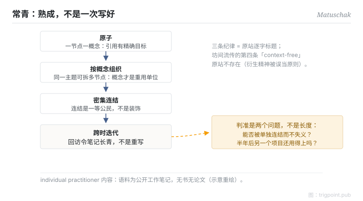

Canonical: https://trigpoint.pub/zh-Hans/collections/pkm/evergreen-notes-matuschak  
Captured: 2026-10-05T03:32:16.683858+08:00

> 公开理论阅读镜像。验证层及 Lab 案例请到原站阅读。

「写得越详细越好」：错。

# 常青笔记

Evergreen Notes · Matuschak

已对照来源本身 ✓  
Lab 实测 ✓  
个人知识管理 · 笔记法

## 三句讲透

常青笔记是一套笔记纪律：一节点一概念（原子）、按概念而非来源或主题组织、节点之间密集连结，笔记随每次回访迭代而非重写。  
判准不是长度：一则笔记够不够「常青」，看它能否被精确引用、能否在新场合重用。  
把「详细」当目标，恰好会写出引用不了的长文。

<strong>图 1</strong> · 常青笔记三条纪律的机制流示意：一节点一概念、按概念而非主题组织、密集连结，笔记随回访迭代长青。  
三条为原站逐字标题；坊间流传的第四条「context-free」原站不存在。  
示意重绘。

## 一、发生什么事

Matuschak（曾任 Apple iOS 工程师与 Khan Academy 研发）在其公开的工作笔记站上实践并提出这套纪律，该站持续更新，页面未标成文日期[\[1\]](#reference-note-1)。三条原则是站上的逐字标题：笔记应该原子（一节点一概念，令引用有精确目标，但仍尽量完整涵盖该概念）、应该按概念组织（同一主题可以拆成多个概念节点，概念才是重用单位）、应该密集连结（连结是一等公民，不是装饰）。他自承这套概念深深受惠于卡片盒传统：这是网状笔记在数位工具时代的重述与细化，不是新发明。坊间常见的第四条「笔记应该去脉络（context-free）」在原站并不存在，是衍生精神被误当独立原则；站上另有两条原则标题，皆非「去脉络」。

<strong>署名要给对：</strong>Matuschak 自承概念「深深受惠于」卡片盒传统，他是数位时代的普及声音，不是概念祖。三条纪律（原子、概念导向、密集连结）是原站逐字标题；「context-free」不是第四条。另须保留身位：这是 individual practitioner 内容，语料是公开工作笔记，无书、无论文，页面未标成文日期[\[1\]](#reference-note-1)。

## 二、为什么这对你重要

「写得越详细越好」的直觉，错在把笔记当文章：文章的单位是论述，笔记系统的单位是概念。一则八百字的心得引用不了其中那个真正有用的判准；拆成三个原子节点，每个都能被未来的你精确调用。所以常青的操作性判准是两个问题：这则笔记能否被单独连结而不失义？半年后在另一个项目里，它还用得上吗？

另一个容易反转的位：常青是「熟成」，不是「一次写好」。笔记靠回访迭代变熟；一开始写得完美反而阻止你回去改它。

## 参考文献

<strong>如何阅读来源注记</strong> 「对照原站核实」指主张已与该项目的原始网站比对。 定义版本：2026-09-20。

- \[1\] Matuschak, A. Working Notes. https://notes.andymatuschak.org/Evergreen_notes 三条纪律已对照原站核实。（持续更新、未标成文日期；individual practitioner 工作笔记）.

## 知识图谱

- [<em>对照 ▸</em>超文本与跨包含 Hypertext & Transclusion（Ted Nelson 1965）](hypertext-transclusion-nelson-1965.md)
- [<em>被应用 ▸</em>Memex（Vannevar Bush 1945）](memex-bush-1945.md)

引用格式：Trigpoint，〈常青笔记〉，trigpoint.pub/zh-Hans/collections/pkm/evergreen-notes-matuschak · © Strategitect Limited. · 内容最后修订 2026-10-01

## 来源注记

**[1]** Matuschak, A. Working Notes. 三条纪律已对照原站核实。见 notes.andymatuschak.org（持续更新，页面未标成文日期）。individual practitioner 工作笔记（无书、无论文）；atomic／concept-oriented／densely linked 三条纪律为站上逐字标题；「context-free 第四原则」经核对于原站不存在，为坊间误传。

---

[English](../../../en/collections/pkm/evergreen-notes-matuschak.md) · [繁體中文](../../../zh-Hant/collections/pkm/evergreen-notes-matuschak.md)

[Index](../../README.md) · [Original page](https://trigpoint.pub/zh-Hans/collections/pkm/evergreen-notes-matuschak) · [Citation and versions](../../../READING.md)

[Original SVG](assets/evergreen-notes-matuschak.svg) · Display copy adds a white background only.
