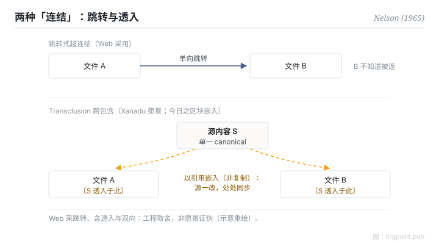

Canonical: https://trigpoint.pub/zh-Hans/collections/pkm/hypertext-transclusion-nelson-1965  
Captured: 2026-10-05T03:32:16.757260+08:00

> 公开理论阅读镜像。验证层及 Lab 案例请到原站阅读。

「连结就是连结」：没这么简单。

# 超文本与跨包含

Hypertext & Transclusion · Nelson (1965)

书目已核 ✓  
个人知识管理 · 思想史

## 三句讲透

「超文本」一词于 1965 年 Nelson 的论文中给出定义：指无法用纸本呈现的互联文本。  
Nelson 称其概念已含于同一构想之内的 transclusion 更深一层：同一内容以引用方式嵌入多处，源头一改，处处同步。  
今日笔记工具的双向连结与区块嵌入，都是这个愿景的局部实现。

<strong>图 1</strong> · 两种「连结」的对照示意：跳转式超连结（单向，目标不知道被连）与 transclusion（内容以引用嵌入多处，源头一改处处同步）。  
Web 采前者、舍后者，是工程取舍而非愿景证伪。  
示意重绘。

## 一、发生什么事

Nelson 要解的问题：人类思想互联、可变、不确定，纸本与循序档案结构却强迫线性。1965 年他在 ACM 会议论文提出承载非线性文本的档案结构，并在文中给出 hypertext 一词的定义（常说 1963 年造词，未见 Nelson 一手出处）[\[1\]](#reference-note-1)。愿景的深层机制是 transclusion：内容「以引用而非复制」存在于多处，源变动则所有嵌入处同步；这个词通说出自 1981 年首版的《Literary Machines》（本页未逐版核该词首见处），但 Nelson 自称概念已在 1965 年的描述之内[\[2\]](#reference-note-2)。完整愿景（双向连结、transclusion、版本、微支付）从未完整实现：Project Xanadu 成了著名的长期未竟工程，真正普及超文本的是 Web，而 Web 刻意舍弃了双向与 transclusion，换取简单与可扩展。

<strong>署名要给对：</strong>概念祖是 Bush 1945 年的联想轨迹，Nelson 援引其为前例[\[3\]](#reference-note-3)；1963 年造词之说常见，未见 Nelson 一手出处；1965 年那篇 ACM 论文给出定义，但据 Nelson 自注，不是他首篇使用该词的出版物。transclusion 一词通说见于 1981 年首版《Literary Machines》，Nelson 自称概念早于命名十余年。概念、造词、印行三件事分开给，署名才给得对。

## 二、为什么这对你重要

分辨三种不同的「连结」承诺：跳转（Web 的超连结，单向，目标不知道被连）、反向可见（连结两端互知）、嵌入同步（内容透入而非复制）。你的笔记工具若支援反向连结与区块嵌入，它做的正是被 Web 舍弃的那部分愿景。所以「连结就是连结」不成立：三种承诺的维护成本与回报各不相同，选工具时值得逐项问清楚。

另一课来自 Xanadu：从未 ship 不等于设计错。被一代工程取舍牺牲的特性，几十年后可以在新约束下平反；把「未实现」读成「无价值」，会错过正在回归的设计。

## 参考文献

<strong>如何阅读来源注记</strong> 「书目经…核对」指作者、年份、题名与出版项已确认；不代表该来源的主张已被核对。「对照全文核实」指主张已与来源文本本身比对。「依多源一致转述」指主张建立于多份彼此一致、转述该来源的资料，而非原文件本身。「验证继承」指核对在本站另一页完成，未在本页重做。 定义版本：2026-09-20。

- \[1\] Nelson, T. H. (1965). Complex Information Processing: A File Structure for the Complex, the Changing and the Indeterminate. Proceedings of the ACM 20th National Conference, 84–100. https://doi.org/10.1145/800197.806036
- \[2\] Nelson, T. H. (1981). Literary Machines. Swarthmore, PA: self-published. 书目经多源交叉核对。「transclusion」一词出自此书之说依多源一致转述。（首版 1981；部分目录作 1980）
- \[3\] Bush, V. (1945). As We May Think. The Atlantic, 176(1), 101–108. https://www.theatlantic.com/magazine/archive/1945/07/as-we-may-think/303881/

## 知识图谱

- [<em>前置 ▸</em>Memex（Vannevar Bush 1945）](memex-bush-1945.md)
- [<em>对照 ▸</em>Zettelkasten · Luhmann 1981](zettelkasten-luhmann-1981.md)
- [<em>对照 ▸</em>Evergreen Notes · Andy Matuschak](evergreen-notes-matuschak.md)

引用格式：Trigpoint，〈超文本与跨包含〉，trigpoint.pub/zh-Hans/collections/pkm/hypertext-transclusion-nelson-1965 · © Strategitect Limited. · 内容最后修订 2026-10-01

## 来源注记

**[1]** Nelson, T. H. (1965). Complex Information Processing: A File Structure for the Complex, the Changing and the Indeterminate. Proceedings of the ACM 20th National Conference, 84–100. DOI 10.1145/800197.806036. 书目经官方记录核对。主张已对照全文核实。「hypertext」一词于此文（p.96）给出定义，为最广被引之处；Nelson 自述其同年 FID 会议论文《The Hypertext》才是他首篇使用该词的出版物。经 DOI 纪录与 Internet Archive 一手扫描对照。

**[2]** Nelson, T. H. (1981). Literary Machines. Swarthmore, PA: self-published. 书目经多源交叉核对。「transclusion」一词出自此书之说依多源一致转述。「transclusion」一词通说出自此书（本页未逐版核该词首见处），定义为 the same content knowably in more than one place；概念已存于 1965 年论文的描述。首版为 1981 年（Internet Archive 所藏首版与第三版版权页；部分目录作 1980）。

**[3]** Bush, V. (1945). As We May Think. The Atlantic, 176(1), 101–108. 验证继承自 记忆延伸机；本页未重验。联想轨迹为 hypertext 之概念祖；Nelson 援引其为前例。

---

[English](../../../en/collections/pkm/hypertext-transclusion-nelson-1965.md) · [繁體中文](../../../zh-Hant/collections/pkm/hypertext-transclusion-nelson-1965.md)

[Index](../../README.md) · [Original page](https://trigpoint.pub/zh-Hans/collections/pkm/hypertext-transclusion-nelson-1965) · [Citation and versions](../../../READING.md)

[Original SVG](assets/hypertext-transclusion-nelson-1965.svg) · Display copy adds a white background only.
