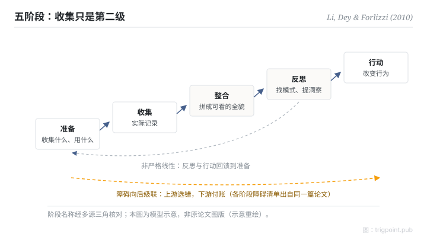

Canonical: https://trigpoint.pub/zh-Hans/collections/pkm/li-dey-forlizzi-2010-personal-informatics  
Captured: 2026-10-05T03:32:17.384137+08:00

> 公开理论阅读镜像。验证层及 Lab 案例请到原站阅读。

「收集到就等于用到」：是两回事。

# 个人资讯学五阶段

Stage-Based Model of Personal Informatics · Li, Dey & Forlizzi (2010)

已对照来源本身 ✓  
个人知识管理 · 实证科学

## 三句讲透

自我追踪系统走五个阶段：准备、收集、整合、反思、行动。  
每个阶段有自己的障碍，而且障碍会向后级联：收集工具选错，到反思阶段才发现数据拼不起来。  
后三个阶段（整合、反思、行动）各有自己的障碍，每级都要另外设计。

<strong>图 1</strong> · 五阶段模型示意：准备、收集、整合、反思、行动；阶段是迭代的（使用者随进展更换资料、工具或流程），且各阶段的障碍会向后级联。  
示意重绘，非原论文图版。

## 一、发生什么事

Li、Dey 与 Forlizzi 以 68 人问卷与 11 人后续访谈为基础，在 CHI 2010 提出五阶段模型[\[1\]](#reference-note-1)：准备（决定收集什么、选什么工具）、收集（实际记录）、整合（把异质数据拼成可看的全貌）、反思（找模式、提取洞察）、行动（据此改变行为）。模型有两个常被漏读的性质：阶段是迭代的，使用者随进展会更换资料、工具或流程；每阶段的障碍会级联到后面的阶段，上游选错，下游付账。这篇论文同时逐阶段列出了障碍清单，让工具设计可以针对特定阶段介入。

<strong>署名要给对：</strong>这篇是阶段模型的首次学术定式；「personal informatics」一词在论文中已作为既有名称使用，Quantified Self 社群也先于论文。各阶段的障碍清单出自同一篇 2010 年论文；2011 年的后续论文把反思细分为发现与维持两型，常被误当障碍清单的出处，引用时分开[\[1\]](#reference-note-1)。

## 二、为什么这对你重要

把五阶段当诊断格用：你的知识系统或自我追踪实践，现在卡在哪一级？「收集到就等于用到」的错觉，来自收集有即时满足感而后三级没有：记录完成的一刻像是做了事，但整合要拼数据、反思要固定回看节奏、行动要改行为，每一级都是独立的工程。设计自己的系统时，资源应该花在最弱的那一级；多买一个收集工具，通常只是把瓶颈往后推。级联性质还给出一条先后次序：上游的选择要带着下游的需求做，先想清楚要反思什么，再决定收集什么。

## 参考文献

<strong>如何阅读来源注记</strong> 「书目经…核对」指作者、年份、题名与出版项已确认；不代表该来源的主张已被核对。「对照全文核实」指主张已与来源文本本身比对。 定义版本：2026-09-20。

- \[1\] Li, I., Dey, A. K., & Forlizzi, J. (2010). A Stage-Based Model of Personal Informatics Systems. CHI 2010, 557–566. https://doi.org/10.1145/1753326.1753409

引用格式：Trigpoint，〈个人资讯学五阶段〉，trigpoint.pub/zh-Hans/collections/pkm/li-dey-forlizzi-2010-personal-informatics · © Strategitect Limited. · 内容最后修订 2026-10-01

## 来源注记

**[1]** Li, I., Dey, A. K., & Forlizzi, J. (2010). A Stage-Based Model of Personal Informatics Systems. CHI 2010, 557–566. DOI 10.1145/1753326.1753409. 书目经多源交叉核对。主张已对照全文核实。书目与五阶段名称经作者出版页与多个索引三角核对，并已对照全文；各阶段障碍清单出自同一篇论文。

---

[English](../../../en/collections/pkm/li-dey-forlizzi-2010-personal-informatics.md) · [繁體中文](../../../zh-Hant/collections/pkm/li-dey-forlizzi-2010-personal-informatics.md)

[Index](../../README.md) · [Original page](https://trigpoint.pub/zh-Hans/collections/pkm/li-dey-forlizzi-2010-personal-informatics) · [Citation and versions](../../../READING.md)

[Original SVG](assets/li-dey-forlizzi-2010-personal-informatics.svg) · Display copy adds a white background only.
