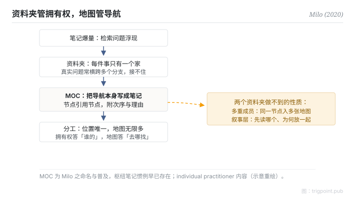

Canonical: https://trigpoint.pub/zh-Hans/collections/pkm/lyt-nick-milo  
Captured: 2026-10-05T03:32:17.592842+08:00

> 公开理论阅读镜像。验证层及 Lab 案例请到原站阅读。

「MOC 只是换个名的资料夹」：未必。

# LYT 与内容地图

LYT / Map of Content · Milo (2020)

已对照来源本身 ✓  
Lab 实测 ✓  
个人知识管理 · 导航

## 三句讲透

MOC（Map of Content，内容地图）是一则引用其他笔记的笔记：一个汇集、发展与导航的中枢，不是一个容器。  
它与资料夹的本质差异在归属：资料夹要求每件东西只有一个家；地图只是引用，同一节点可以同时出现在任意多张地图上。  
资料夹管拥有权，地图管导航，两者是分工不是替代。

<strong>图 1</strong> · MOC 机制流示意：笔记爆量后，资料夹的单一归属接不住跨域检索；MOC 以节点引用节点作导航中枢，资料夹管拥有权、地图管导航，同一节点可入多张地图。  
示意重绘。

## 一、发生什么事

Milo 2020 年 5 月发布首版 LYT Kit（笔记库模板，后更名 Ideaverse），在双向连结工具社群普及了 MOC 这个命名[\[1\]](#reference-note-1)。它回应的是笔记爆量后的检索问题：资料夹的树状结构要求单一归属，但真实问题常常横跨多个分支；标签太平，搜寻要先知道找什么。MOC 的答法是把导航本身写成笔记：一则节点引用一批相关节点，附上为什么相关、按什么次序读。地图是一等公民，可以有很多张，可以互相引用，过期了可以改，这些都是资料夹做不到的。

<strong>署名要给对：</strong>MOC 是 Milo 的推广与普及，不是全新发明：「一则笔记引用其他笔记」的枢纽惯例早已存在，第三方评述指其受 Matuschak 与 Luhmann 影响，本页没有他本人的第一手说法作依据。另须保留身位：这是 individual practitioner 内容，语料是 YouTube、模板与付费工作坊，无书、无论文；「MOC 不是资料夹」是概念转述，不是可页码锚定的逐字引句[\[1\]](#reference-note-1)。

## 二、为什么这对你重要

「换个名的资料夹」这个误读，错过了两个结构性质。一，多重成员：同一个节点按不同问题入不同地图，不需要复制，也不需要在两个资料夹之间二选一。二，叙事层：地图可以告诉你先读哪个、为什么这几个放在一起，资料夹的排序做不到这件事。实践上的分工判准：位置答「谁拥有这个节点」，永远唯一；地图答「解这类问题要看哪些节点」，可以无限多。两层混用，库一大就会塌。

## 参考文献

<strong>如何阅读来源注记</strong> 「书目经…核对」指作者、年份、题名与出版项已确认；不代表该来源的主张已被核对。「对照原站核实」指主张已与该项目的原始网站比对。 定义版本：2026-09-20。

- \[1\] Milo, N. Linking Your Thinking. https://www.linkingyourthinking.com/ 书目经多源交叉核对。LYT 名称与 MOC 之定义已对照原站核实。（首版 LYT Kit 2020-05，后更名 Ideaverse；individual practitioner 内容）.

引用格式：Trigpoint，〈LYT 与内容地图〉，trigpoint.pub/zh-Hans/collections/pkm/lyt-nick-milo · © Strategitect Limited. · 内容最后修订 2026-10-01

## 来源注记

**[1]** Milo, N. Linking Your Thinking. 书目经多源交叉核对。LYT 名称与 MOC 之定义已对照原站核实。（linkingyourthinking.com）。individual practitioner 内容（YouTube、模板、付费工作坊；无书、无论文）；首版 LYT Kit 2020 年 5 月经多源核对（后更名 Ideaverse）；「MOC 不是资料夹」为概念转述，确切首发片段未锚定。

---

[English](../../../en/collections/pkm/lyt-nick-milo.md) · [繁體中文](../../../zh-Hant/collections/pkm/lyt-nick-milo.md)

[Index](../../README.md) · [Original page](https://trigpoint.pub/zh-Hans/collections/pkm/lyt-nick-milo) · [Citation and versions](../../../READING.md)

[Original SVG](assets/lyt-nick-milo.svg) · Display copy adds a white background only.
