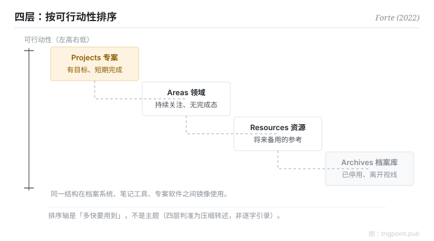

Canonical: https://trigpoint.pub/zh-Hans/collections/pkm/para-tiago-forte-2022  
Captured: 2026-10-05T03:32:17.676604+08:00

> 公开理论阅读镜像。验证层及 Lab 案例请到原站阅读。

「按主题分类就够」：接不了。

# PARA 组织法

PARA Method · Forte (2022)

书目已核 ✓  
Lab 实测 ✓  
个人知识管理 · 组织法

## 三句讲透

个人组织的第一个问题不是「这属于哪个主题」，而是「这什么时候要用」。  
PARA 把答案排成四层：Projects 带目标、Areas 需持续关注、Resources 备参考、Archives 已停用，按可行动性由高至低。  
同一结构跨所有工具镜像，分类为行动服务，不为收藏服务。

<strong>图 1</strong> · 四层按可行动性由高至低排列示意：Projects（带目标的短期工作）、Areas（需持续关注）、Resources（备参考）、Archives（已停用）。  
分类轴是「多快要用到」，不是主题。  
示意重绘，非原书图表。

## 一、发生什么事

Forte 在 2017 年的网上文章首次提出 PARA（月份未核），2022 年在《Building a Second Brain》一书中把它系统化[\[2\]](#reference-note-2)。他的诊断是：像图书馆员那样按主题归档，档案柜看起来整齐，但工作进行到一半时，它答不到你真正在问的问题：「跟眼前这件事有关的东西在哪」。他的口号是「organize by actionability」（按可行动性组织）[\[1\]](#reference-note-1)：Projects（带目标的短期工作）、Areas（需持续关注、没有完成态）、Resources（将来可能用到的参考）、Archives（已停用），四层按「多快要用到」排成一条斜坡。同一套结构在档案系统、笔记工具、专案软件之间镜像使用，搬工具不用重新发明分类[\[1\]](#reference-note-1)。

<strong>署名要给对：</strong>PARA 首发于 2017 年（月份未核），2022 年的书是系统化与普及的里程碑，不是首创年份；引用「2022」指书。通用缩写展开是复数 Archives：Forte 访谈口语与官网个别页面也用过单数，引用时建议采复数。「organize by actionability」是他的原话；常见的「不按情境组织」对照句在作者官页未见，较像是对 GTD 的转述对照；官页上的对照轴是「按主题」。引用时把原话与转述分开。

## 二、为什么这对你重要

检验一套组织系统，不是看它整齐与否，而是看任务进行到一半时，能否立刻取到相关材料。按主题分类在收藏时最舒服，在行动时最迟钝；按可行动性分类刚好相反。它还附带一条诚实的衰退路径：project 完结就落 Archives，没有人维持标准的 area 其实已经停用。主题式归档会让过期的东西体面地住在原位；可行动性一问，它们即刻现形。

一条边界要记住：PARA 管「放在哪」，不管「怎样连结」。它与网状笔记不是竞争关系，是分工：前者答「东西摆边」，后者答「概念点串」。

## 参考文献

<strong>如何阅读来源注记</strong> 「书目经…核对」指作者、年份、题名与出版项已确认；不代表该来源的主张已被核对。「对照原站核实」指主张已与该项目的原始网站比对。「依多源一致转述」指主张建立于多份彼此一致、转述该来源的资料，而非原文件本身。 定义版本：2026-09-20。

- \[1\] Forte, T. (2022). Building a Second Brain: A Proven Method to Organize Your Digital Life and Unlock Your Creative Potential. New York: Atria Books / Simon & Schuster. https://www.simonandschuster.com/books/Building-a-Second-Brain/Tiago-Forte/9781982167387
- \[2\] Forte Labs blog. The PARA Method: The Simple System for Organizing Your Digital Life in Seconds. https://fortelabs.com/blog/para/ 书目经官方记录核对。「organize by actionability」措辞与四层名称已对照原站核实。（2017 首发；2023 年重刊版本）.

引用格式：Trigpoint，〈PARA 组织法〉，trigpoint.pub/zh-Hans/collections/pkm/para-tiago-forte-2022 · © Strategitect Limited. · 内容最后修订 2026-10-01

## 来源注记

**[1]** Forte, T. (2022). Building a Second Brain: A Proven Method to Organize Your Digital Life and Unlock Your Creative Potential. Atria Books / Simon & Schuster. ISBN 9781982167387. 书目经多源交叉核对。「organize by actionability」口号措辞依多源一致转述。

**[2]** Forte Labs. 书目经官方记录核对。「organize by actionability」措辞与四层名称已对照原站核实。部落格（fortelabs.com/blog/para）。PARA 于 2017 年首发（月份未核）；现行线上版本为 2023 年重刊。经多源交叉核对。

---

[English](../../../en/collections/pkm/para-tiago-forte-2022.md) · [繁體中文](../../../zh-Hant/collections/pkm/para-tiago-forte-2022.md)

[Index](../../README.md) · [Original page](https://trigpoint.pub/zh-Hans/collections/pkm/para-tiago-forte-2022) · [Citation and versions](../../../READING.md)

[Original SVG](assets/para-tiago-forte-2022.svg) · Display copy adds a white background only.
