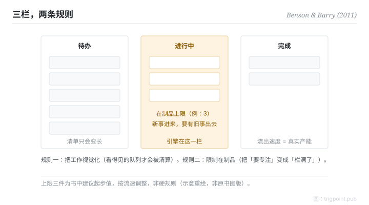

Canonical: https://trigpoint.pub/zh-Hans/collections/pkm/personal-kanban-benson-barry-2011  
Captured: 2026-10-05T03:32:18.260588+08:00

> 公开理论阅读镜像。验证层及 Lab 案例请到原站阅读。

「看板就是 to-do list」：是两回事。

# 个人看板

Personal Kanban · Benson & Barry (2011)

书目已核 ✓  
Lab 实测 ✓  
个人知识管理 · 工作流

## 三句讲透

个人看板只有两条规则：把工作视觉化，限制同时进行的数量。  
to-do list 答「有什么要做」；看板多答两个问题：「现在正做多少」和「卡在哪」。  
第二条规则才是引擎：在制品上限迫使你完成而不是开新，切换成本因此下降。

<strong>图 1</strong> · 三栏看板示意：待办、进行中（挂在制品上限）、完成。  
两条规则：把工作视觉化、限制同时进行的数量。  
书中建议个人自上限三件起步，属建议值非硬规则。  
示意重绘，非原书图版。

## 一、发生什么事

看板源自丰田产线：约 1953 年落地的信号机制，用实体卡控制在制品流量，是精实生产的核心构件之一[\[2\]](#reference-note-2)。Anderson 2010 年的专书把它系统化为软件开发的变革方法[\[3\]](#reference-note-3)；2011 年 Benson 与 Barry 再把它个人化：一块板、三栏（待办、进行中、完成）、两条规则：把工作视觉化、限制在制品[\[1\]](#reference-note-1)。书中建议个人从上限三件起步，再按自己的流速调整；这是建议值，不是硬规则。个人化版本的洞察在于：知识工作者的超载多数不是任务太多，是同时打开的任务太多，每一件都在收切换税。

<strong>署名要给对：</strong>看板不是 Benson 与 Barry 发明：机制约 1953 年落地于丰田产线（大野耐一）[\[2\]](#reference-note-2)，1990 年随精实生产进入学术正典，Anderson 2010 年的专书把它系统化为软件开发的变革方法[\[3\]](#reference-note-3)，2011 年两位作者再个人化[\[1\]](#reference-note-1)。这是一条应用梯度，不是发明链；引用时把层次分开。

## 二、为什么这对你重要

to-do list 与看板的分别，是「清单」与「流量控制」的分别。清单只会变长；看板的「进行中」栏有上限，新事想进来，就要有旧事出去。这个约束把一个模糊的品德问题（「要专注」）变成一个机械的结构问题（「栏满了」）。实践上最大的坑是把上限当装饰：栏里贴了八件事，上限写三，等于没有。上限要咬得住，通常需要一个会迫你表态的面，而不是靠每天自我提醒。

「把工作视觉化」也不只是贴卡好看：看得见的队列才会被清算，看不见的队列只会发酵。

## 参考文献

<strong>如何阅读来源注记</strong> 「书目经…核对」指作者、年份、题名与出版项已确认；不代表该来源的主张已被核对。「对照原站核实」指主张已与该项目的原始网站比对。 定义版本：2026-09-20。

- \[1\] Benson, J., & Barry, T. D. (2011). Personal Kanban: Mapping Work | Navigating Life. Seattle: Modus Cooperandi Press. https://moduscooperandi.com/modus-cooperandi/blog/personal-kanban-the-book
- \[2\] Ohno, T. (1988). Toyota Production System: Beyond Large-Scale Production. Cambridge, MA: Productivity Press. 2019 digital reprint: https://doi.org/10.4324/9780429273018
- \[3\] Anderson, D. J. (2010). Kanban: Successful Evolutionary Change for Your Technology Business. Blue Hole Press.
- \[4\] Womack, J. P., Jones, D. T., & Roos, D. (1990). The Machine That Changed the World. Rawson Associates.

引用格式：Trigpoint，〈个人看板〉，trigpoint.pub/zh-Hans/collections/pkm/personal-kanban-benson-barry-2011 · © Strategitect Limited. · 内容最后修订 2026-10-01

## 来源注记

**[1]** Benson, J., & Barry, T. D. (2011). Personal Kanban: Mapping Work | Navigating Life. Modus Cooperandi Press. ISBN 9781453802267. 书目经多源交叉核对。两条核心规则措辞已对照原站核实。坊间流传一个不对应的错误 ISBN。「上限三件起步」为书中建议值，非硬规则。

**[2]** Toyota Production System: Beyond Large-Scale Production. Productivity Press. 书目经双源核对。Ohno, T. (1978／英译 1988). 看板机制约 1953 年落地于丰田产线（广义丰田生产系统自约 1948 年发展）；日文原版逐字未验。

**[3]** Anderson, D. J. (2010). Kanban: Successful Evolutionary Change for Your Technology Business. Blue Hole Press. 书目经双源核对。看板由制造业移植至软件开发之桥。

---

[English](../../../en/collections/pkm/personal-kanban-benson-barry-2011.md) · [繁體中文](../../../zh-Hant/collections/pkm/personal-kanban-benson-barry-2011.md)

[Index](../../README.md) · [Original page](https://trigpoint.pub/zh-Hans/collections/pkm/personal-kanban-benson-barry-2011) · [Citation and versions](../../../READING.md)

[Original SVG](assets/personal-kanban-benson-barry-2011.svg) · Display copy adds a white background only.
