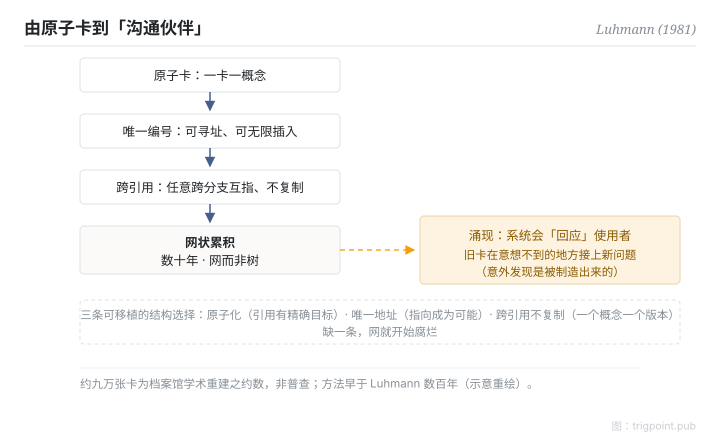

Canonical: https://trigpoint.pub/zh-Hans/collections/pkm/zettelkasten-luhmann-1981  
Captured: 2026-10-05T03:32:18.446748+08:00

> 公开理论阅读镜像。验证层及 Lab 案例请到原站阅读。

「卡片盒是 Luhmann 发明的」：未必。

# 卡片盒笔记法

Zettelkasten · Luhmann (1981)

书目已核 ✓  
Lab 实测 ✓  
个人知识管理 · 笔记法

## 三句讲透

卡片盒是一套网状累积的笔记系统：每张卡只载一个概念、有唯一编号，卡与卡用引用互指，几十年累积成一张知识网。  
社会学家 Luhmann 以约九万张卡实践终身，并在 1981 年自述这套系统是他的「沟通伙伴」：它会用你忘记的旧卡回应你，不只是储存。  
方法本身早于他数百年，他是最著名的实践者与理论化者。

<strong>图 1</strong> · 卡片盒机制流示意：原子卡、唯一编号、跨引用累积成网，到「沟通伙伴」的涌现层。  
约九万张卡为档案馆学术重建之约数，非普查。  
示意重绘。

## 一、发生什么事

Luhmann 从 1950 年代起累积实体卡片：每张卡原子化载一个概念，配唯一的位置编号，编号在数字与字母间交替分支，可以在任意两张卡之间无限插入新卡。卡上手写其他卡的编号作交叉引用，不受树状分类限制，任意跨分支互指。累积数十年后，这堆卡不再是档案柜：1981 年他在一篇经验报告里形容它是可以对话的「第二记忆」，双方要能互相给对方惊喜[\[1\]](#reference-note-1)。约九万张卡的规模，出自档案馆后来的学术重建[\[2\]](#reference-note-2)。重建研究给这个涌现性质起了个准确的名字：意外发现是被「制造」出来的，网的密度到了，旧卡就会在你意想不到的地方接上新问题。

<strong>署名要给对：</strong>卡片索引法自近代早期（十六世纪以降）即有，Luhmann 是它最著名的实践者与理论化者：1981 年那篇经验报告把「系统会回应使用者」这层讲清楚了。约九万张卡是 Schmidt 2018 年学术重建的约数，勿当精确统计引用[\[2\]](#reference-note-2)。英语世界流行的做法多出自 Ahrens 2017 年的普及书，它把做法整理成可操作的流程；其步骤与 Luhmann 本人做法的差异，本页未核；两者要分开引用[\[3\]](#reference-note-3)。

## 二、为什么这对你重要

卡片盒的可移植教训不是「用卡片」，是三条结构选择：原子化（一卡一概念，令引用有精确目标）、唯一地址（令「指向」可能）、跨引用不复制（令同一概念只有一个版本）。这三条在数位工具里对应原子笔记、稳定连结与嵌入引用；缺一条，网就开始腐烂：概念糊在长文里引用不了，或同一事实复制出多个互相漂移的版本。

它也有设计领域：这是跨时累积的长期系统，不是单次输入的消化工具。想清楚你在建哪一种，再决定学它哪一部分。

## 参考文献

<strong>如何阅读来源注记</strong> 「书目经…核对」指作者、年份、题名与出版项已确认；不代表该来源的主张已被核对。「对照全文核实」指主张已与来源文本本身比对。 定义版本：2026-09-20。

- \[1\] Luhmann, N. (1981). Kommunikation mit Zettelkästen. In Öffentliche Meinung und sozialer Wandel. Opladen: Westdeutscher Verlag, 222–228. https://doi.org/10.1007/978-3-322-87749-9_19
- \[2\] Schmidt, J. F. K. (2018). Niklas Luhmann's Card Index: The Fabrication of Serendipity. Sociologica, 12(1), 53–60. https://doi.org/10.6092/issn.1971-8853/8350
- \[3\] Ahrens, S. (2017). How to Take Smart Notes.

## 知识图谱

- [<em>对照 ▸</em>超文本与跨包含 Hypertext & Transclusion（Ted Nelson 1965）](hypertext-transclusion-nelson-1965.md)

引用格式：Trigpoint，〈卡片盒笔记法〉，trigpoint.pub/zh-Hans/collections/pkm/zettelkasten-luhmann-1981 · © Strategitect Limited. · 内容最后修订 2026-10-01

## 来源注记

**[1]** Luhmann, N. (1981). Kommunikation mit Zettelkästen. Ein Erfahrungsbericht. In Baier, Kepplinger & Reumann (Hrsg.), Öffentliche Meinung und sozialer Wandel. Opladen: Westdeutscher Verlag, 222–228. 书目经多源交叉核对。原始 1981 出处（常见误标为 1992 年重刊本《Universität als Milieu》）；「沟通伙伴」语经英译本核对，德文原文未逐字核对。

**[2]** Schmidt, J. F. K. (2018). Niklas Luhmann's Card Index: The Fabrication of Serendipity. Sociologica, 12(1), 53–60. DOI 10.6092/issn.1971-8853/8350. 书目经出版社记录核对。主张已对照全文核实。约九万张卡之计数出处（Bielefeld 档案馆学术重建；约数非普查）。

**[3]** Ahrens, S. (2017). How to Take Smart Notes. 书目经多源交叉核对。英语圈普及本；系统化为可操作流程，非 Luhmann 原始实践本身。

---

[English](../../../en/collections/pkm/zettelkasten-luhmann-1981.md) · [繁體中文](../../../zh-Hant/collections/pkm/zettelkasten-luhmann-1981.md)

[Index](../../README.md) · [Original page](https://trigpoint.pub/zh-Hans/collections/pkm/zettelkasten-luhmann-1981) · [Citation and versions](../../../READING.md)

[Original SVG](assets/zettelkasten-luhmann-1981.svg) · Display copy adds a white background only.
