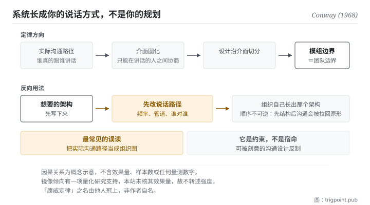

Canonical: https://trigpoint.pub/zh-Hans/collections/software-systems-architecture/conways-law-conway-1968  
Captured: 2026-11-02T21:27:39.888509+08:00

> 公开理论阅读镜像。验证层及 Lab 案例请到原站阅读。

组织图上的线，和每天实际说话的路径，是两张不同的图。

# 康威定律

Conway's Law · Conway (1968)

摘要已核 ✓  
Lab 实测 ✓  
软体架构 · 组织与结构  
先读：模组化与薄切面

## 三句讲透

设计系统的组织，会产出镜像自身沟通结构的设计。  
这里的沟通结构指实际的说话路径，不是组织图。  
它是约束不是宿命，所以最有价值的用法是反过来：先改说话路径。

<strong>图 1</strong> · 上排是定律本身的方向：组织的实际沟通路径固化成介面，设计沿介面切分，于是模组边界长成团队边界。  
下排是它的反向用法：先改沟通结构，让组织自己长出想要的架构。  
左下角标出最常见的误读，把实际沟通路径当成组织图。

## 一、发生什么事

这条定律里的沟通结构，指谁实际跟谁说话，组织图上的连线是另一张图。1968 年那篇论文的命题只有一句：设计系统的组织，被<strong>约束</strong>成产出的设计是这些组织之沟通结构的副本[\[1\]](#reference-note-1)。

机制不神秘。分工一旦定下来，就形成了固定的沟通界面：谁跟谁每天讲话、谁跟谁一季讲一次、谁跟谁从来不讲。而模组之间的介面<strong>只能在能沟通的人之间协商出来</strong>。两个每天讲话的人会协商出细致、可以随时调整的介面；两个不讲话的人之间只会出现一个粗糙、写死、双方都不敢动的介面。系统的边界因此长成团队的边界。

这条命题后来被实证检验过：一项 2012 年的研究发现，松耦合组织产出的产品显著更模组化[\[4\]](#reference-note-4)。所以它不只是一个好用的隐喻，有量化支持（本站只核到该研究的摘要，未核全文）。

而它最有价值的用法是<strong>反过来</strong>。既然架构会镜像沟通结构，那么想要某种架构，就先去建那种沟通结构：让组织自己长出你要的形状，而不是硬推一个与组织错位的设计。这个反向用法在实务上被称为反向操作，是这条定律从「观察」变成「工具」的关键。

归属有一处必须说清楚：<strong>这个名字不是作者取的</strong>。来源有两种记载：一说 1968 年 7 月一场模组化程式设计研讨会上已有人这样称它；作者本人网站则记为一本广为流传的软体工程书（初版 1975 年）引用他的论文时如此称呼[\[2\]](#reference-note-2)。作者提出的是命题与论文。期号本站标 14(4)，与多数书目记录一致；另有来源标 14(5)[\[3\]](#reference-note-3)。

<strong>署名要给对：</strong>命题与论文归 Conway（1968，该期刊 14(4)）[\[1\]](#reference-note-1)；<strong>「康威定律」这个名字归他人</strong>（一说 1968 年研讨会上已有人如此称呼，一说一本广为流传的书（初版 1975 年）引用时所称）[\[2\]](#reference-note-2)；镜像假说之实证检验归 2012 年那篇研究政策论文的三位作者[\[4\]](#reference-note-4)。三段要分开署名：把名字归给作者本人是最常见的一条错，本站在此页明文更正。

## 二、为什么这对你重要

这页对你最直接的一句话是：<strong>你的工作系统会长成你的说话方式，而不是长成你的规划。</strong>

具体一点。你跟模型的协作方式决定了你会做出什么工具。如果你的习惯是每次开一个新对话、把背景重贴一次，你会做出一批「提示词模板」。如果你的习惯是让同一个脉络持续累积，你会做出「状态档案」。这两种产物不是品味差异，是沟通方式的镜像。

同一件事在跟人协作时更明显。你跟某位协作者每天讲话，你们之间的介面会是模糊而灵活的（「你看着办」）；跟一位一个月讲一次的，介面会变成一份写死的规格。<strong>两种介面都是沟通频率的产物，不是设计决定的产物。</strong> 而当你抱怨那份规格太僵硬时，真正该改的可能是讲话的频率。

所以这页给的实务是两问加一个顺序。

第一问：<strong>我现在的工作结构，是我设计的，还是我说话方式的副本。</strong> 多数时候是后者，而且后者长得比前者快。

第二问：<strong>我想要的那个结构，需要什么样的说话路径才长得出来。</strong> 如果答案是「需要每天对话」而你实际上一周对一次，那个结构不会出现，硬推也不会。

顺序：<strong>先动沟通，后等结构。</strong> 反过来做（先改结构、期待沟通跟上）几乎总是被组织惯性拉回原形，这是定律的另一半在说话。

## 常见误读

所属页核验：摘要已核 ✓ · 内容最后修订 2026-10-25

- 常见转述「康威自己把它命名为康威定律」：名字由他人冠上。一说 1968 年一场研讨会上已有人如此称呼，一说（作者本人网站之记载）是一本广为流传的软体工程书（初版 1975 年）引用该文时所称。作者提出的是命题与论文，不是这个名字。
- 常见转述「架构会镜像组织图」：定律讲的是<strong>实际的沟通路径</strong>（谁真的跟谁讲话），这常常与正式的阶层图不符。拿组织图去套架构会误判。
- 常见转述「这是铁律，所以改架构没用」：它是约束，不是宿命。可以透过刻意的沟通结构设计去反向利用，这正是它最有价值的用法。

## 修正记录

- 期号本站标 14(4)，与多数书目记录一致；另有来源标 14(5)。

## 参考文献

<strong>如何阅读来源注记</strong> 「书目经…核对」指作者、年份、题名与出版项已确认；不代表该来源的主张已被核对。「与摘要一致」指主张与论文摘要相符；不含逐句对照全文。「对照全文核实」指主张已与来源文本本身比对。 定义版本：2026-09-20。

- \[1\] Conway, M. E. (1968). How Do Committees Invent? Datamation, 14(4), 28–31.
- \[2\] Brooks, F. P. (1975). The Mythical Man-Month: Essays on Software Engineering. Addison-Wesley.
- \[3\] Conway, M. E. (1968). How Do Committees Invent? Datamation, 14(4), 28–31.
- \[4\] MacCormack, A., Baldwin, C., & Rusnak, J. (2012). Exploring the duality between product and organizational architectures: A test of the “mirroring” hypothesis. Research Policy, 41(8), 1309–1324.

## 知识图谱

- [<em>应用于 ▸</em>微服务（Microservices）](microservices-lewis-fowler-2014.md)
- [<em>下游 ▸</em>模组化与薄切面（Modularity & Thin Crossing Points）](modularity-baldwin-clark-2000.md)
- [<em>下游 ▸</em>团队拓扑（Team Topologies）](team-topologies-skelton-pais-2019.md)
- [<em>下游 ▸</em>资料网格（Data Mesh）](data-mesh-dehghani-2022.md)

引用格式：Trigpoint，〈康威定律〉，trigpoint.pub/zh-Hans/collections/software-systems-architecture/conways-law-conway-1968 · © Strategitect Limited. · 内容最后修订 2026-10-25

## 来源注记

**[1]** Conway, M. E. (1968). How Do Committees Invent? Datamation, 14(4), 28–31. 书目经双源核对。主张已对照全文核实。刊于该刊 1968 年 4 月号。命题那句已对照全文逐字确认，中译：设计系统（取本文所用的广义）的组织，被约束成产出的设计是这些组织之沟通结构的副本。

**[2]** 命名归属：这个名字不是作者自取，现有两种记载。IEEE 电脑学会的先驱人物史料记为 1968 年 7 月一场模组化程式设计研讨会上由 George Mealy 命名；作者本人网站则记为 Brooks 在《人月神话》引用该文时称之为康威定律。本站并列两说，不代为裁定。

**[3]** 期号：多数书目记录标 14(4)，本站从之；该刊 1968 年第 14 卷共 12 期。另有来源标 14(5)。

**[4]** MacCormack, A., Baldwin, C., & Rusnak, J. (2012). Exploring the duality between product and organizational architectures: A test of the “mirroring” hypothesis. Research Policy, 41(8), 1309–1324. 书目经官方记录核对。要旨与摘要一致。镜像假说之实证检验。摘要所述：以配对产品比较，每一对中松耦合组织开发的产品都显著更模组化。本站核到同题工作论文版之摘要，未核期刊全文。

---

[English](../../../en/collections/software-systems-architecture/conways-law-conway-1968.md) · [繁體中文](../../../zh-Hant/collections/software-systems-architecture/conways-law-conway-1968.md)

[Index](../../README.md) · [Original page](https://trigpoint.pub/zh-Hans/collections/software-systems-architecture/conways-law-conway-1968) · [Citation and versions](../../../READING.md)

[Original SVG](assets/conways-law-conway-1968.svg) · Display copy adds a white background only.
