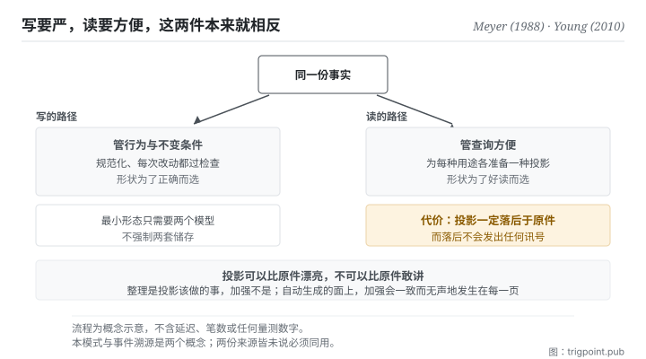

Canonical: https://trigpoint.pub/zh-Hans/collections/software-systems-architecture/cqrs-young-2010  
Captured: 2026-11-02T21:27:40.157873+08:00

> 公开理论阅读镜像。验证层及 Lab 案例请到原站阅读。

读与写要共用一个模型，还是沿两者的边界切成两个？

# 命令查询职责分离

Command Query Responsibility Segregation (CQRS) · Young (2010) / Meyer CQS (1988)

书目已核 ✓  
Lab 实测 ✓  
软体架构 · 读写分离  
先读：事件溯源

## 三句讲透

更新资讯用的模型，不必等于读取资讯用的模型。  
两边的需求本来就相反：写要严，读要方便。  
分开之后多出一个东西要顾，就是那份会落后于原件的投影。

<strong>图 1</strong> · 同一份事实往两边走：左边是写的路径，管行为与不变条件；右边是读的路径，管查询方便。  
两边各自可以有自己的形状。  
底部标出一条纪律：投影可以比原件漂亮，不可以比原件敢讲。

## 一、发生什么事

读与写该共用一份模型，还是各用一份，是一个要逐块判断的取舍。一份模型同时服务读与写时，它得同时满足两组互相拉扯的要求。写的那一边要严：资料要规范化、不变条件要守得住、每次改动都得通过检查。读的那一边要方便：常常需要跨好几处拼起来的视图、需要为不同用途各准备一种形状、需要快。

模型被两边同时拉的结果是扭曲：为了读方便而放宽结构，或为了写严谨而让每个查询都要绕远路。这个模式的主张很单纯：<strong>沿读与写的边界，把一个模型切成两个</strong>[\[2\]](#reference-note-2)。写的那一边专注行为与一致性，读的那一边专注查询优化的投影。

它的祖系是 1988 年那本原典里的「命令与查询分离」：一个方法要嘛改状态而不回值，要嘛回值而无副作用[\[1\]](#reference-note-1)。那条规矩管的是方法层，这个模式把同一个切法<strong>升到模型层</strong>。命令与查询这组词汇也来自那本原典：而 2011 年那篇文章（本站标为把模式带进主流架构讨论的一篇）其实没有提到那位原典作者[\[3\]](#reference-note-3)，本站因此直接锚到原典，不从二手回推。

归属还有两处要说。2010 年 11 月那份作者自行发布的文件把这个模式系统化整理[\[2\]](#reference-note-2)，但它不是起点：2008 年已有另一位实务者的文章在架构层把命令与查询分给两个服务，同一位作者 2009 年 12 月的文章已通篇使用这个缩写[\[4\]](#reference-note-4)，本站因此把 2010 年那份文件的作者标为<strong>结晶化者，不标为孤立首创</strong>。至于他第一次公开讲这套想法是哪一年，本页未能从当事人原话核定，因此不写年份[\[5\]](#reference-note-5)。

最后一件事，那篇 2011 年的文章特别强调：这个模式应该<strong>局部施用</strong>在确实被读写冲突扭曲的那一块，不是整个系统统一架构[\[3\]](#reference-note-3)。

<strong>署名要给对：</strong>命令与查询分离之原典与该组词汇归 Meyer（1988）[\[1\]](#reference-note-1)；本模式之系统化整理，本站归 Young（2010 年 11 月那份文件）[\[2\]](#reference-note-2)，惟架构层的读写分离与这个缩写在此之前已见于 Dahan 2008 与 2009 年的文章，故本站标 Young 为结晶化者，非孤立首创[\[4\]](#reference-note-4)；主张局部施用归 Fowler（2011 年 7 月 14 日），本站并把该文标为把模式带入主流架构论述的一篇[\[3\]](#reference-note-3)。首讲年份未能从当事人原话核定，本页不写[\[5\]](#reference-note-5)。四段要分开署名：把整条线压成「某某在 2010 年提出」会一次弄错词汇来源与先行者。

## 二、为什么这对你重要

你已经在用这个模式了，只是没有把它的纪律一起带进来。

任何「派生出来给人看的东西」都是读模型：一份月报、一张看板、一页对外说明、一段喂给模型的摘要。它们的原件在别处。你之所以做它们，正是因为原件的形状不适合那个用途：这就是分离的理由，而且理由是对的。

分离带来的成本只有一项，但它是结构性的：<strong>投影一定会落后于原件。</strong> 落后多少取决于你多久重新生成一次，而落后这件事本身<strong>不会发出任何讯号</strong>。一份三周前生成的看板，看起来跟今天生成的一模一样。

所以这页给的实务是三条，第三条最少人做。

<strong>第一，决定要不要分之前先问：读的人跟写的人是同一群吗。</strong> 如果是同一个人（例如你自己的决策记录），分离大概只是多一份要维护的东西。如果不是（对外页面、交给协作者的说明、喂给模型的脉络），分离几乎总是对的。

<strong>第二，投影一律标生成时间。</strong> 这是承认落后，而不是假装同步。

<strong>第三，也是本页真正要留下的一句：投影可以比原件漂亮，不可以比原件敢讲。</strong> 派生的过程很容易加料：把一个模糊的等级换成一句明确的措辞、把一段有保留的叙述整理成一句干净的结论。整理是投影该做的事，加强不是。而这种加强在自动生成的面上特别危险，因为它会<strong>一致地、无声地</strong>发生在每一页上。

## 常见误读

所属页核验：书目已核 ✓ · 内容最后修订 2026-10-25

- 常见转述「这个模式就是事件溯源的一部分」：两者是两个概念，命令查询职责分离可以配一般的资料存取方式，不必先改成事件溯源。两份原始来源都把两者分开介绍：2010 年那份文件说两者结合时最有意思、彼此相辅，2011 年那篇说它与事件式的程式模型很相配；两份都没有说必须同用。
- 常见转述「分离就要用两个资料库、接受最终一致」：最小形态只需要两个模型，不强制两套储存。把分库的最终一致性当成必选，是把可选的放大当成定义。
- 常见转述「这是那位实务者 2010 年发明的」：本站把 2010 年 11 月那份文件标为系统化整理，不是起点。架构层的读写分离 2008 年已有文章写过，这个缩写 2009 年 12 月已在公开文章中通篇使用；命令与查询这组词汇则来自 1988 年那本原典。发明、定名与词汇来源要分开记。

## 修正记录

- 首讲年份：先前版本并列的两处当事人自述（2006 与 2007 年）未能从原话核对，已改为不写年份。

## 参考文献

<strong>如何阅读来源注记</strong> 「书目经…核对」指作者、年份、题名与出版项已确认；不代表该来源的主张已被核对。「对照全文核实」指主张已与来源文本本身比对。「依多源一致转述」指主张建立于多份彼此一致、转述该来源的资料，而非原文件本身。 定义版本：2026-09-20。

- \[1\] Meyer, B. (1988). Object-Oriented Software Construction. Prentice Hall. ISBN 0-13-629049-3.
- \[2\] Young, G. (2010). CQRS Documents. cqrs.files.wordpress.com/2010/11/cqrs_documents.pdf.
- \[3\] Fowler, M. (2011). CQRS. martinfowler.com/bliki/CQRS.html. Published 14 July 2011.
- \[4\] Dahan, U. (2008). Command Query Separation and SOA. udidahan.com/2008/08/11/command-query-separation-and-soa/; Dahan, U. (2009). Clarified CQRS. udidahan.com/2009/12/09/clarified-cqrs/.
- \[5\] 编辑注，无外部来源；全文见正文注 \[5\]。

## 知识图谱

- [<em>对照 ▸</em>事件溯源（Event Sourcing）](event-sourcing-fowler-2005.md)

引用格式：Trigpoint，〈命令查询职责分离〉，trigpoint.pub/zh-Hans/collections/software-systems-architecture/cqrs-young-2010 · © Strategitect Limited. · 内容最后修订 2026-10-25

## 来源注记

**[1]** Meyer, B. (1988). Object-Oriented Software Construction (1st ed.). Prentice Hall. 书目经双源核对。命令与查询分离及其用词之归属依多源一致转述。命令与查询分离之原典：一个方法要嘛改状态而不回值，要嘛回值而无副作用；命令与查询这组词汇的来源。书内章节本页未逐字核对。

**[2]** Young, G. (2010-11). CQRS Documents (PDF). 书目经官方记录核对。主张已对照全文核实。作者自行发布、把这个模式系统化整理的实务文件。文中自述：它起初只被当成在更高层次套用命令查询分离，经过一段混淆之后才被认定为另一个模式。

**[3]** Fowler, M. (2011-07-14). CQRS. martinfowler.com/bliki/CQRS.html. 书目经官方记录核对。主张已对照全文核实。原句说这个模式是作者最先从 Young 口中听到的描述；同文主张它只应施用在系统的特定部分，而非整个系统。

**[4]** Dahan, U. (2008, August 11). Command Query Separation and SOA. udidahan.com; Dahan, U. (2009, December 9). Clarified CQRS. udidahan.com. 书目经官方记录核对。主张已对照全文核实。两篇皆早于 2010 年 11 月那份文件：2008 年那篇已在架构层把命令与查询分给两个服务、各用自己的资料存放，但仍称命令查询分离；2009 年那篇通篇使用这个缩写。

**[5]** 首讲年份：本页未能从当事人原话核定他第一次公开讲述这套想法的年份，故不写年份。

---

[English](../../../en/collections/software-systems-architecture/cqrs-young-2010.md) · [繁體中文](../../../zh-Hant/collections/software-systems-architecture/cqrs-young-2010.md)

[Index](../../README.md) · [Original page](https://trigpoint.pub/zh-Hans/collections/software-systems-architecture/cqrs-young-2010) · [Citation and versions](../../../READING.md)

[Original SVG](assets/cqrs-young-2010.svg) · Display copy adds a white background only.
