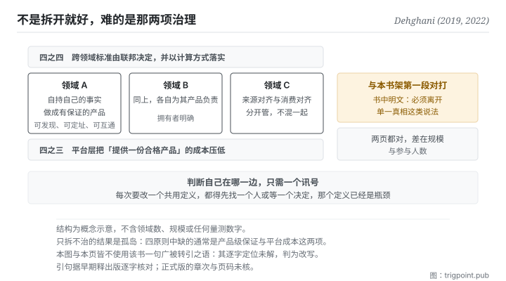

Canonical: https://trigpoint.pub/zh-Hans/collections/software-systems-architecture/data-mesh-dehghani-2022  
Captured: 2026-11-02T21:27:40.419028+08:00

> 公开理论阅读镜像。验证层及 Lab 案例请到原站阅读。

资料该由中央团队统一管，还是交给各领域自己持有？

# 资料网格

Data Mesh · Dehghani (2019, 2022)

书目已核 ✓  
软体架构 · 联邦式治理  
先读：单一真相来源  
先读：CAP 定理

## 三句讲透

规模上来之后，维持一个全域统一的正典模型会让那个模型变成瓶颈。  
资料网格的处置是把事实留在各领域自己手上，并要求它做成有品质保证的产品。  
跨领域的互通标准由联邦决定，不由中央指定。

<strong>图 1</strong> · 四个原则的关系：领域各自持有自己的事实并把它做成有品质保证的产品，平台层把提供产品的成本压低，跨领域的互通标准由联邦决定而非中央指定。  
右侧标出本页与本书架第一段的对打点：这里明文把单一真相列为要离开的说法之一。

## 一、发生什么事

资料该由一个中央团队统一管理，还是留在产生它的各领域手上，是企业规模下的一个取舍。这一页是本书架唯一<strong>明文反对第一段</strong>的节点，而它反对的方式值得看清楚。

它的诊断从一个运维现象开始：中央资料团队成为瓶颈，而整合式的大水池在企业规模下整合复杂度爆炸。原因不是技术不够好，是<strong>结构</strong>：每个新需求都要经过同一批人、同一个模型。

它的处置是四件事[\[2\]](#reference-note-2)。第一，<strong>领域自己持有自己的资料</strong>。第二，<strong>资料要做成产品</strong>：可被发现、可被定址、可与他人互通，也就是要有品质保证，不是把档案丢出去就算。第三，<strong>平台层要把「提供一份产品」的成本压低</strong>，否则自治只是把负担转嫁给领域。第四，<strong>跨领域的标准由联邦决定并以计算方式落实</strong>，不由中央指定。

而它最直接的一句话是：资料网格必须离开诸如<strong>单一真相来源</strong>、或单一受严格控制的正典模型这类说法[\[2\]](#reference-note-2)。这句曾对照该书早期释出版逐字确认，不是后人归纳。

它还做了一个很有用的区分[\[1\]](#reference-note-1)：来源对齐的资料集（各领域自己产生的、不可变的带时间事实）与消费对齐的资料集（为了下游用途而转换、加工出来的视图）。这两者不该混在一起管：前者是事实，后者是派生物。<strong>这个区分其实就是本书架段二那两页的放大版</strong>：事实在一处，派生物可以有很多个。

归属与谱系这一页很干净：概念与命名同一人，2019 年一篇文章、2022 年一本书[\[1\]](#reference-note-1)[\[2\]](#reference-note-2)；本站在本书架内为它标出的祖系有三页（组织沟通结构的约束、领域驱动设计、团队拓扑），只是举例[\[5\]](#reference-note-5)；学界已有一篇系统性回顾，但它整理的是业界灰色文献，并指出学界对这个概念的界定仍然缺乏[\[4\]](#reference-note-4)。

<strong>署名要给对：</strong>概念与命名皆归 Dehghani（2019 年那篇文章、2022 年那本书）[\[1\]](#reference-note-1)[\[2\]](#reference-note-2)，原创与造词为同一人。祖系，本站举本书架已有之三页为例：组织沟通结构之约束（1968）、领域驱动设计（2003）、团队拓扑（2019）[\[5\]](#reference-note-5)。学术层之系统性回顾归 2024 年那篇综述期刊论文之作者群[\[4\]](#reference-note-4)。<strong>一句被广泛转引的话本页不使用</strong>：其逐字定位未解，判为改写[\[3\]](#reference-note-3)。

## 二、为什么这对你重要

这页是本书架给你的<strong>尺度感</strong>，而尺度感通常比原则本身更难得。

段一那页说：每个元素只在一处被维护，他处引用。那条在你自己的知识库里几乎总是对的。这页说：当领域数量与变更速度超过某个点，维持一个全域统一的正典模型会让那个模型变成瓶颈。两页都对，差别在规模与参与人数。

判断自己在哪一边，有一个很实际的讯号：<strong>如果每次要改一个共用的定义，都得先找一个人（或等一个决定），那个共用定义已经是瓶颈了。</strong> 一个人的系统没有这个问题（那个人就是你）；两三个人的系统开始有；十个人的系统一定有。

而这页真正该带走的是那四个原则中最容易被跳过的两个。

<strong>「做成产品」这一项比自治重要。</strong> 把事实留在各领域手上很容易，难的是要求每一份都可被发现、有明确的拥有者、有品质承诺。少了这一项，去中心化就退化成一堆各自为政的孤岛：你把瓶颈换成了迷路。

<strong>「平台把成本压低」这一项决定成败。</strong> 如果提供一份合格产品的成本很高，各领域就会敷衍它，或干脆绕过去。这一项在个人层面的对应物是：如果你的归档规矩太麻烦，你就不会照做，然后你会怪自己不够自律，而真正该修的是成本。

## 常见误读

所属页核验：书目已核 ✓ · 内容最后修订 2026-10-25

- 常见转述「资料网格就是把资料湖拆成几个小湖」：四个原则里有两个与拆分无关（产品级品质保证、联邦式治理）。只拆不治，得到的是几个各自为政的孤岛。
- 常见转述「联邦式治理就是没有治理」：它指的是跨领域的互通标准由参与者共同决定并以计算方式落实，不是取消标准。这与中央指定的差别在谁决定，不在有没有。

## 修正记录

- 本页不使用某句被广泛转引的话：深度覆核未能在所查版本中逐字定位它，最接近者是一个小节标题，因此该句被判为改写而非引文，状态未解。本站不引用状态未解的句子。

## 参考文献

<strong>如何阅读来源注记</strong> 「书目经…核对」指作者、年份、题名与出版项已确认；不代表该来源的主张已被核对。「与摘要一致」指主张与论文摘要相符；不含逐句对照全文。「对照全文核实」指主张已与来源文本本身比对。 定义版本：2026-09-20。

- \[1\] Dehghani, Z. (2019). How to Move Beyond a Monolithic Data Lake to a Distributed Data Mesh. martinfowler.com/articles/data-monolith-to-mesh.html. Published 20 May 2019.
- \[2\] Dehghani, Z. (2022). Data Mesh: Delivering Data-Driven Value at Scale. O'Reilly. ISBN 978-1-492-09239-1.
- \[3\] 编辑注，无外部来源；全文见正文注 \[3\]。
- \[4\] Goedegebuure, A., Kumara, I., Driessen, S., Van Den Heuvel, W.-J., Monsieur, G., Tamburri, D. A., & Di Nucci, D. (2024). Data Mesh: A Systematic Gray Literature Review. ACM Computing Surveys, 57(1), Article 11, 1–36.
- \[5\] 编辑注，无外部来源；全文见正文注 \[5\]。

## 知识图谱

- [<em>前置 ▸</em>领域驱动设计（Domain-Driven Design (DDD)）](domain-driven-design-evans-2003.md)
- [<em>前置 ▸</em>康威定律（Conway's Law）](conways-law-conway-1968.md)
- [<em>对照 ▸</em>单一真相来源（Single Source of Truth (concept history)）](single-source-of-truth-concept-history.md)
- [<em>对照 ▸</em>事件溯源（Event Sourcing）](event-sourcing-fowler-2005.md)

引用格式：Trigpoint，〈资料网格〉，trigpoint.pub/zh-Hans/collections/software-systems-architecture/data-mesh-dehghani-2022 · © Strategitect Limited. · 内容最后修订 2026-10-25

## 来源注记

**[1]** Dehghani, Z. (2019-05-20). How to Move Beyond a Monolithic Data Lake to a Distributed Data Mesh. martinfowler.com. 书目经出版社记录核对。主张已对照全文核实。出处经跨模型双查核实。原文逐字确认：来源对齐的领域资料集必须与内部作业系统的资料集分开，前者体量更大、代表不可变的带时间事实、且变动频率低于其来源系统。

**[2]** Dehghani, Z. (2022). Data Mesh: Delivering Data-Driven Value at Scale. O'Reilly. 书目经双源核对。出处经跨模型双查核实。此句曾对照早期释出版逐字确认：资料网格必须离开诸如单一真相来源、或单一受严格控制的正典模型这类资料神话。早期释出版把这段放在题为〈After the Inflection Point〉的一章；正式版目录中此题为第 7 章，第 2 章另有一节题为〈Embrace the Most Relevant Domain Data: Don’t Expect a Single Source of Truth〉。正式版的章次与页码本站未核。

**[3]** 深度覆核之残留一件：另一句被广泛转引的话未能在所查版本中逐字定位，最接近者为早期释出版的一个小节标题。判为改写而非引文，状态未解。本页因此完全不使用该句。

**[4]** Goedegebuure, A., Kumara, I., Driessen, S., Van Den Heuvel, W.-J., Monsieur, G., Tamburri, D. A., & Di Nucci, D. (2024). Data Mesh: A Systematic Gray Literature Review. ACM Computing Surveys, 57(1), Article 11, 1–36. DOI 10.1145/3687301. 书目经官方记录核对。要旨与摘要一致。2024 年一篇计算机领域综述期刊的系统性灰色文献回顾：整理 114 篇业界文章，归纳出四个原则。摘要指出，业界的灰色文献已相当多，学界对这个概念的界定与延伸则仍然缺乏。

**[5]** 本站整理之知识祖系（举例，非全部）：组织沟通结构之约束（1968）→ 领域驱动设计（2003）→ 团队拓扑（2019）→ 本概念（2019、2022）。四段皆为本书架已有之节点。

---

[English](../../../en/collections/software-systems-architecture/data-mesh-dehghani-2022.md) · [繁體中文](../../../zh-Hant/collections/software-systems-architecture/data-mesh-dehghani-2022.md)

[Index](../../README.md) · [Original page](https://trigpoint.pub/zh-Hans/collections/software-systems-architecture/data-mesh-dehghani-2022) · [Citation and versions](../../../READING.md)

[Original SVG](assets/data-mesh-dehghani-2022.svg) · Display copy adds a white background only.
