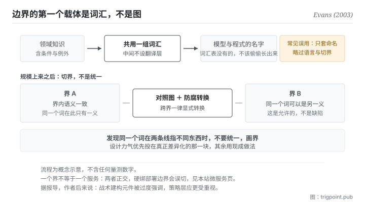

Canonical: https://trigpoint.pub/zh-Hans/collections/software-systems-architecture/domain-driven-design-evans-2003  
Captured: 2026-11-02T21:27:40.742337+08:00

> 公开理论阅读镜像。验证层及 Lab 案例请到原站阅读。

先画架构图，还是先让专家与开发者用同一组词？

# 领域驱动设计

Domain-Driven Design (DDD) · Evans (2003)

书目已核 ✓  
软体架构 · 语言与边界  
先读：模组化与薄切面

## 三句讲透

复杂度的主战场在领域本身，不在技术层。  
处理它的第一个动作不是画架构图，是把词汇统一：领域专家与开发者共用一组词，那组词直接成为系统里的名字。  
规模上来之后再切界，界内语义一致，跨界靠显式转换。

<strong>图 1</strong> · 上排是知识怎么进到系统里：领域专家与开发者共用一组词汇，那组词汇直接成为模型与程式的名字，中间不设翻译层。  
下排是规模上来之后的处置：切成几个界，界内语义一致，跨界靠一张对照图与一层防腐转换。  
右侧标出常见误用：只套战术命名而略过语言与界。

## 一、发生什么事

要先定架构，还是先定一套领域专家与开发者共用的词汇，是系统开工时就得做的取舍。2003 年那本书的立场是：软体真正的难处在<strong>业务领域</strong>，不在框架与资料库[\[1\]](#reference-note-1)。而知识要无损地进到系统里，第一个瓶颈不是技术，是<strong>翻译</strong>。

典型的失败长这样：领域专家讲一套词，开发者在脑里翻译成另一套词，再写成第三套词（程式里的变数与类别名）。每一次翻译都掉一点东西，而且掉的通常是条件与例外：专家说的「这种客户通常不用预付，除非上一单有争议」，翻到程式里剩下一个布林栏位。

书里的第一个要求因此是<strong>共用语言</strong>：一组领域专家与开发者共同使用的词汇，中间不设翻译层，而且那组词<strong>直接成为模型与程式里的名字</strong>。这听起来像沟通建议，实际上是设计约束：如果一个概念在词汇表里没有名字，它就不该在程式里有一个偷偷长出来的实作。

第二个要求来自规模。大系统里<strong>维持不了单一统一的模型</strong>：同一个词在销售与物流那边本来就指不同东西，硬要统一只会让模型变成没人满意的妥协。书的处置是切成几个<strong>界限脉络</strong>：每个界内语义一致，界与界之间用一张对照图显式管理，必要时在交界处加一层防腐转换，避免外部模型的形状渗进来[\[1\]](#reference-note-1)。

第三个要求是资源分配：设计力气有限，要优先投在<strong>核心领域</strong>（真正产生差异化的那一块），周边与通用的部分能买现成就买现成。

归属这一页比较单纯：方法之名与策略层的核心词汇（共用语言、界限脉络）一般归于这本书。但战术层那组建构元件不能整组归给它：例如储存库一式，前一年出版的企业应用架构模式书已经收录，且署名另两位作者[\[2\]](#reference-note-2)。另有一件作者自己的后见值得放进来：据 2009 年一次讲座的会后报导，他说战术层那组建构元件被过度强调，界与核心领域则应更受重视[\[3\]](#reference-note-3)。

<strong>署名要给对：</strong>方法与其策略层词汇（共用语言、界限脉络、策略设计）一般归 Evans（2003）[\[1\]](#reference-note-1)；战术层建构元件之系统化归该书，但<strong>部分元件另有前例</strong>，如储存库一式见于 2002 年之企业应用架构模式书，该条署名 Hieatt 与 Mee[\[2\]](#reference-note-2)。关于战术层被过度强调、策略层应更受重视之后见，据其 2009 年讲座之会后报导[\[3\]](#reference-note-3)。概念上的邻居（模组边界的成本判准、服务边界、组织沟通结构）各有其主，见本书架段三第一页与段四、段五。

## 二、为什么这对你重要

这页对你最直接的用途，是它解释了为什么你跟模型的协作常常在<strong>同一个词</strong>上翻车。

你手上有一套自己的词汇：某个档案叫什么、某个阶段叫什么、某个判准叫什么。当你把工作交给模型，你用的是你的词，它用的是它从整个网路学来的通用义。两者八成重叠，剩下两成就是误解的来源，而且<strong>误解不会表现为它答不出来，会表现为它答得很顺但答的是另一件事</strong>。

共用语言的做法直接可搬：把你的词汇固定下来，一个概念一个名字，并且<strong>在给模型的脉络里带上那组定义</strong>。这比反复纠正它更省，因为你不是在修结果，是在修输入。

界限脉络那一层更有意思，因为它反过来允许不一致。你不必让「专案」这个词在所有地方都指同一件事：你只需要在<strong>每一个界内</strong>一致，并且在跨界的时候明确转换。这对一人多线的工作特别有用：对客户那条线的「交付」和对自己那条线的「交付」本来就不是同一件事，硬统一比分开更贵。

实务上这页给三个动作。第一，写下那份词汇表，一个概念一个名字，同义词明确标为同义。第二，当你发现同一个词在两条线指不同东西，<strong>不要统一，画界</strong>。第三，设计力气优先投在你真正差异化的那一块；其他地方用现成的做法，不要自己发明。

## 常见误读

所属页核验：书目已核 ✓ · 内容最后修订 2026-10-25

- 常见转述「领域驱动设计就是那套命名惯例（实体、值物件、聚合、储存库）」：那是战术层。据作者 2009 年一次讲座的会后报导，他说这组建构元件被过度强调，界限脉络与核心领域应更受重视。只套命名不做语言与界，会退化成换了花俏名字的普通增删查改。
- 常见转述「一个界限脉络就是一个微服务」：两者正交。一个服务可以含多个界，反之亦然。把界的边界硬绑部署边界会误切。

## 参考文献

<strong>如何阅读来源注记</strong> 「书目经…核对」指作者、年份、题名与出版项已确认；不代表该来源的主张已被核对。「对照原站核实」指主张已与该项目的原始网站比对。「转引自」指本页未读原文，引注取自所列来源。 定义版本：2026-09-20。

- \[1\] Evans, E. (2003). Domain-Driven Design: Tackling Complexity in the Heart of Software. Boston: Addison-Wesley Professional. ISBN-13 978-0-321-12521-7. 560 pp.
- \[2\] Hieatt, E. & Mee, R. Repository. In Fowler, M. (2002). Patterns of Enterprise Application Architecture. martinfowler.com/eaaCatalog/repository.html.
- \[3\] Evans, E. (2009). What I've learned about DDD since the book. QCon London 2009. As reported in Adzic, G. (2009, March 12), gojko.net/2009/03/12/qcon-london-2009-eric-evans-what-ive-learned-about-ddd-since-the-book.

## 知识图谱

- [<em>应用于 ▸</em>微服务（Microservices）](microservices-lewis-fowler-2014.md)
- [<em>被应用 ▸</em>模组化与薄切面（Modularity & Thin Crossing Points）](modularity-baldwin-clark-2000.md)
- [<em>被应用 ▸</em>六角架构（Hexagonal Architecture (Ports and Adapters)）](hexagonal-architecture-cockburn-2005.md)
- [<em>下游 ▸</em>资料网格（Data Mesh）](data-mesh-dehghani-2022.md)

引用格式：Trigpoint，〈领域驱动设计〉，trigpoint.pub/zh-Hans/collections/software-systems-architecture/domain-driven-design-evans-2003 · © Strategitect Limited. · 内容最后修订 2026-10-25

## 来源注记

**[1]** Evans, E. (2003). Domain-Driven Design: Tackling Complexity in the Heart of Software. Addison-Wesley. ISBN-13 978-0-321-12521-7. 书目经出版社记录核对。560 页，2003 年 8 月出版。书中系统化共用语言、界限脉络、模型驱动设计的建构元件，以及策略设计（脉络对照图、蒸馏、核心领域）；书内段落本页未逐字核对。

**[2]** Hieatt, E. & Mee, R. Repository. In Fowler, M. (2002). Patterns of Enterprise Application Architecture. martinfowler.com/eaaCatalog/repository.html. 书目经官方记录核对。储存库一式之署名与出处已对照原站核实。早于 2003 年那本书的前例：储存库一式已收于 2002 年的企业应用架构模式书，作者站上该条署名另两位作者。战术层的建构元件因此不能整组归给 2003 年那本书。

**[3]** Evans, E. (2009, March). What I've learned about DDD since the book. Talk at QCon London 2009. 转引自 Adzic (2009)。会后报导（Adzic, 2009 年 3 月 12 日, gojko.net）记其说：战术建构元件（值物件、实体、工厂、储存库、服务）被过度强调；脉络边界一章是他对成书方式少数的遗憾之一；核心领域在书中出现得很晚，应在整个过程中得到更多重视。

---

[English](../../../en/collections/software-systems-architecture/domain-driven-design-evans-2003.md) · [繁體中文](../../../zh-Hant/collections/software-systems-architecture/domain-driven-design-evans-2003.md)

[Index](../../README.md) · [Original page](https://trigpoint.pub/zh-Hans/collections/software-systems-architecture/domain-driven-design-evans-2003) · [Citation and versions](../../../READING.md)

[Original SVG](assets/domain-driven-design-evans-2003.svg) · Display copy adds a white background only.
