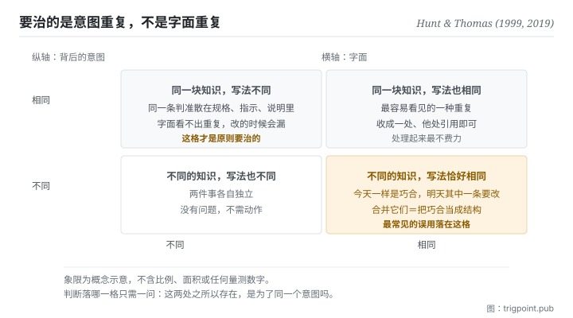

Canonical: https://trigpoint.pub/zh-Hans/collections/software-systems-architecture/dry-pragmatic-programmer-1999  
Captured: 2026-11-02T21:27:41.014762+08:00

> 公开理论阅读镜像。验证层及 Lab 案例请到原站阅读。

二十年后，两位作者补了一句：原则讲的是知识与意图。

# 不重复原则

Don't Repeat Yourself (DRY) · Hunt & Thomas (1999)

书目已核 ✓  
软体架构 · 设计原则

## 三句讲透

原则的原文说的是：每一块知识在系统里只能有一个明确而权威的表述。  
它管的是知识与意图，不是字面。  
所以两段完全不同的文字可能违反它，而两段一字不差的文字可能完全没问题。

<strong>图 1</strong> · 两个轴分开看的四种情形：横轴是两段东西的字面是否相同，纵轴是它们背后的意图是否相同。  
原则要治的只有左上那一格；右下那一格是最常见的误用，把字面相同而意图不同的东西硬合成一个。

## 一、发生什么事

这条原则写下二十年后，两位作者在新版里回头替它补了一句说明。1999 年那本书把这条原则写成一句话：系统内的每一块知识，必须有单一、无歧义、权威的表述[\[1\]](#reference-note-1)。书里放它的那一节叫「重复之恶」。二十周年版把病症讲得很直白：同一件事写在两处以上，改了一处就得记得改其他几处；问题不在你会不会记得，而在你什么时候忘记[\[2\]](#reference-note-2)。举个常见的例子：同一条业务规则同时活在资料库的栏位定义、后端的检核、前端的表单、以及一份给人看的文件里。规则改的时候，你要记得改四处。人不会每次都记得，于是系统开始自我矛盾。

二十年后，两位作者在新版里补了一句，而这句补充比原句更常被需要：这条原则讲的是<strong>知识与意图</strong>的重复，是「把同一件事在两个地方、甚至用两种完全不同的方式说出来」[\[2\]](#reference-note-2)。他们补这句，是因为初版没把它讲清楚，许多人把它读成了「不要复制贴上程式码」[\[2\]](#reference-note-2)。

这两种读法会导致相反的行为。照原意，你会去找「同一个判断散落在几处」，然后指定一处为准、其余引用它。照误读，你会去找「长得像的两段文字」，然后把它们合并成一个共用的东西。后者在字面相同而意图不同的时候会出事：两段规则今天恰好一样，明天其中一条因为业务原因要改，而它们已经被绑在一起了。你省下的那次复制，换来一个更难拆的耦合。

归属上有一处要说清楚。这条原则的定义逐字确认在 1999 年初版，章名也确认；但编号在两版不同（初版是第 11 条提示；二十周年版放在第 9 主题，提示改为第 15 条），而初版定义句所在的页码未能对照原书核实[\[3\]](#reference-note-3)。本站因此只标章与编号，不标页。

<strong>署名要给对：</strong>原则的表述与名称归 Hunt 与 Thomas（1999 年初版第 2 章第 11 条提示）[\[1\]](#reference-note-1)；二十周年版（2019）的意图层澄清为同两位作者所补，并把它移为第 9 主题（第 15 条提示）[\[2\]](#reference-note-2)。本页不把「单一真相来源」这个词归给这两位作者：那是另一条概念线，见本站的单一真相来源概念史页。两者相容但不同源，署名要分开记。

## 二、为什么这对你重要

把「知识」这个词换成「判准」，这页就直接落到你的工作流上。

你手上的判准现在住在几个地方？一份写给自己看的规格、一段贴给模型的指示、一份交给协作者的说明、可能还有一个你记在脑里但没写下来的例外。这四份会漂。而它们漂的时候<strong>不会报错</strong>：每一份单独看都合理，只有把它们并排才看得出矛盾，而你平常不会并排。

原意的做法是指定一处为准，其他地方写「见那一处」。这听起来像行政手续，实际上是在改变失效的形状：漂移从「四份各自演化，你不知道哪份对」变成「一份改了，引用它的地方自动跟上」。

但误读那条路也要防，而且在使用模型的时候更容易踩到。你会很想把三段看起来重复的指示合成一段通用的，因为它们的文字八成相同。停一下，问那个真正的问题：<strong>这三段背后是同一个意图吗？</strong> 如果其中一段之所以存在，是为了处理另外两段不处理的例外，那它的字面重复是巧合，合并它就等于删掉那个例外。

实务上这页只留一句可以直接用的话：先问这是不是同一块知识，再决定要不要合。反过来做，你会把巧合当成结构。

## 常见误读

所属页核验：书目已核 ✓ · 内容最后修订 2026-10-25

- 常见转述「这条原则就是叫你不要有重复的程式码」：原文治的是知识与意图的重复，不是字面的重复。作者在二十年后那一版明文再讲一次，并承认初版没把它讲清楚，许多人因此以为它只关乎程式码。
- 常见转述「这是书里的第 11 条提示」：1999 年初版是第 11 条提示；2019 年二十周年版把它放在第 9 主题，提示编号改为第 15 条。引用时要一并标版本，否则读者按编号翻不到。初版定义句所在的页码本站不标，因为未能对照原书核实。

## 参考文献

<strong>如何阅读来源注记</strong> 「书目经…核对」指作者、年份、题名与出版项已确认；不代表该来源的主张已被核对。「对照全文核实」指主张已与来源文本本身比对。「依多源一致转述」指主张建立于多份彼此一致、转述该来源的资料，而非原文件本身。 定义版本：2026-09-20。

- \[1\] Hunt, A. & Thomas, D. (1999). The Pragmatic Programmer: From Journeyman to Master. Addison-Wesley. ISBN 0-201-61622-X. Chapter 2, Tip 11.
- \[2\] Hunt, A. & Thomas, D. (2019). The Pragmatic Programmer, 20th Anniversary Edition. Addison-Wesley. ISBN 978-0-13-595705-9. Chapter 2, Topic 9.
- \[3\] 编辑注，无外部来源；全文见正文注 \[3\]。

引用格式：Trigpoint，〈不重复原则〉，trigpoint.pub/zh-Hans/collections/software-systems-architecture/dry-pragmatic-programmer-1999 · © Strategitect Limited. · 内容最后修订 2026-10-25

## 来源注记

**[1]** Hunt, A. & Thomas, D. (1999). The Pragmatic Programmer: From Journeyman to Master. Addison-Wesley. Chapter 2, The Evils of Duplication; Tip 11. 书目经官方记录核对。第 11 条提示的编号与定义句依多源一致转述。原文定义：every piece of knowledge must have a single, unambiguous, authoritative representation within a system. 该节题为 The Evils of Duplication。

**[2]** Hunt, A. & Thomas, D. (2019). The Pragmatic Programmer: Your Journey to Mastery, 20th Anniversary Edition. Addison-Wesley. Chapter 2, Topic 9; Tip 15. 书目经出版社记录核对。主张已对照全文核实。作者二十年后的补充：DRY is about the duplication of knowledge, of intent. 同一节并说明，初版没把这条讲清楚，许多人把它理解成只关乎程式码。

**[3]** 初版的第 11 条提示与定义句，见于该版的提示清单；馆藏目录记初版该节起于第 26 页，但定义句所在的页码未对照原书核实，本站因此不标页。二十周年版把它放在第 9 主题（起于第 30 页），提示编号改为第 15 条。

---

[English](../../../en/collections/software-systems-architecture/dry-pragmatic-programmer-1999.md) · [繁體中文](../../../zh-Hant/collections/software-systems-architecture/dry-pragmatic-programmer-1999.md)

[Index](../../README.md) · [Original page](https://trigpoint.pub/zh-Hans/collections/software-systems-architecture/dry-pragmatic-programmer-1999) · [Citation and versions](../../../READING.md)

[Original SVG](assets/dry-pragmatic-programmer-1999.svg) · Display copy adds a white background only.
