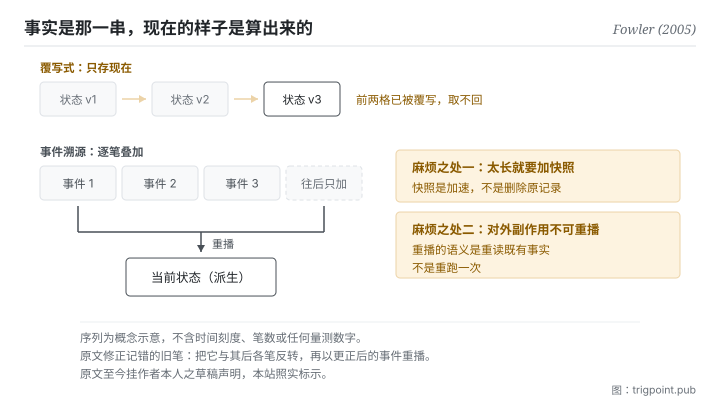

Canonical: https://trigpoint.pub/zh-Hans/collections/software-systems-architecture/event-sourcing-fowler-2005  
Captured: 2026-11-02T21:27:41.343846+08:00

> 公开理论阅读镜像。验证层及 Lab 案例请到原站阅读。

变更纪录与当前状态，一个是事实，一个由事实算出。

# 事件溯源

Event Sourcing · Fowler (2005)

已对照来源本身 ✓  
软体架构 · 事实与派生  
先读：单一真相来源

## 三句讲透

把每一次变更存成一笔不可改的事件，当前状态改由重播那串事件得出。  
于是「现在是什么样」不再是被保存的东西，而是被算出来的东西。  
代价是你得永远不去改旧的那几笔。

<strong>图 1</strong> · 上半是只存当前状态的做法：每次变更覆写上一次，历史随之消失。  
下半是事件溯源：变更逐笔叠上去、永不就地修改，当前状态由重播得出，也因此任何过去时点都重建得回来。  
右侧标出原文谈到的两个难处：事件太多时重建会慢、要加快照；对外的副作用不能在重播时再发一次。

## 一、发生什么事

变更的纪录与此刻的状态是两样东西：由前者可以重播出后者，由后者推不回前者。多数系统只存当前状态：一笔资料改了，新值覆盖旧值。这种做法有一个安静的损失：<strong>变更史被覆写的那一刻就永久消失了。</strong> 你有现在的样子，但没有「为什么会走到这个样子」。于是三件事同时做不到：稽核、重建任一过去时点、以及回头修正一个早先的错误。

事件溯源把顺序反过来：<strong>那串事件才是事实，当前状态是派生物。</strong> 原文的定义是把对应用状态的每一次变更捕捉为一串事件[\[1\]](#reference-note-1)。做法上只有两条硬规矩：事件只能往后加、永不就地修改；当前状态由空状态起重播全部事件得出。这两条一成立，时间旅行就自动附赠：重播到第 k 笔，你就得到那个时点的样子。

原文同时谈到几个实作上的难处，以下三项比定义更有教学价值[\[1\]](#reference-note-1)。第一，事件太多时从头重建会慢，于是需要快照：存下某时点的状态，之后只从快照往后播。第二，发现早先某笔事件记错时，原文的做法是把它与其后各笔反转，再以更正后的事件重播；事件若写成差额（「加 10 元」而非「设为 110 元」），反转最容易。第三，也是最容易出事的一项：如果事件的处理过程会触发对外的副作用（寄一封信、扣一次款），重播就不能真的再执行一次，否则你会重复扣款，而且结果不再可重现。重播的语义必须是「重读既有事实」，不是「重跑一次」。

归属有两处要说清楚。这位作者自己在原文把版本控制系统举为常见的例子，也说在会计系统里见过很强的例子[\[3\]](#reference-note-3)，所以本站把他标为系统化记录者，不是发明者。而那页至今挂着他本人的草稿声明，明言这批写作停在 2000 年代中期、在他能重拾之前不会修订[\[2\]](#reference-note-2)。它常被当成标准参照，同时自陈是草稿：这件事本身值得记一笔。

<strong>署名要给对：</strong>以此为名的系统化记录，本站归 Fowler（2005 年 12 月 12 日该文）[\[1\]](#reference-note-1)；他本人在原文举版本控制系统与会计系统为既有的例子，故本站<strong>不标他为发明者</strong>，名称是否由他首创本站未查证[\[3\]](#reference-note-3)。与命令查询职责分离的配对是后续实务推广的结果，<strong>不在</strong> 2005 年原文之内[\[4\]](#reference-note-4)。该文的草稿状态为作者自陈，并非本站推测[\[2\]](#reference-note-2)。四段要分开署名。

## 二、为什么这对你重要

你的工作流里最接近这个模式的东西，是你的决策记录。

多数人的判准是覆写式的：规矩改了，就把旧那句删掉、写上新那句。一年后你手上有一份看起来很干净的规矩，以及零笔「为什么会变成这样」。这在你自己记得的时候没问题，在你忘了、或需要说服别人、或需要判断「当初那个理由现在还成立吗」的时候，就完全没有材料。

事件溯源的做法是：规矩那一页是<strong>派生物</strong>，逐笔的变更记录才是事实。改规矩时你新增一笔（改了什么、为什么、当时的触发是什么），派生的那一页重新生成。这样一年后你有两样东西：可读的现值，以及可查的来历。

三条可以直接搬的规矩，都从上面那三项难处改写而来。<strong>第一，永不改旧笔。</strong> 发现先前记错了，补一笔更正，不要回去修：一旦允许回去修，整串记录就失去它唯一的价值。<strong>第二，太长就加摘要层，但摘要不取代原记录。</strong> 这是快照，不是删除。<strong>第三，重播不等于重做。</strong> 你回头读旧决策是为了理解当时的判断，不是为了照着再执行一次；当时的前提可能已经不在。第三条在使用模型时特别容易踩到：你把一整串历史决策喂进去要它「照这个模式继续」，它会很配合地把过期的前提一并沿用。

## 常见误读

所属页核验：已对照来源本身 ✓ · 内容最后修订 2026-10-25

- 常见转述「事件溯源就是命令查询职责分离的一部分」：2005 年那篇全文没有提到后者。两者常一起出现是后续实务推广的结果，不是定义上的依赖。可以只用其中一个。
- 常见转述「这个做法是那位作者发明的」：他自己在原文里把版本控制系统举为常见的例子，也说在会计系统里见过很强的例子。本站因此把他标为系统化记录者，不标为发明者。这两件要分开讲。
- 常见转述「原文是一篇成熟的架构文献」：该页至今挂著作者本人的草稿声明，明言在他能重拾之前不会修订。它常被当成标准参照，但它自陈是草稿。

## 参考文献

<strong>如何阅读来源注记</strong> 「对照全文核实」指主张已与来源文本本身比对。 定义版本：2026-09-20。

- \[1\] Fowler, M. (2005). Event Sourcing. martinfowler.com/eaaDev/EventSourcing.html. Published 12 December 2005 (draft status per author's own notice).
- \[2\] Fowler, M. (2005). Event Sourcing. martinfowler.com/eaaDev/EventSourcing.html. Published 12 December 2005 (draft status per author's own notice).
- \[3\] Fowler, M. (2005). Event Sourcing. martinfowler.com/eaaDev/EventSourcing.html. Published 12 December 2005 (draft status per author's own notice).
- \[4\] Fowler, M. (2005). Event Sourcing. martinfowler.com/eaaDev/EventSourcing.html. Published 12 December 2005 (draft status per author's own notice).
- \[5\] Fowler, M. (2004). Reporting Database. martinfowler.com/bliki/ReportingDatabase.html. Original publication 2 April 2004.

## 知识图谱

- [<em>对照 ▸</em>命令查询职责分离（Command Query Responsibility Segregation (CQRS)）](cqrs-young-2010.md)
- [<em>对照 ▸</em>资料网格（Data Mesh）](data-mesh-dehghani-2022.md)

引用格式：Trigpoint，〈事件溯源〉，trigpoint.pub/zh-Hans/collections/software-systems-architecture/event-sourcing-fowler-2005 · © Strategitect Limited. · 内容最后修订 2026-10-25

## 来源注记

**[1]** Fowler, M. (2005-12-12). Event Sourcing. martinfowler.com/eaaDev/EventSourcing.html. 主张已对照全文核实。原文定义为把对应用状态的每一次变更捕捉为一串事件。同页谈到几个实作上的难处：事件多时从头重建会慢，可改存快照；记错的事件可连同其后各笔反转，再以更正后的事件重播；外部系统分不出真正的处理与重播，要经闸道处理。

**[2]** 同一页面的草稿声明：作者自述这批写作是他在 2000 年代中期进行的，此后被其他事情占去时间，材料仍为草稿形态，在他能重拾之前不会修订或更新。

**[3]** 同一页面把版本控制系统举为采用这种做法的常见例子，并说他在会计系统里见过很强的例子；可见做法早于这篇文章。本站把作者标为系统化记录者，非发明者；这个名称是否由他首创，本站未查证。

**[4]** 2005 年该文全文未提命令查询职责分离；两者常被配对是后续实务推广的结果，非定义之必要成分。见本站命令查询职责分离页。

---

[English](../../../en/collections/software-systems-architecture/event-sourcing-fowler-2005.md) · [繁體中文](../../../zh-Hant/collections/software-systems-architecture/event-sourcing-fowler-2005.md)

[Index](../../README.md) · [Original page](https://trigpoint.pub/zh-Hans/collections/software-systems-architecture/event-sourcing-fowler-2005) · [Citation and versions](../../../READING.md)

[Original SVG](assets/event-sourcing-fowler-2005.svg) · Display copy adds a white background only.
