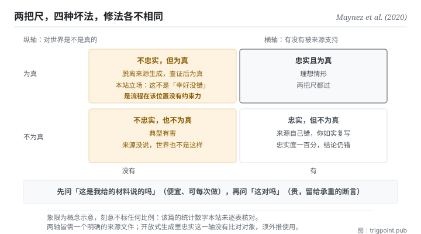

Canonical: https://trigpoint.pub/zh-Hans/collections/software-systems-architecture/faithfulness-factuality-maynez-2020  
Captured: 2026-11-02T21:27:42.104889+08:00

> 公开理论阅读镜像。验证层及 Lab 案例请到原站阅读。

忠于来源，和对世界为真，是两条各自独立的判定线。

# 忠实性与事实性

Faithfulness vs Factuality · Maynez et al. (2020)

已对照来源本身 ✓  
机器学习 · 评估轴  
先读：生成幻觉

## 三句讲透

忠实问的是这段话有没有被来源支持，事实问的是它对世界是不是真的。  
两者是独立的判定线，交叉出四种情形，每一种的修法都不同。  
用一个分数代表两者，你会修错方向。

<strong>图 1</strong> · 两条独立的判定线交叉出四种情形：横轴问这段话有没有被来源支持，纵轴问它对世界是不是真的。  
右上是理想；左上是脱离来源但查证为真；右下是来源自己错而你如实复写；左下是典型有害。  
本图刻意不标任何比例，理由见验证层。

## 一、发生什么事

一段输出有没有被来源支持，和它对世界是不是真的，要分两条线各自判定。这篇 2020 年的论文把一个长期混用的东西拆开了。

<strong>忠实</strong>的判准是触发式的：若一段输出含有<strong>未被输入文件支持</strong>的片段，即判为幻觉[\[1\]](#reference-note-1)。注意这条完全不问世界：它只问来源。

<strong>事实</strong>的判准是独立条款：若一段输出含有<strong>不在文件中而为事实正确</strong>的资讯，则它含有事实性幻觉[\[1\]](#reference-note-1)。这句话的措辞值得停一下：它承认一段输出可以同时「不忠于来源」与「对世界为真」，而且那仍然被算作一种幻觉（因为它不是来源说的）。

两轴交叉出四种情形，每一种都真实存在：忠实且正确（理想）；忠实但不正确（<strong>来源自己错，你如实复写，判定仍是忠实，但你传递了错误</strong>）；不忠实但正确（脱离来源生成，但查证为真）；不忠实且不正确（典型有害）。

而这个拆分的实务价值在于<strong>它指向不同的修法</strong>：忠实的问题是复写失真，可以用蕴涵检查或强制引用来治；事实的问题是世界知识错误，只能靠外部查核或检索。混成一个分数，你会拿错的工具去修。

本篇同时给了摘要领域的内外型界定[\[2\]](#reference-note-2)，而这里有一个追溯上的陷阱：后续的通用综述把它简化为「与来源矛盾」与「来源无法验证」，与本篇的原始措辞（误述已有内容／完全脱离来源）<strong>不逐字等价</strong>[\[4\]](#reference-note-4)。两个版本都在流通，追溯定义时要分清是哪一版。

归属：这组正交拆分的<strong>关切早于本篇</strong>，更早已见于 2017 至 2019 年间的摘要研究；例如 2019 年一篇评估批判已把事实正确性列为当时评估协定的缺口，但未提出两轴正交或这组命名[\[3\]](#reference-note-3)。本站因此把本篇标为<strong>结晶化与形式化者</strong>，不是关切本身的首次提出者。

<strong>署名要给对：</strong>两轴正交之形式化（本站之归属）与摘要领域之内外型区分归 Maynez 等四位作者（2020；该篇自述依资讯来源把幻觉分为内在与外在两型）[\[1\]](#reference-note-1)[\[2\]](#reference-note-2)；<strong>该关切更早已见于 2017 至 2019 年间的摘要研究</strong>（例：2019 年那篇评估批判，列为评估协定缺口，未提出正交拆分）[\[3\]](#reference-note-3)；后续通用综述之简化措辞归该综述，与本篇不逐字等价[\[4\]](#reference-note-4)。三段要分开署名。本页不引用该篇之具体统计数字，理由见验证层[\[5\]](#reference-note-5)。

## 二、为什么这对你重要

这页是本书架给你的<strong>验收工具</strong>，而且它可以今天就用。

你请模型整理一份材料，拿到结果之后，多数人问的是「这对不对」。这页要你把那一问拆成两问，而且顺序很重要。

<strong>先问：这句话是我给的材料说的吗。</strong> 这一问便宜、快、而且答案是二元的：回去比对就知道。它抓的是复写失真。

<strong>再问：这句话对吗。</strong> 这一问贵，需要外部知识或另一份来源。它抓的是世界知识错误。

顺序很重要，因为第一问能过滤掉大部分问题，而且<strong>它的成本低到可以每次都做</strong>。第二问则要留给真正承重的断言。

第二个实务点是那个最容易被忽略的象限：<strong>忠实但不正确</strong>。你给的材料本身错了，模型如实复写，于是它「完全忠实」而你拿到一个错的结论。这一格提醒你：对来源的忠实度做到一百分，也不会修正来源的错误。所以要用检索增强的工作流，检索库的品质仍然是天花板：这一条扣回段六第一页。

第三个，也是这页最反直觉的一句，而且它是<strong>本站的立场，论文本身站在另一边</strong>。论文明说，摘要系统可以融入背景知识：脱离来源的内容，只要能带来更好、而且就文件与相关背景知识而言为真的摘要，就可以接受；它也指出，学界对此并无共识[\[1\]](#reference-note-1)。放在摘要里，这说得通：好的摘要本来就会带进作者的背景知识。但本页讲的是验收：你交出一份材料，要模型照它整理。在这个情境里，<strong>脱离来源而为真的那一格，不该被当成「幸好没错」。</strong> 它代表你的流程在那个位置没有约束力；下一次同样的位置可能就不真了。碰巧为真是流程失效的伪阴性，不是成功。

## 常见误读

所属页核验：已对照来源本身 ✓ · 内容最后修订 2026-11-01

- 常见转述「忠实与正确是同一件事」：它们是两条独立的判定线。一段完全忠于来源的输出可以是错的（来源自己错），一段脱离来源的输出也可以是对的。混用会让你修错方向。
- 常见转述「这组轴是这篇凭空原创」：关切早于它（例：2019 年一篇评估批判已把事实正确性列为缺口），但把两轴列为正交、并把忠实与事实两词成对使用，本站归为这篇所形式化。原创与形式化要分开记。
- 常见转述「内在型与外在型在各篇论文里是同一组定义」：本篇的原始措辞（误述已有内容／完全脱离来源）与后续通用综述的简化措辞不逐字等价。追溯定义时要分清版本。

## 修正记录

- 本页不引用该篇的具体百分比：本站未逐表核对其统计数字，只作定性陈述。

## 参考文献

<strong>如何阅读来源注记</strong> 「书目经…核对」指作者、年份、题名与出版项已确认；不代表该来源的主张已被核对。「对照全文核实」指主张已与来源文本本身比对。 定义版本：2026-09-20。

- \[1\] Maynez, J., Narayan, S., Bohnet, B., & McDonald, R. (2020). On Faithfulness and Factuality in Abstractive Summarization. Proceedings of ACL 2020, 1906–1919.
- \[2\] Maynez, J., Narayan, S., Bohnet, B., & McDonald, R. (2020). On Faithfulness and Factuality in Abstractive Summarization. Proceedings of ACL 2020, 1906–1919.
- \[3\] Kryściński, W., Keskar, N. S., McCann, B., Xiong, C., & Socher, R. (2019). Neural Text Summarization: A Critical Evaluation. Proceedings of EMNLP-IJCNLP 2019, 540–551. DOI [10.18653/v1/D19-1051](https://doi.org/10.18653/v1/D19-1051). 书目经官方记录核对。主张已对照全文核实。
- \[4\] 编辑注，无外部来源；全文见正文注 \[4\]。
- \[5\] 编辑注，无外部来源；全文见正文注 \[5\]。

## 知识图谱

- [<em>特化自 ▸</em>生成幻觉（Hallucination in NLG）](llm-hallucination-ji-2023.md)
- [<em>基于 ▸</em>生成幻觉（Hallucination in NLG）](llm-hallucination-ji-2023.md)
- [<em>应用 ▸</em>先红队，再采信：以单一主张为单位的红队程序](https://trigpoint.pub/zh-Hans/methods/red-team-a-claim)

引用格式：Trigpoint，〈忠实性与事实性〉，trigpoint.pub/zh-Hans/collections/software-systems-architecture/faithfulness-factuality-maynez-2020 · © Strategitect Limited. · 内容最后修订 2026-11-01

## 来源注记

**[1]** Maynez, J., Narayan, S., Bohnet, B., & McDonald, R. (2020). On Faithfulness and Factuality in Abstractive Summarization. Proceedings of the 58th Annual Meeting of the Association for Computational Linguistics (ACL 2020), 1906–1919. DOI 10.18653/v1/2020.acl-main.173. 书目经官方记录核对。主张已对照全文核实。忠实判准之触发式定义：若摘要含有未被输入文件支持的片段，即判为幻觉。事实判准之独立条款：若摘要含有不在文件中而为事实正确的资讯，则含有事实性幻觉。同篇并明说其立场：摘要中脱离来源的内容，若能带来更好、且就文件与相关背景知识而言为真的摘要，即可接受；并指出学界对此并无共识。

**[2]** 同篇对摘要领域之内外型界定：内在型为利用文件中已有的资讯但误述；外在型为完全脱离来源材料生成。

**[3]** 归属：此拆分的关切早于本篇，更早已见于 2017 至 2019 年间的摘要研究。例如这篇 2019 年的评估批判已指出当时的评估协定未顾及事实正确性等重要特性，但未提出两轴正交，也未使用忠实与事实这组名称；又如 2017 年 11 月一篇摘要预印本（arXiv 1711.04434）的标题已用上「忠实」一词，摘要并指出当时的神经摘要系统倾向制造虚假事实。本站把本篇标为把拆分结晶化、形式化的一篇，不是关切本身的首次提出者。

**[4]** 与后续通用综述之措辞差异：后续把内外型简化为「与来源矛盾」与「来源无法验证」，与本篇原始措辞（误述已有内容／完全脱离来源）不逐字等价。追溯定义时须分清版本。

**[5]** 统计数字：本站未逐表核对该篇的统计，因此不引具体百分比，只作定性陈述；正文的定性陈述已对照全文。

---

[English](../../../en/collections/software-systems-architecture/faithfulness-factuality-maynez-2020.md) · [繁體中文](../../../zh-Hant/collections/software-systems-architecture/faithfulness-factuality-maynez-2020.md)

[Index](../../README.md) · [Original page](https://trigpoint.pub/zh-Hans/collections/software-systems-architecture/faithfulness-factuality-maynez-2020) · [Citation and versions](../../../READING.md)

[Original SVG](assets/faithfulness-factuality-maynez-2020.svg) · Display copy adds a white background only.
