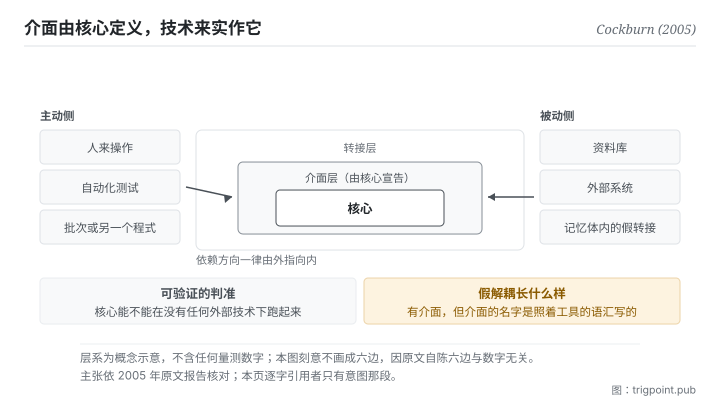

Canonical: https://trigpoint.pub/zh-Hans/collections/software-systems-architecture/hexagonal-architecture-cockburn-2005  
Captured: 2026-11-02T21:27:42.366189+08:00

> 公开理论阅读镜像。验证层及 Lab 案例请到原站阅读。

「包一层介面就算解耦」：未必。

# 六角架构

Hexagonal Architecture (Ports and Adapters) · Cockburn (2005)

已对照来源本身 ✓  
软体架构 · 依赖方向  
先读：领域驱动设计

## 三句讲透

核心宣告它需要什么样的对话，技术来实作那组介面。  
依赖方向因此一律由外指向内，而不是核心去认识某个资料库或某个框架。  
判准只有一条：核心能不能在没有任何外部技术的情况下跑起来。

<strong>图 1</strong> · 由内往外三层：核心只认自己宣告的那组介面，每种技术各写一个转接去实作它，依赖方向一律由外指向内。  
左右两侧是同一件事的两个方向：人与测试在主动侧推核心，资料库与外部系统在被动侧被核心呼叫。  
底部是可验证的判准：核心能不能在没有任何外部技术的情况下独立跑起来。

## 一、发生什么事

作者当年要处理的病症很具体，而且与测试有关：业务逻辑渗进了介面层，于是系统<strong>没办法被自动化测试驱动</strong>，也很难从「人来操作」切换到「批次跑」或「另一个程式来呼叫」。

根因是依赖的方向错了：核心去认识了具体技术（某个资料库驱动、某个介面框架）。一旦如此，你要测核心就得先把那些技术架起来。

这套架构把方向反过来：<strong>核心宣告一组介面，技术写转接去实作它</strong>[\[1\]](#reference-note-1)。介面是核心定义的、与技术无关的一段「有目的的对话」；转接是那段对话对某个具体技术的实作。核心只对介面编程，不知道背后是什么。于是要测核心，你只要接一个记忆体内的假转接。

作者原文的意图那句话值得逐字留着：让一个应用能<strong>同等地</strong>被使用者、程式、自动化测试或批次脚本驱动，并且能在脱离其最终执行期装置与资料库的情况下开发与测试[\[1\]](#reference-note-1)。

而 2005 年那篇的关键想法是<strong>对称性</strong>：这个图没有上层下层。资料库与使用者介面被平等对待，两者都只是接在某个介面上的外部技术。主动侧（推核心的：人、测试、批次）与被动侧（被核心呼叫的：资料库、外部系统）只由介面的方向区分，不由架构层级区分。

命名有一段：2005 年那篇报告以 Ports and Adapters 为模式名，六边形架构列为别名[\[2\]](#reference-note-2)。先后的经过，作者 2020 年受访时自己说过：1994 年他在物件导向程式设计课的讲义上第一次画出这个六边形，最初发表时还没有 Ports and Adapters 这个名字；到 2005 年 6 月，他才想通六边的每一面就是一个介面，同月在 wiki 上建立以 Ports and Adapters 为名的页面[\[5\]](#reference-note-5)。而六边与数字六无关：原文说选六边只为留出空间画多个介面，不受一维分层图的限制[\[2\]](#reference-note-2)。

<strong>署名要给对：</strong>概念之提出与命名皆归 Cockburn（2005 年那篇报告，Ports and Adapters）[\[1\]](#reference-note-1)；原文把它写成转接器模式的一种特定用法，并列出几个相近的既有模式，本站因此标他为提出者兼命名者，不标为无前例的首创；六边形架构为别名，该名在先：作者自述 1994 年已画出六边形，2005 年 6 月才改以 Ports and Adapters 为名[\[2\]](#reference-note-2)[\[5\]](#reference-note-5)。<strong>洋葱架构（2008）与整洁架构（2012）各归其作者</strong>：前者自述与本架构共享前提，后者自述整合了本架构与其他几种[\[4\]](#reference-note-4)。本页对原文核到哪一层，见验证层[\[3\]](#reference-note-3)。

## 二、为什么这对你重要

把「技术」换成「工具与模型」，这页就变成一个很实际的建议：<strong>你的判准不该绑定某个工具。</strong>

现在很多人的工作流是反过来的：判准长在工具里。提示词写在某个平台的专案设定里、分类规则写在某个笔记软体的栏位里、检查清单存在某个服务的模板里。这在单一工具好用时完全没问题，直到你要换工具、或要用第二个工具做同一件事、或那个工具改了它的功能。

这套架构的做法是把方向反过来：判准写在你自己的地方，用你自己的语汇宣告「我需要什么样的输入与输出」，然后每个工具各写一层薄薄的接法。换工具时你只换接法，判准不动。

它同时给你一个<strong>可验证</strong>的判准，这是这页最有价值的部分。不是问「我有没有解耦」（这个问题没有答案），而是问：<strong>我的判准能不能在没有任何特定工具的情况下被说清楚、被人执行。</strong> 如果你的分类规则要靠某个软体的栏位才讲得通，那它已经绑死了。

反过来也要提防那个<strong>假解耦</strong>。在工具外面包一层，但那层的形状完全照着工具长：例如你的规格里写满某个平台的专有名词。这在形式上是多了一层，在实质上什么都没换到，因为换工具时那层要整个重写。介面的形状必须由核心决定，这是原则里最容易被跳过的一句。

## 常见误读

所属页核验：已对照来源本身 ✓ · 内容最后修订 2026-10-25

- 常见转述「六边代表六个层或六种介面」：六边只是画图方便，作者选它是为了留出空间画多个介面，不受一维分层图的限制。纠结边数是抓错重点。
- 常见转述「洋葱架构与整洁架构是这套的衍生版」：三者同家族、不同作者、各自命名，共享的是依赖只向内这个原则。作者归属不可混。

## 参考文献

<strong>如何阅读来源注记</strong> 「书目经…核对」指作者、年份、题名与出版项已确认；不代表该来源的主张已被核对。「对照全文核实」指主张已与来源文本本身比对。 定义版本：2026-09-20。

- \[1\] Cockburn, A. (2005). The Hexagonal (Ports & Adapters) Architecture. HaT Technical Report 2005.02. alistair.cockburn.us/hexagonal-architecture/
- \[2\] 编辑注，无外部来源；全文见正文注 \[2\]。
- \[3\] 编辑注，无外部来源；全文见正文注 \[3\]。
- \[4\] Palermo, J. (2008). The Onion Architecture: part 1. jeffreypalermo.com/2008/07/the-onion-architecture-part-1/; Martin, R. C. (2012). The Clean Architecture. blog.cleancoder.com/uncle-bob/2012/08/13/the-clean-architecture.html
- \[5\] Garrido de Paz, J. M. (2020). Interview with Alistair Cockburn. jmgarridopaz.github.io/content/interviewalistair.html

## 知识图谱

- [<em>应用于 ▸</em>领域驱动设计（Domain-Driven Design (DDD)）](domain-driven-design-evans-2003.md)
- [<em>对照 ▸</em>模型视图控制器（Model-View-Controller (MVC)）](mvc-reenskaug-1979.md)

引用格式：Trigpoint，〈六角架构〉，trigpoint.pub/zh-Hans/collections/software-systems-architecture/hexagonal-architecture-cockburn-2005 · © Strategitect Limited. · 内容最后修订 2026-10-25

## 来源注记

**[1]** Cockburn, A. (2005, September 4). The Hexagonal (Ports & Adapters) Architecture. HaT Technical Report 2005.02, v0.9. alistair.cockburn.us/hexagonal-architecture/. 书目经官方记录核对。主张已对照全文核实。意图逐字：让一个应用能同等地被使用者、程式、自动化测试或批次脚本驱动，并且能在脱离其最终执行期装置与资料库的情况下开发与测试。

**[2]** 命名：2005 年那篇报告以 Ports and Adapters 为模式名，六边形架构列为别名，并说这个别名来自图的视觉效果；先以六边形为名、2005 年才加上 Ports and Adapters 之名，一般记述如此，作者 2020 年受访时的自述亦同（见注 5）。六边与数字六无关：原文说选它是为了让画图的人有空间随需要加上介面与转接，不受一维分层图的限制。

**[3]** 2005 年那篇报告（作者站上之版本，标为 0.9 版、2005 年 9 月 4 日）已对照全文：意图、对称性、主动与被动两侧、六边的由来皆依原文。命名先后另依作者 2020 年的访谈自述（见注 5）。

**[4]** Palermo, J. (2008, July 29). The Onion Architecture: part 1. jeffreypalermo.com; Martin, R. C. (2012, August 13). The Clean Architecture. blog.cleancoder.com. 书目经官方记录核对。主张已对照全文核实。洋葱架构（2008，另一位作者）与整洁架构（2012，又另一位作者）各有其作者与名字：前者自述与六角架构共享同一前提，后者自述是把六角、洋葱等几种架构整合成单一可操作的想法。

**[5]** Garrido de Paz, J. M. (2020, September 9). Interview with Alistair Cockburn. jmgarridopaz.github.io/content/interviewalistair.html. 书目经官方记录核对。主张已对照全文核实。作者受访自述（第一人称）：1994 年在物件导向程式设计课的讲义上第一次画出六边形；最初发表时没有 Ports and Adapters 这个名字；2005 年 6 月才想通六边的每一面就是一个介面（port），同月在 wiki 上建立以 Ports and Adapters 为名的页面。他想通的是介面与转接，不是对称性。

---

[English](../../../en/collections/software-systems-architecture/hexagonal-architecture-cockburn-2005.md) · [繁體中文](../../../zh-Hant/collections/software-systems-architecture/hexagonal-architecture-cockburn-2005.md)

[Index](../../README.md) · [Original page](https://trigpoint.pub/zh-Hans/collections/software-systems-architecture/hexagonal-architecture-cockburn-2005) · [Citation and versions](../../../READING.md)

[Original SVG](assets/hexagonal-architecture-cockburn-2005.svg) · Display copy adds a white background only.
