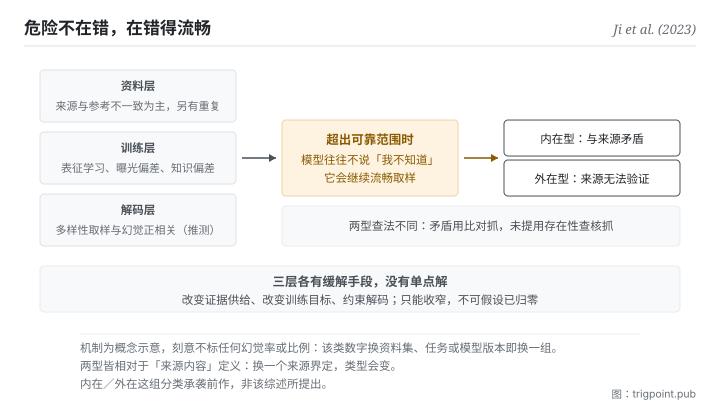

Canonical: https://trigpoint.pub/zh-Hans/collections/software-systems-architecture/llm-hallucination-ji-2023  
Captured: 2026-11-02T21:27:42.682961+08:00

> 公开理论阅读镜像。验证层及 Lab 案例请到原站阅读。

「再进步一点就不会幻觉」：接不了。

# 生成幻觉

Hallucination in NLG · Ji et al. (2023)

摘要已核 ✓  
机器学习 · 失效模式  
先读：检索增强生成

## 三句讲透

幻觉是生成流畅却不忠于来源或不知所云。  
危险不在错，在<strong>错得流畅</strong>：流畅度给了真值不具备的可信外观。  
而它的成因跨资料、训练、解码三层，目前只能收窄，不能假设已经归零。

<strong>图 1</strong> · 本图把综述的两大类成因拆成三层：资料层以来源与参考答案不一致为主因（另有未滤除的重复资料），训练层有表征学习不良、曝光偏差与参数知识偏差，解码时的多样性取样与幻觉正相关（后者原文属推测）。  
三层各有各的缓解手段，没有单点解，也没有一层宣称能归零。  
三层成因汇向中段，即这页最反直觉的一点：超出可靠范围时，模型往往不说「我不知道」，而是继续流畅地取样；这个倾向与现行训练和评分方式奖励猜测有关。  
这样生成的幻觉分两型，标在右侧：内在型是与来源矛盾，外在型是无法从来源验证。  
本图刻意不标任何比率。

## 一、发生什么事

那篇 2023 年综述采用的定义（沿用先前研究的说法）是：生成的内容不知所云，或<strong>不忠于所提供的来源内容</strong>[\[1\]](#reference-note-1)。分类分两型：内在型是与来源矛盾，外在型是无法从来源验证[\[2\]](#reference-note-2)。

机制值得慢慢看，因为它决定了你能做什么。生成模型本质是对训练分布的压缩，解码时逐个记号取样。当任务需要的资讯超出模型可靠压缩的范围（分布外、长尾、或训练之后世界变了），模型<strong>往往不会停下来说「我不知道」</strong>：它会继续流畅地取样。这就是幻觉。这个倾向有一部分是被奖励出来的：一篇 2025 年的研究主张，现行训练与评分方式给猜测分数、不给承认不确定的分数，模型因此在没把握时倾向照猜[\[6\]](#reference-note-6)。所以它不是不能说不知道，而是在现行奖励下少说。

那篇综述把成因分成两大类：资料，以及训练与推论。本页把后者再拆成训练与解码，合起来看三层，这也是为什么没有单点解：资料层（主因是来源与参考答案本身就不一致；资料收集时未滤除的重复是另一种情形）、训练层（表征学习不良、训练与生成之间的曝光偏差、模型偏向预训练时带来的知识而非手上的来源）、解码层（多样性取样与幻觉正相关，但其机制原文标为推测）。上一段「往往不说不知道」那条则不在该综述的范围内，出自 2025 年那篇研究。缓解也可对应分三路：改变证据供给（检索增强，上一页）、改变目标（用忠实度的度量去训）、改变解码（约束生成）。

归属这一页有一条<strong>必须说</strong>的更正。那篇综述在 §2.1 自己写明，内在型与外在型这组分类是<strong>沿用先前研究的</strong>[\[3\]](#reference-note-3)。所以正确的引用方式是「该综述采用的分类」，不是「该综述提出的分类」。另外，这个词更早已用于视觉语言任务（2018 年那篇）[\[4\]](#reference-note-4)，不是大型语言模型时代才有的。

<strong>署名要给对：</strong>综述之整理归 Ji 等十位作者（2023，同侪审查期刊；期刊版），本站以它为该领域的锚[\[1\]](#reference-note-1)；<strong>内在型与外在型之分类承袭前作，不归该篇</strong>（该篇 §2.1 自述）[\[3\]](#reference-note-3)；此词更早之已验用例，例见 2018 年那篇视觉语言任务论文[\[4\]](#reference-note-4)；该综述自己另记此词最先出现在 2000 年的电脑视觉研究，当时含意偏正面[\[1\]](#reference-note-1)。三段要分开署名，第二段是本页明文更正的一条。

## 二、为什么这对你重要

这页给你的不是警告，是一个<strong>校准值</strong>：你该对流畅度打多少折。

人判断可信度时，语言的流畅与结构的整齐是强力线索：这在人写的东西上大致有效，因为胡说的人通常也讲得比较乱。生成模型把这个相关性<strong>切断了</strong>：它的流畅度与内容真假几乎无关。所以你的直觉在这里不是不准，是<strong>被校准在错的分布上</strong>。

第二件事是「少说不知道」这个倾向的实务后果。你不能靠模型主动示警来抓幻觉：它在没把握时往往照猜，猜错时讲得一样流畅。这意味着查核的责任在你这一侧，而且<strong>必须是流程而不是警觉</strong>：警觉会疲劳，流程不会。

第三件事，也是本书架的立场所在：既然没有任何一层能保证它已经归零，模型又不会可靠地示警，那么「值得信任的输出」就不能靠模型的品质保证，只能靠<strong>可查核性</strong>。这是本书架自己的立场，不是那篇综述的结论。这正是本站把每一个判定都留下出处与查证状态的理由：不是因为我们比较严谨，是因为结构上没有别的办法。

实务上两个动作就够了。第一，<strong>把「这句话的依据在哪」变成固定问句</strong>，而不是凭感觉挑句子查。第二，<strong>分开处理两型</strong>：与你给的来源矛盾（内在型）用比对抓；来源根本没提（外在型）用存在性查核抓。两者的查法不同，混在一起会两边都漏。

## 常见误读

所属页核验：摘要已核 ✓ · 本页版次 v2 · 内容最后修订 2026-11-01

- 常见转述「内在型与外在型这组分类是那篇综述提出的」：该篇第 2.1 节自己写明是沿用先前研究的分类。本站把它当作整理整个领域的锚；它不是分类的原创者。
- 常见转述「新版模型已经不会幻觉了」：那篇综述列的是成因与分型缓解，没有任何一层宣称可以归零。本站因此把它当作只能收窄、不可假设已归零的常态风险；这是本站的设计前提，不是该综述的结论。这句话不是悲观，是决定你要不要建查核流程的前提。
- 常见转述「这个词是大型语言模型时代才有的」：更早的已验用例，例见 2018 年一篇视觉语言任务的论文；该综述自己也记此词最先出现在电脑视觉研究。

## 修正记录

- 2026-10-12 · 本页前版有三处超出那篇综述原文，已依全文改正。其一，前版把「幻觉源自压缩加取样的结构，只能收窄不能归零」写成源头的结论；综述只列成因与分型缓解，没有主张它不可消除。本书架的立场句保留，但前提改为「没有任何一层能保证已归零、模型又不会可靠示警」，并标明是本书架自己的立场。其二，前版把训练层成因写成「最大化似然的目标奖励流畅、不奖励忠实」；综述列的是表征学习不良、曝光偏差与参数知识偏差，资料层主因是来源与参考答案不一致。其三，前版说忠于来源与合于事实「不是同一件事」；综述原文是两者可能相同也可能不同。

## 参考文献

<strong>如何阅读来源注记</strong> 「书目经…核对」指作者、年份、题名与出版项已确认；不代表该来源的主张已被核对。「与摘要一致」指主张与论文摘要相符；不含逐句对照全文。「对照全文核实」指主张已与来源文本本身比对。 定义版本：2026-09-20。

- \[1\] Ji, Z. et al. (2023). Survey of Hallucination in Natural Language Generation. ACM Computing Surveys, 55(12), Article 248. DOI [10.1145/3571730](https://doi.org/10.1145/3571730).
- \[2\] Ji, Z. et al. (2023). Survey of Hallucination in Natural Language Generation. ACM Computing Surveys, 55(12), Article 248. DOI [10.1145/3571730](https://doi.org/10.1145/3571730).
- \[3\] Ji, Z. et al. (2023). Survey of Hallucination in Natural Language Generation. ACM Computing Surveys, 55(12), Article 248. DOI [10.1145/3571730](https://doi.org/10.1145/3571730).
- \[4\] Rohrbach, A., Hendricks, L. A., Burns, K., Darrell, T., & Saenko, K. (2018). Object Hallucination in Image Captioning. Proceedings of EMNLP 2018, 4035–4045. arXiv:1809.02156.
- \[5\] Ji, Z. et al. (2023). Survey of Hallucination in Natural Language Generation. ACM Computing Surveys, 55(12), Article 248. DOI [10.1145/3571730](https://doi.org/10.1145/3571730).
- \[6\] Kalai, A. T., Nachum, O., Vempala, S. S., & Zhang, E. (2025). Why Language Models Hallucinate. arXiv:2509.04664. https://arxiv.org/abs/2509.04664

## 知识图谱

- [<em>延伸 ▸</em>忠实性与事实性（Faithfulness vs Factuality）](faithfulness-factuality-maynez-2020.md)
- [<em>延伸 ▸</em>虚构引用（Fabricated Citations）](fabricated-citations-walters-wilder-2023.md)
- [<em>被应用 ▸</em>检索增强生成（Retrieval-Augmented Generation (RAG)）](retrieval-augmented-generation-lewis-2020.md)
- [<em>被特化 ▸</em>忠实性与事实性（Faithfulness vs Factuality）](faithfulness-factuality-maynez-2020.md)
- [<em>被特化 ▸</em>虚构引用（Fabricated Citations）](fabricated-citations-walters-wilder-2023.md)
- [<em>应用 ▸</em>先红队，再采信：以单一主张为单位的红队程序](https://trigpoint.pub/zh-Hans/methods/red-team-a-claim)

引用格式：Trigpoint，〈生成幻觉〉，trigpoint.pub/zh-Hans/collections/software-systems-architecture/llm-hallucination-ji-2023 · © Strategitect Limited. · 内容最后修订 2026-11-01

## 来源注记

**[1]** Ji, Z., Lee, N., Frieske, R., Yu, T., Su, D., Xu, Y., Ishii, E., Bang, Y. J., Madotto, A., & Fung, P. (2023). Survey of Hallucination in Natural Language Generation. ACM Computing Surveys, 55(12), Article 248. DOI 10.1145/3571730. 书目经官方记录核对。主张已对照全文核实。期刊版共 10 位作者；预印本 arXiv:2202.03629 第一版 2022-02-08，其后版本增列作者，2024 年 7 月版为 13 位。该综述 §2 采用的定义引自先前研究：生成的内容不知所云，或不忠于所提供的来源内容。

**[2]** 分类定义（该篇 §2.1）：内在型为与来源内容矛盾之输出；外在型为无法从来源内容验证之输出。

**[3]** 归属：该篇 §2.1 写明这组分类沿用先前研究（所引前作包括 Maynez 等 2020）。引用时应写「该综述采用的分类」，不写「该综述提出的分类」。

**[4]** Rohrbach, A., Hendricks, L. A., Burns, K., Darrell, T., & Saenko, K. (2018). Object Hallucination in Image Captioning. Proceedings of the 2018 Conference on Empirical Methods in Natural Language Processing, 4035–4045. DOI 10.18653/v1/D18-1437. 书目经官方记录核对。要旨与摘要一致。更早的用例：该篇摘要即以「幻觉」描述图像描述模型生成画面中并不存在的物件，说明此词在大型语言模型流行之前已用于视觉语言任务。

**[6]** Kalai, A. T., Nachum, O., Vempala, S. S., & Zhang, E. (2025). Why Language Models Hallucinate. arXiv:2509.04664. 书目经官方记录核对。要旨与摘要一致。摘要原意：模型在没把握时有时会猜，而非承认不确定；作者主张成因是训练与评估程序奖励猜测多于承认不确定。

---

[English](../../../en/collections/software-systems-architecture/llm-hallucination-ji-2023.md) · [繁體中文](../../../zh-Hant/collections/software-systems-architecture/llm-hallucination-ji-2023.md)

[Index](../../README.md) · [Original page](https://trigpoint.pub/zh-Hans/collections/software-systems-architecture/llm-hallucination-ji-2023) · [Citation and versions](../../../READING.md)

[Original SVG](assets/llm-hallucination-ji-2023.svg) · Display copy adds a white background only.
