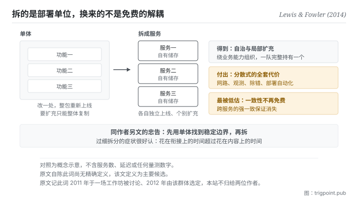

Canonical: https://trigpoint.pub/zh-Hans/collections/software-systems-architecture/microservices-lewis-fowler-2014  
Captured: 2026-11-02T21:27:42.957792+08:00

> 公开理论阅读镜像。验证层及 Lab 案例请到原站阅读。

「拆得越细就越解耦」：是两回事。

# 微服务

Microservices · Lewis & Fowler (2014)

已对照来源本身 ✓  
软体架构 · 服务边界  
先读：领域驱动设计  
先读：康威定律

## 三句讲透

把一个应用拆成一组各自独立上线的服务，于是部署与扩充的单位变小。  
换到的是自治与局部扩充，付出的是分散式系统的全套代价。  
而最容易被低估的那项代价，是跨服务的一致性从此不再免费。

<strong>图 1</strong> · 左边是单体：改一处就要整包重新上线，要扩充只能整体复制。  
右边是拆开之后：部署与扩充的单位变成服务，代价是三件事同时进门，其中最容易被低估的是跨服务的一致性退化。  
底部是同作者另文的忠告：先用单体找到稳定边界，再拆。

## 一、发生什么事

单体的问题不是「大」，是<strong>耦合到部署层</strong>：任何一处小改动都要整包重新上线，而要扩充只能整体复制，即使压力只集中在一个功能上。

这篇 2014 年的文章把替代方案定义下来：把单一应用建构成<strong>一组小型服务</strong>，各自跑在自己的行程、以轻量机制沟通[\[1\]](#reference-note-1)。文章同时列了九项共通特征，并说明不是每个微服务架构都具备全部九项[\[1\]](#reference-note-1)。本页着重其中三项：<strong>绕业务能力组织、以服务为元件而各自独立部署、去中心化（资料与治理都是）</strong>。

「绕业务能力组织」这一项直接扣回上一页：服务边界会镜像团队沟通边界，所以理想形态是一个跨功能小团队完整持有一个服务。这不是巧合，文章明确引了那条定律。

去中心化资料是最容易被低估的一项。每个服务自管自己的储存，于是跨服务的一致性<strong>从此不再是免费的</strong>：你原本靠单一资料库交易得到的保证消失了，取而代之是最终一致性、补偿流程与分散式除错。

归属有三处要说清楚，而这一页的归属比多数节点复杂。第一，<strong>本站不把这个词归给两位作者</strong>：原文自己说该词在 2011 年 5 月威尼斯附近一场架构师工作坊上被讨论、2012 年 5 月由同一群人选定，并没有说谁最先提出[\[2\]](#reference-note-2)。第二，据二手记载，更早在 2005 年一场产业会议上已有相近的语汇，出自另一条技术脉络；本站未核原始出处[\[3\]](#reference-note-3)。第三，原文自陈<strong>此词尚无精确定义</strong>[\[4\]](#reference-note-4)：所以引用它时该说「这是那篇文章的定义」，不是「这是微服务的定义」。

最后一件，同作者在别处给过一句忠告，而它比整套特征清单更常被需要：<strong>先用单体找到稳定边界，再拆</strong>[\[5\]](#reference-note-5)。

<strong>署名要给对：</strong>定义之结晶化与普及，本站归 Lewis 与 Fowler（2014 年 3 月 25 日该文）[\[1\]](#reference-note-1)；<strong>术语，原文只记其 2011 年 5 月在一场工作坊上被讨论、2012 年 5 月由该群体选定为名，未说谁最先提出，本站不归给两位作者</strong>[\[2\]](#reference-note-2)；更早的相近语汇（2005 年）据二手记载归另一条技术脉络，原始出处本站未核[\[3\]](#reference-note-3)；「先用单体」之忠告与采用前的三项基本能力归同作者另两篇短文[\[5\]](#reference-note-5)[\[6\]](#reference-note-6)。四段要分开署名：把整条线压成「2014 年由那两位提出」会一次弄错发明、命名与定义三件事，这是本站在此页明文更正的一条。

## 二、为什么这对你重要

这页对你的用处不在服务，在<strong>拆分的时机</strong>。

你会很想把工作流拆成一堆小块：一个专门写大纲的、一个专门查资料的、一个专门润稿的、一个专门检查引注的。每一块各自简单、各自好测，听起来完全正确。而这页要说的是：<strong>拆分的收益需要一组前置条件，前置条件不到，拆分就是净负担。</strong>

前置条件是什么？同作者另一篇短文列了三项：快速开设机器、基本监控、快速部署[\[6\]](#reference-note-6)。换到你身上就是：<strong>你有没有便宜的方法把那些小块接起来、看它们现在的状态、以及在中间出错时查出是哪一块。</strong> 如果每次要跑完整流程都要你手动搬三次输出、而且哪里错了要逐块回头看，那你付的协调成本已经超过拆分省下的成本。

第二件事是那个「越小越好」的误读。小是相对于单体的对比，不是目标。拆得过细的具体症状很好认：<strong>你花在衔接上的时间超过花在内容上的时间。</strong>

第三件事，也是最实际的一条，就是那句忠告的直译：<strong>边界未明之前不要拆。</strong> 先在一个地方把整件事做通、做到你能讲出哪几段是稳定的、哪几段每次都不一样，然后再沿那些稳定的接缝拆。反过来做（先拆再摸边界）会让你在错的位置上建接口，而那些接口之后很难拆掉：这正是段三第一页那个判准在说的事。

## 常见误读

所属页核验：已对照来源本身 ✓ · 内容最后修订 2026-10-25

- 常见转述「微服务是那两位作者提出的」：原文自己说，这个词在 2011 年 5 月一场工作坊上被讨论、2012 年 5 月由那群人选定。本站把两位作者标为定义的结晶化者与普及者。据二手记载，更早还有 2005 年的一个相近语汇，属另一条技术脉络。
- 常见转述「小是重点，越小越好」：小是相对于单体的对比，不是强制拆到最细。原文提醒远端介面要比程序内呼叫粗；同作者另文主张先用单体，边界稳定后再拆。
- 常见转述「这是这个词的权威定义」：原文自陈此词尚无精确定义，该文只描述共通特征，其定义为主要候选。

## 参考文献

<strong>如何阅读来源注记</strong> 「书目经…核对」指作者、年份、题名与出版项已确认；不代表该来源的主张已被核对。「对照全文核实」指主张已与来源文本本身比对。 定义版本：2026-09-20。

- \[1\] Lewis, J. & Fowler, M. (2014). Microservices: a definition of this new architectural term. martinfowler.com/articles/microservices.html. Published 25 March 2014.
- \[2\] Lewis, J. & Fowler, M. (2014). Microservices: a definition of this new architectural term. martinfowler.com/articles/microservices.html. Published 25 March 2014.
- \[3\] 编辑注，无外部来源；全文见正文注 \[3\]。
- \[4\] Lewis, J. & Fowler, M. (2014). Microservices: a definition of this new architectural term. martinfowler.com/articles/microservices.html. Published 25 March 2014.
- \[5\] Fowler, M. (2015). MonolithFirst. martinfowler.com/bliki/MonolithFirst.html. Published 3 June 2015.
- \[6\] Fowler, M. (2014). MicroservicePrerequisites. martinfowler.com/bliki/MicroservicePrerequisites.html. Published 28 August 2014.

## 知识图谱

- [<em>对照 ▸</em>单一真相来源（Single Source of Truth (concept history)）](single-source-of-truth-concept-history.md)
- [<em>被应用 ▸</em>模组化与薄切面（Modularity & Thin Crossing Points）](modularity-baldwin-clark-2000.md)
- [<em>被应用 ▸</em>领域驱动设计（Domain-Driven Design (DDD)）](domain-driven-design-evans-2003.md)
- [<em>被应用 ▸</em>康威定律（Conway's Law）](conways-law-conway-1968.md)
- [<em>被应用 ▸</em>团队拓扑（Team Topologies）](team-topologies-skelton-pais-2019.md)

引用格式：Trigpoint，〈微服务〉，trigpoint.pub/zh-Hans/collections/software-systems-architecture/microservices-lewis-fowler-2014 · © Strategitect Limited. · 内容最后修订 2026-10-25

## 来源注记

**[1]** Lewis, J. & Fowler, M. (2014-03-25). Microservices: a definition of this new architectural term. martinfowler.com/articles/microservices.html. 书目经出版社记录核对。主张已对照全文核实。原文定义：把单一应用建构成一组小型服务，各自跑在自己的行程、以轻量机制沟通，常为基于超文本传输协定的资源介面。同文列出九项共通特征，并说明并非每个微服务架构都具备全部特征。

**[2]** Lewis, J. & Fowler, M. (2014-03-25). Microservices: a definition of this new architectural term. martinfowler.com/articles/microservices.html. 书目经出版社记录核对。主张已对照全文核实。术语来历（原文所述）：该词在 2011 年 5 月威尼斯附近一场架构师工作坊上被讨论，2012 年 5 月同一群人选定此名。原文没有说谁最先提出这个词；本站不把它归给两位作者，只把他们定位为定义的结晶化者与普及者。

**[3]** 更早的相近语汇：据二手记载，2005 年一场产业会议上已有人以 Micro-Web-Services 描述软体元件，出自另一条技术脉络。本站未核原始出处。

**[4]** Lewis, J. & Fowler, M. (2014-03-25). Microservices: a definition of this new architectural term. martinfowler.com/articles/microservices.html. 书目经出版社记录核对。主张已对照全文核实。原文另一项自陈：此词尚无精确定义，该文只尝试描述共通特征；其定义为主要候选，而非权威裁定。

**[5]** Fowler, M. (2015-06-03). MonolithFirst. martinfowler.com/bliki/MonolithFirst.html. 书目经出版社记录核对。主张已对照全文核实。同作者 2015 年的短文主张：新专案不要一开始就用微服务，先用单体找出服务之间稳定的边界；微服务只在边界稳定时才好用，也只在较复杂的系统上才划算。

**[6]** Fowler, M. (2014-08-28). MicroservicePrerequisites. martinfowler.com/bliki/MicroservicePrerequisites.html. 书目经出版社记录核对。主张已对照全文核实。同作者 2014 年 8 月的短文列出采用前的三项基本能力：快速开设机器、基本监控、快速部署应用；缺少这些基本能力，就不该考虑微服务这种风格。

---

[English](../../../en/collections/software-systems-architecture/microservices-lewis-fowler-2014.md) · [繁體中文](../../../zh-Hant/collections/software-systems-architecture/microservices-lewis-fowler-2014.md)

[Index](../../README.md) · [Original page](https://trigpoint.pub/zh-Hans/collections/software-systems-architecture/microservices-lewis-fowler-2014) · [Citation and versions](../../../READING.md)

[Original SVG](assets/microservices-lewis-fowler-2014.svg) · Display copy adds a white background only.
