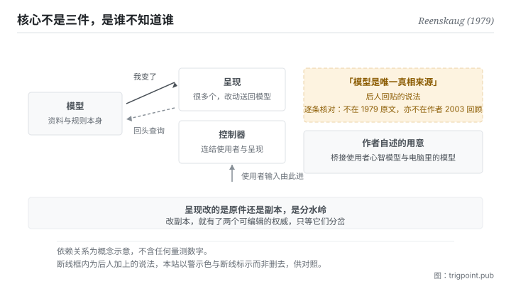

Canonical: https://trigpoint.pub/zh-Hans/collections/software-systems-architecture/mvc-reenskaug-1979  
Captured: 2026-11-02T21:27:43.604346+08:00

> 公开理论阅读镜像。验证层及 Lab 案例请到原站阅读。

「这是为了让资料有唯一真相」：是误读。

# 模型视图控制器

Model-View-Controller (MVC) · Reenskaug (1979)

已对照来源本身 ✓  
软体架构 · 关注点分离  
先读：单一真相来源

## 三句讲透

把资料与画面分开，让同一批资料可以有多个同步的呈现。  
模型里不放任何关于画面怎么显示的资讯，依赖只往一个方向走，这是整个结构的关键。  
至于「模型是唯一真相」这句话，经核对确认不在原文里。

<strong>图 1</strong> · 三件之间的依赖方向：模型不需要知道有谁在看它，变更以通知的方式往外走（作者 2003 年的讲义把这一层写成模式本身的解法，Smalltalk-80 类别库是其中一例），看的那一端自己回头查询；呈现要改动，也是送回模型那一处去改。  
右侧以断线标出一件后人加上的东西：把模型称为唯一真相，这个说法经逐条核对确认不在 1979 年的原文里。

## 一、发生什么事

1978 至 1979 年间，一位访问学者在 Xerox PARC 处理一个问题[\[5\]](#reference-note-5)：使用者要同时看到同一批资料的几种呈现（一张图、一张表、一个输入栏），而这些呈现要保持同步。

他的解法是把资料本身跟呈现彻底分开：1979 年 5 月那份备忘明说，模型里不含任何关于资讯如何在画面上显示的资讯[\[1\]](#reference-note-1)；呈现则向模型提问，取得要显示的资料[\[2\]](#reference-note-2)。同步怎么做，作者 2003 年的讲义写成一条模式：呈现向模型登记为依附者，<strong>模型一变就通知它们，不需要知道它们是什么样的呈现</strong>，呈现收到后自己回头查询[\[3\]](#reference-note-3)。讲义举了两个实作：Smalltalk-80 类别库的变更通知，以及作者自己的 OOram 工具，后者先把变更累积起来，再一次通知呈现[\[3\]](#reference-note-3)。这套通知机制是否已见于 1979 年的两份备忘，本站未核。这个单向的依赖带来一个性质：不管有几个呈现、后来加了几个，资料端的完整性都不受影响。

命名有一段小历史。1979 年 5 月那份备忘用的是四个词，最后一个是「编辑器」，第一个词指的是使用者感兴趣的那个事物[\[1\]](#reference-note-1)；同年 12 月那份改成今天的三词[\[2\]](#reference-note-2)，据作者本人说明，是与另一位研究者长时间讨论之后定下的[\[5\]](#reference-note-5)。作者在 2003 年写过一份回顾，把当初的顶层目标写成支援使用者对相关资讯的心智模型，让使用者能检视与编辑这些资讯[\[3\]](#reference-note-3)；他在自己的 MVC 资料页上说得更直接：根本目的是<strong>桥接使用者的心智模型与电脑里的数位模型</strong>，起点是让使用者能掌控一大批复杂资料[\[5\]](#reference-note-5)。那份回顾本身是为业界会议写的自出版讲义草稿，不是同侪审查论文，本站照实标示。

而本页最重要的一件事是一个<strong>否证</strong>。「模型是单一真相来源」这句话，在深度覆核里被逐条检核，判定<strong>不在</strong> 1979 年的两份备忘，也不在 2003 年的回顾里[\[4\]](#reference-note-4)。它是后来社群回贴上去的框架。原文的关切是使用者的掌控权，不是资料的权威性。

这两件事不冲突（分开资料与呈现，确实使资料端更像一个权威处），但<strong>不能把后来的解读当成原始主张</strong>。这正是本站在段一放它压轴的原因：一个进了所有教科书的分法，其最广为流传的一句解释，经核对是后人加的。

<strong>署名要给对：</strong>概念与命名归 Reenskaug（1979 年 5 月与 12 月两份 Xerox PARC 技术备忘）[\[1\]](#reference-note-1)[\[2\]](#reference-note-2)；两份备忘中，今天的三词命名首见于同年 12 月那份，据作者本人说明为与另一位研究者讨论后的结果[\[2\]](#reference-note-2)[\[5\]](#reference-note-5)；作者本人的回顾出自 2003 年那份自出版讲义草稿[\[3\]](#reference-note-3)，目的叙述另见其 MVC 资料页[\[5\]](#reference-note-5)。<strong>「模型是单一真相来源」不归作者</strong>：经逐条核对确认不在原文，属后人社群回贴的说法[\[4\]](#reference-note-4)。这条是本站有明文更正的一条，署名与说法要分开记。

## 二、为什么这对你重要

这页有两层用途，第二层比第一层有用。

第一层是那个结构本身。你的工作流里几乎一定有「同一批东西的多个呈现」：一份规格与它的简报版、一份清单与它的看板视图、一份原始记录与它的月度摘要。这里的设计问题不是要不要有多个呈现（要），而是<strong>呈现改的是原件，还是它自己手上那一份</strong>。如果是后者，你就有了两个可编辑的权威，接下来只是等它们分岔。原始设计的答案是：呈现可以要求改动，但改动是送一则讯息回模型那一处去做，用的是模型的词汇[\[2\]](#reference-note-2)；呈现手上就算留了一份资料，也只是为了显示快一点的副本[\[1\]](#reference-note-1)。权威只有一处。

第二层是这页自己示范的那件事：<strong>一个说法被普遍相信，跟它出自原文，是两回事。</strong> 你今天引用的多数架构词汇，都经过一层或几层社群转述。转述通常更好用，因为它把概念修得更贴近当代问题。但当你需要往回追（为什么当初这样设计、这个设计解的到底是什么问题），你必须知道自己手上拿的是原话还是转述。

实务上这页给的是一个习惯，而且用得上的场合比想像多：<strong>当你引用一个框架的「用意」时，顺手问一句这句用意是谁说的。</strong> 如果答不出来，那句话很可能是后人加的：它未必错，但它不能拿来当作者的意图去论证。

## 常见误读

所属页核验：已对照来源本身 ✓ · 内容最后修订 2026-10-25

- 常见转述「这个分法的用意是让模型成为唯一真相来源」：经逐条核对，该说法<strong>不在</strong> 1979 年的两份备忘，也不在 2003 年作者本人的回顾里。作者本人把根本目的写成桥接使用者的心智模型与电脑里的数位模型，起点是让使用者能掌控一大批复杂资料。这是后来社群回贴上去的框架，本站在正文、摘要与此处三处同步更正。
- 常见转述「控制器负责应用逻辑」：1979 年 12 月那份把它写成使用者与系统之间的连结，负责安排呈现、把使用者的指令转成讯息交给呈现，而且不该替呈现补东西。把应用逻辑集中到控制器是后来不少网页框架的做法；作者本人也说过，这个问题的面向比他 1979 年所想的更多。两者要分开讲。
- 常见转述「1979 年就叫模型视图控制器」：1979 年 5 月那份的命名是四个词，最后一个是编辑器；今天的三词命名出现在同年 12 月那份，是与另一位研究者讨论之后改的。

## 参考文献

<strong>如何阅读来源注记</strong> 「书目经…核对」指作者、年份、题名与出版项已确认；不代表该来源的主张已被核对。「对照全文核实」指主张已与来源文本本身比对。「对照原站核实」指主张已与该项目的原始网站比对。 定义版本：2026-09-20。

- \[1\] Reenskaug, T. (1979). Thing-Model-View-Editor — an Example from a planningsystem. Xerox PARC Technical Note, May 12, 1979.
- \[2\] Reenskaug, T. (1979). Models — Views — Controllers. Xerox PARC Technical Note, December 10, 1979.
- \[3\] Reenskaug, T. (2003). The Model-View-Controller (MVC): Its Past and Present. JavaZone / JAOO 2003 handout (self-published draft).
- \[4\] 编辑注，无外部来源；全文见正文注 \[4\]。
- \[5\] Reenskaug, T. (n.d.). MVC: Xerox PARC 1978-79. Author's web page, University of Oslo.

## 知识图谱

- [<em>对照 ▸</em>六角架构（Hexagonal Architecture (Ports and Adapters)）](hexagonal-architecture-cockburn-2005.md)

引用格式：Trigpoint，〈模型视图控制器〉，trigpoint.pub/zh-Hans/collections/software-systems-architecture/mvc-reenskaug-1979 · © Strategitect Limited. · 内容最后修订 2026-10-25

## 来源注记

**[1]** Reenskaug, T. (1979, May 12). Thing-Model-View-Editor: An Example from a Planningsystem. Technical note, Xerox PARC. 书目经双源核对。主张已对照全文核实。两份原始备忘中较早的命名版本，四个词依序为事物、模型、视图、编辑器；第一个词指使用者感兴趣的事物，可以具体，也可以是抽象的想法。备忘并写明，模型里不含任何关于资讯如何在画面上显示的资讯。

**[2]** Reenskaug, T. (1979, December 10). Models - Views - Controllers. Technical note, Xerox PARC. 书目经双源核对。主张已对照全文核实。两份原始备忘中，今天的三词命名首见于这份。呈现向模型提问，取得要显示的资料，也可以送讯息请模型更新；控制器是使用者与系统之间的连结。

**[3]** Reenskaug, T. (2003). The Model-View-Controller (MVC): Its Past and Present. Handout, JavaZone (Oslo) and JAOO (Aarhus), September 2003. Draft of August 20, 2003. 书目经双源核对。主张已对照全文核实。两场业界会议的自出版讲义草稿，非同侪审查。摘要把顶层目标写成支援使用者对相关资讯的心智模型，让使用者能检视与编辑这些资讯；讲义把「呈现向模型登记为依附者、模型一变即通知」写成一条模式（同步模型与呈现）的解法，并举 Smalltalk-80 类别库与作者的 OOram 工具两例。

**[4]** 把模型称为单一真相来源这个说法，对照 1979 年两份备忘与 2003 年那份讲义，三份都没有；属后人加上的说法。

**[5]** Reenskaug, T. (n.d.). MVC: Xerox PARC 1978-79. Author's web page, University of Oslo. 访问期、命名经过与目的叙述已对照原站核实。作者本人的 MVC 资料页。

---

[English](../../../en/collections/software-systems-architecture/mvc-reenskaug-1979.md) · [繁體中文](../../../zh-Hant/collections/software-systems-architecture/mvc-reenskaug-1979.md)

[Index](../../README.md) · [Original page](https://trigpoint.pub/zh-Hans/collections/software-systems-architecture/mvc-reenskaug-1979) · [Citation and versions](../../../READING.md)

[Original SVG](assets/mvc-reenskaug-1979.svg) · Display copy adds a white background only.
