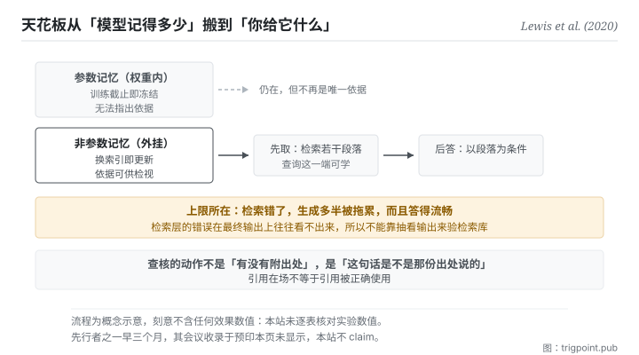

Canonical: https://trigpoint.pub/zh-Hans/collections/software-systems-architecture/retrieval-augmented-generation-lewis-2020  
Captured: 2026-11-02T21:27:43.947390+08:00

> 公开理论阅读镜像。验证层及 Lab 案例请到原站阅读。

一组问答里，答案不在任何取回段落时，仍有一成多答对。

# 检索增强生成

Retrieval-Augmented Generation (RAG) · Lewis et al. (2020)

摘要已核 ✓  
机器学习 · 外部证据  
先读：单一真相来源

## 三句讲透

把模型的记忆拆成两层：压在权重里的，与生成当下才去取的。  
知识因此可以更新、取回的依据可以检视，幻觉的面收窄。  
但品质的天花板也跟着搬家：从模型记得多少，变成你的检索库有多好。

<strong>图 1</strong> · 把记忆分成两层：压在权重里的那一层无法更新也无法指出依据，挂在外面的那一层可以换、可以检视。  
权重里那一层仍在，但不再是作答的唯一依据。  
生成时先取后答。  
下方标出上限所在：品质的天花板从模型记得多少，变成检索库有多好与检索器准不准。

## 一、发生什么事

在论文报告的一组开放领域问答中，就算取回的段落都没有答案，模型还是答对了一成多。纯参数的生成模型把知识封在权重里，这带来三个结构性弱点：知识<strong>过期</strong>（训练截止就冻结）、<strong>不可溯源</strong>（无法指出答案的依据）、以及<strong>在分布外仍然高信度地生成</strong>。

这篇 2020 年的论文的做法是把记忆分两层：参数记忆（权重）之外，再挂一层<strong>非参数记忆</strong>，一个生成当下才去检索的外部文本库[\[1\]](#reference-note-1)。流程是先取后答：把问题转成检索，取回若干段落，再让生成以那些段落为条件作答。原始设计里检索器与生成器一起训练：文件那一端的编码与索引固定不动，问题那一端的编码与生成器一起微调。所以检索这一步有一部分是可学的，不只是外挂。

三个弱点因此各有处置：知识更新变成换索引而不必重训；取回的段落可以拿出来检视（论文把「标示出处」列为纯参数模型的未解问题，并以此作为接上外部记忆的理由；原模型并不输出引用）；生成的分布被外部证据收窄。

但上限也要讲清楚[\[4\]](#reference-note-4)：<strong>检索层自己弱的话，生成多半会被拖累。</strong> 不是必然照错：论文报告过，在一组开放领域问答上，答案不在任何取回段落时仍有一成多答对，权重里那一层会补位。所以品质的天花板从「模型记得多少」搬到「检索库有多好、检索器准不准」。这不是消灭了知识问题，是把它外部化：而外部化的好处是它变得<strong>可以被治理</strong>（你能检查、能更新、能指定范围），不是它消失了。

归属有两处要说。这篇把自己的做法命名为检索增强生成，一般以它为这个术语的出处；<strong>先行者之一</strong>是 2020 年 2 月另一篇把检索增强放在预训练阶段的论文，早它三个月[\[3\]](#reference-note-3)；这篇自己的引言把它与一篇 2019 年的检索式问答模型并列，称两者为近期提出、结合遮罩语言模型与可微检索器的模型[\[1\]](#reference-note-1)。另外，这篇的会议收录本站标为<strong>次级</strong>：那个资讯来自预印本页面的自述附注，不是会议官方纪录[\[2\]](#reference-note-2)；而 2 月那篇的会议收录在其预印本页<strong>没有显示，所以本站不 claim</strong>[\[3\]](#reference-note-3)。这两个决定看起来吹毛求疵，但它们正是本站的做法：能查到什么就说什么。

<strong>署名要给对：</strong>该架构与其命名归 Lewis 等十二位作者（2020，该预印本第一版 5 月 22 日；一般以此为术语出处）[\[1\]](#reference-note-1)；<strong>先行者之一是 2020 年 2 月那篇把检索增强放在预训练阶段的论文</strong>（早三个月）[\[3\]](#reference-note-3)；同篇引言另并列一篇 2019 年的检索式问答模型[\[1\]](#reference-note-1)。会议收录之标示为次级，且 2 月那篇之会议收录本站不 claim[\[2\]](#reference-note-2)[\[3\]](#reference-note-3)。三段要分开署名。

## 二、为什么这对你重要

你大概已经在用这个模式，而且用的是它最弱的形态。

把档案丢给模型、让它读完再回答，那就是检索增强的手工版。它有效，而它的效力完全取决于你丢了什么进去。这页要你把注意力从「怎么问」移到<strong>「取什么给它」</strong>，因为后者才是天花板。

三件事直接可用。

<strong>第一，先建可信的那一层，再谈问法。</strong> 大部分人花力气调整问法，而问法能改善的是表达，不是依据。如果你要它回答的东西依赖一批特定的事实，那批事实得先存在、被整理过、而且你知道它们对。

<strong>第二，引用在场不等于引用被正确使用。</strong> 这是本页最实用的一句。模型可以附上一份真实存在的来源，同时说出那份来源没有说的话。查核的动作不是「有没有附出处」，是<strong>「这句话是不是那份出处说的」</strong>。这一点与本书架最后一页直接相接。

<strong>第三，这个做法对不需要外部知识的任务增益有限</strong>[\[4\]](#reference-note-4)。纯推理、风格改写、结构重排这类任务，挂检索未必有帮助，还可能引入无关内容。判断方法很简单：这个任务答错的时候，是因为它不知道某件事，还是因为它想错了。前者挂检索有用，后者没用。

## 常见误读

所属页核验：摘要已核 ✓ · 本页版次 v2 · 内容最后修订 2026-10-25

- 常见转述「接了检索就不会产生幻觉」：检索错了，生成多半会被拖累，而且答得流畅。这个做法把知识问题外部化，不消灭它。品质的瓶颈有相当部分移到检索库与检索器。
- 常见转述「有引用就代表有根据」：引用在场不等于引用被正确使用。答案可以附一份真实的来源，同时说出那份来源没有说的话。

## 修正记录

- 本站对这篇的会议收录标为次级：该资讯来自预印本页面的自述附注，非会议官方纪录。先行者之一（2020 年 2 月那篇）的会议收录在其预印本页未显示，本站不 claim。
- 2026-10-12 · 本页前版有三处超出原论文，已依全文改正。其一，前版说检索错了生成就会照着错答；论文 §4.1 报告答案不在任何取回文件时仍有 11.8% 答对，改为「多半受拖累」。其二，前版说答案可以附出处；原模型并不输出引用，论文说的是取回的知识可以检视，故改为取回段落可供检视。其三，前版说检索器与生成器一起微调；原设计中文件编码器与索引固定，只微调查询端与生成器。另，「对不需外部知识的任务增益有限甚至为负」改为论文附录的初步观察，删去「甚至为负」。

## 参考文献

<strong>如何阅读来源注记</strong> 「书目经…核对」指作者、年份、题名与出版项已确认；不代表该来源的主张已被核对。「与摘要一致」指主张与论文摘要相符；不含逐句对照全文。「对照全文核实」指主张已与来源文本本身比对。 定义版本：2026-09-20。

- \[1\] Lewis, P. et al. (2020). Retrieval-Augmented Generation for Knowledge-Intensive NLP Tasks. arXiv:2005.11401.
- \[2\] Lewis, P. et al. (2020). Retrieval-Augmented Generation for Knowledge-Intensive NLP Tasks. arXiv:2005.11401.
- \[3\] Guu, K., Lee, K., Tung, Z., Pasupat, P., & Chang, M.-W. (2020). REALM: Retrieval-Augmented Language Model Pre-Training. arXiv:2002.08909.
- \[4\] 编辑注，无外部来源；全文见正文注 \[4\]。

## 知识图谱

- [<em>应用于 ▸</em>生成幻觉（Hallucination in NLG）](llm-hallucination-ji-2023.md)

引用格式：Trigpoint，〈检索增强生成〉，trigpoint.pub/zh-Hans/collections/software-systems-architecture/retrieval-augmented-generation-lewis-2020 · © Strategitect Limited. · 内容最后修订 2026-10-25

## 来源注记

**[1]** Lewis, P., Perez, E., Piktus, A., Petroni, F., Karpukhin, V., Goyal, N., Küttler, H., Lewis, M., Yih, W., Rocktäschel, T., Riedel, S., & Kiela, D. (2020). Retrieval-Augmented Generation for Knowledge-Intensive NLP Tasks. arXiv:2005.11401. 书目经官方记录核对。主张已对照全文核实。预印本第一版 2020-05-22，共 12 位作者。摘要把这套做法描述为结合参数化与非参数化记忆的语言生成；摘要把「为决策标示出处」列为纯参数模型的未解问题，并以此作为接上外部记忆的理由。原始设计中检索器与生成器一起训练，但文件编码器与索引固定，只微调查询端与生成器（该篇 §2.4）。

**[2]** 会议收录之标示：该预印本页面自述收录于 2020 年一场机器学习顶会。本站标为次级：这是预印本页的附注，不是会议官方纪录。

**[3]** Guu, K., Lee, K., Tung, Z., Pasupat, P., & Chang, M.-W. (2020). REALM: Retrieval-Augmented Language Model Pre-Training. arXiv:2002.08909. 书目经官方记录核对。要旨与摘要一致。先行者之一：预印本第一版 2020-02-10，把检索增强放在预训练阶段，早于本页所谈那篇约三个月；本页所谈那篇的引言把它与一篇 2019 年的检索式问答模型并列，本站因此不把它标为唯一的先行者。其会议收录在预印本页没有显示，本站刻意不 claim。

**[4]** 边界：检索错时生成多半受拖累，属推论，不是论文的结论；该篇 §4.1 另报告，在一组开放领域问答上，答案不在任何取回文件时仍有 11.8% 答对，参数记忆可补位。引用在场不等于引用被正确使用，亦属推论（原模型不输出引用）。对无需外部知识的任务增益有限，出自该篇附录 H 的初步观察，其原因原文属推测。

---

[English](../../../en/collections/software-systems-architecture/retrieval-augmented-generation-lewis-2020.md) · [繁體中文](../../../zh-Hant/collections/software-systems-architecture/retrieval-augmented-generation-lewis-2020.md)

[Index](../../README.md) · [Original page](https://trigpoint.pub/zh-Hans/collections/software-systems-architecture/retrieval-augmented-generation-lewis-2020) · [Citation and versions](../../../READING.md)

[Original SVG](assets/retrieval-augmented-generation-lewis-2020.svg) · Display copy adds a white background only.
