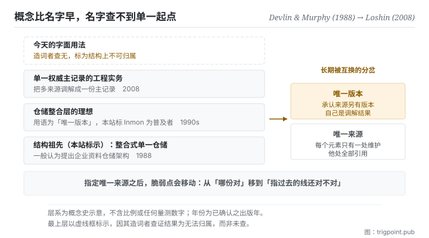

Canonical: https://trigpoint.pub/zh-Hans/collections/software-systems-architecture/single-source-of-truth-concept-history  
Captured: 2026-11-02T21:27:44.222497+08:00

> 公开理论阅读镜像。验证层及 Lab 案例请到原站阅读。

「唯一版本」承认别处还有版本，「只有一处」不承认。

# 单一真相来源

Single Source of Truth (concept history) · Devlin & Murphy (1988) → Loshin (2008)

书目已核 ✓  
Lab 实测 ✓  
软体架构 · 资料治理  
先读：不重复原则

## 三句讲透

单一真相来源说的是：每个元素只在一处被维护，其他地方全部引用它。  
它是结构选择，不是地点选择。  
而它最容易失效的地方不是那个唯一来源，是指向它的那些引用。

<strong>图 1</strong> · 四层概念史由下往上：1988 年的整合式仓储是本站标出的结构祖先，其后是承认他处另有版本的仓储理想，再上是把多来源调解成单一主记录的工程实务，最上是今天的字面用法。  
右侧标出那个关键分岔：承认他处另有版本，与真正只有一处，不是同一件事。

## 一、发生什么事

谈单一真相，有两件事常被当成一件：保留一份调解出来的权威版本，与真正只在一处维护。这个概念的历史比它的名字长很多，而名字比概念晚很多。

本站采为可追溯工程祖先的，是 1988 年一篇期刊论文，一般认为它提出了企业资料仓储的架构[\[1\]](#reference-note-1)：把分散在各处的作业资料整合进单一仓储，让「哪一份才是对的」这个问题有答案。那篇论文解的是决策支援的资料一致性。

接下来的一段最容易被讲错。资料仓储业界在 1990 年代已流传「唯一版本的真相」这个说法；一般把它与 Inmon 一派的企业资讯工厂论述连在一起，但它不见于 Inmon 与 Kimball 早期资料仓储著作的索引与目录[\[2\]](#reference-note-2)。注意那个词是「版本」。它承认一件事：作业系统那边还有别的版本，仓储只是调解出来的那一份。这跟「真正只有一处」在语义上不同，而两者长期被互换使用。2008 年一本主资料管理的书，是把「调解成单一权威主记录」写成工程实务的代表著作之一[\[3\]](#reference-note-3)；至于「唯一版本的真相」作为书名，2006 年已见于另一本客户资料整合的书[\[4\]](#reference-note-4)。

而今天软体架构意义下的字面术语，<strong>查无单一造词者</strong>[\[5\]](#reference-note-5)。它是社群泛化出来的用法，广泛使用，没有公认的起点。本站因此把它标为结构上不可归属，而不是硬给一个人。

概念本身在这段历史里稳定下来的形状是这样：指定一处为唯一维护点，其他位置全部引用而非复制，并把资料规范化到一个标准形式，使「哪份才对」不再是一个要问的问题。它的反面不是「有两份」，而是「有两份而且都可以被编辑」。

最后一件要说在段一的事：这条原则有一个明文的反对者。2022 年那本资料网格在第 2 章用一整节主张「不要期待单一真相来源」[\[6\]](#reference-note-6)，理由与规模有关。本书架把那一页放在最后，让它回头跟这一页对打。

<strong>署名要给对：</strong>结构祖先，本站归 Devlin 与 Murphy（1988，期刊论文）[\[1\]](#reference-note-1)；「唯一版本的真相」在 1990 年代的资料仓储业界已有流传，一般与 Inmon 一派连在一起，但此词不见于他与 Kimball 早期资料仓储著作的索引与目录[\[2\]](#reference-note-2)，本站因此把他标为普及者，不标为造词者；该用语用作书名，例见 Dyché 与 Levy（2006）[\[4\]](#reference-note-4)；把调解成单一主记录写成工程实务的代表著作，举 Loshin（2008）[\[3\]](#reference-note-3)。今天字面术语的造词者<strong>无法归属</strong>，本站标为结构上不可得[\[5\]](#reference-note-5)。四段要分开署名：把整条线压成「某某在某年提出单一真相来源」，会一次弄错词、人与年份。

## 二、为什么这对你重要

你手上大概有一份「哪个是最新版」的问题，只是它不叫这个名字。

一份判准的最新版在哪里？如果答案是「在我脑里，另外三处是旧的抄本」，那你已经在维护四份。原则的做法是把那三处改成连结，不是把它们删掉。差别在于：删掉会让人再抄一次，连结会让人跳过去。

但本页真正要你带走的不是这件事，是它的<strong>失效形状</strong>。指定唯一来源之后，系统的脆弱点会<strong>移动</strong>：从「哪份是对的」移到「指过去的那条线还对不对」。而后者的失效是安静的，因为那条线看起来一直在。

这件事在使用模型的时候放大得很快。你把一份规格指定为准，然后在十个地方写「依规格办」。半年后规格改了名、搬了位置、或者其中一段被拆到另一份文件里。那十处引用不会报错，它们只会指向一个不再说同一件事的地方。而模型读到那些引用时，会很配合地照着它找到的东西做。

所以这页给的实务只有两问。第一，这个元素的唯一维护点在哪，讲得出来吗。第二，<strong>指过去的那些线，上次验是什么时候。</strong> 第二问比第一问难答，也比第一问重要。

## 常见误读

所属页核验：书目已核 ✓ · 内容最后修订 2026-10-25

- 常见转述「单一真相来源是 1992 年那本资料仓储经典提出的」：没有证据显示该书用过这个字面术语；一篇业界文章指出，连较接近的「唯一版本的真相」都不见于该书的索引与目录。「唯一版本的真相」语义也不同（承认他处另有版本）。今天的字面术语查无单一造词者；「唯一版本的真相」则在 2006 年已有一本客户资料整合的书以它为书名。要用哪个词、归给谁，两件都要分开讲。
- 常见转述「做到单一真相就是把资料集中到一个资料库」：原则讲的是每个元素指定一处维护、他处引用，这是结构决定，不是拓朴决定。分散而同步的系统同样可以满足它。

## 参考文献

<strong>如何阅读来源注记</strong> 「书目经…核对」指作者、年份、题名与出版项已确认；不代表该来源的主张已被核对。「对照全文核实」指主张已与来源文本本身比对。 定义版本：2026-09-20。

- \[1\] Devlin, B. A. & Murphy, P. T. (1988). An architecture for a business and information system. IBM Systems Journal, 27(1), 60–80.
- \[2\] Smith, S. J. (2018, June 5). Single Version of the Truth - Not Optional. Eckerson Group.
- \[3\] Loshin, D. (2008). Master Data Management. Morgan Kaufmann / OMG Press. ISBN 978-0-12-374225-4.
- \[4\] Dyché, J. & Levy, E. (2006). Customer Data Integration: Reaching a Single Version of the Truth. Wiley. ISBN 978-0-471-91697-0.
- \[5\] 编辑注，无外部来源；全文见正文注 \[5\]。
- \[6\] Dehghani, Z. (2022). Data Mesh: Delivering Data-Driven Value at Scale. O'Reilly. Chapter 2.

## 知识图谱

- [<em>对照 ▸</em>微服务（Microservices）](microservices-lewis-fowler-2014.md)
- [<em>对照 ▸</em>CAP 定理（CAP Theorem）](cap-theorem-brewer-2000.md)
- [<em>对照 ▸</em>资料网格（Data Mesh）](data-mesh-dehghani-2022.md)

引用格式：Trigpoint，〈单一真相来源〉，trigpoint.pub/zh-Hans/collections/software-systems-architecture/single-source-of-truth-concept-history · © Strategitect Limited. · 内容最后修订 2026-10-25

## 来源注记

**[1]** Devlin, B. A. & Murphy, P. T. (1988). An architecture for a business and information system. IBM Systems Journal, 27(1), 60–80. DOI 10.1147/sj.271.0060. 书目经官方记录核对。一般认为这篇论文提出了企业资料仓储的架构：把分散的作业资料整合进单一仓储。本站采为此概念可追溯的工程祖先。

**[2]** Smith, S. J. (2018, June 5). Single Version of the Truth - Not Optional. Eckerson Group. 主张已对照全文核实。作者自述约 1995 年在商业智慧业界接触到「唯一版本的真相」这个说法，并指出它不见于 Kimball 与 Inmon 早期资料仓储著作的索引与目录。一般把这个词与 Inmon 一派的企业资讯工厂论述连在一起；本站把 Inmon 标为普及者，不标为造词者。这是本站的标示，本文没有谈谁造词、谁普及。

**[3]** Loshin, D. (2008). Master Data Management. Morgan Kaufmann / OMG Press. ISBN 978-0-12-374225-4. 书目经官方记录核对。把多来源调解成单一权威主记录写成工程实务的代表著作之一。

**[4]** Dyché, J. & Levy, E. (2006). Customer Data Integration: Reaching a Single Version of the Truth. Wiley. 书目经官方记录核对。该用语作为书名出现于此，非 Loshin。

**[5]** 字面术语（今天软体架构意义下的用法）本站查无单一造词者，标为无法归属：广泛使用，没有公认的起点。

**[6]** Dehghani, Z. (2022). Data Mesh: Delivering Data-Driven Value at Scale. O'Reilly. 书目经官方记录核对。第 2 章〈领域所有权原则〉有一节题为「拥抱最相关的领域资料：不要期待单一真相来源」。见本站资料网格页。

---

[English](../../../en/collections/software-systems-architecture/single-source-of-truth-concept-history.md) · [繁體中文](../../../zh-Hant/collections/software-systems-architecture/single-source-of-truth-concept-history.md)

[Index](../../README.md) · [Original page](https://trigpoint.pub/zh-Hans/collections/software-systems-architecture/single-source-of-truth-concept-history) · [Citation and versions](../../../READING.md)

[Original SVG](assets/single-source-of-truth-concept-history.svg) · Display copy adds a white background only.
