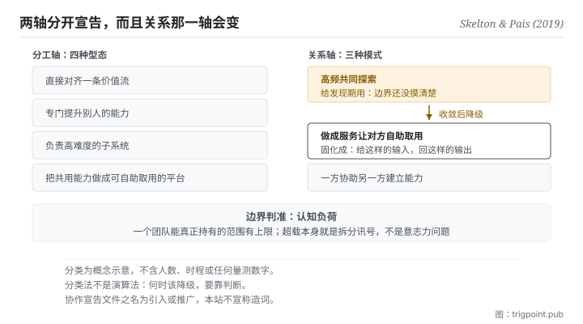

Canonical: https://trigpoint.pub/zh-Hans/collections/software-systems-architecture/team-topologies-skelton-pais-2019  
Captured: 2026-11-02T21:27:44.590938+08:00

> 公开理论阅读镜像。验证层及 Lab 案例请到原站阅读。

两个团队要高频共探，还是一方做成服务让另一方自助？

# 团队拓扑

Team Topologies · Skelton & Pais (2019)

书目已核 ✓  
软体架构 · 接口与认知负荷  
先读：康威定律

## 三句讲透

团队之间的关系要像介面一样被明确宣告，而不是靠默契。  
边界的判准是认知负荷：一个团队能真正持有的范围有上限。  
而关系本身预期会变：发现期需要高频共探，收敛之后应该降级。

<strong>图 1</strong> · 左边是分工轴的四种型态，右边是关系轴的三种模式。  
书的主张是两轴要分开宣告，而且关系那一轴预期会随时间演化：发现期用高频共探，收敛之后降级为服务式消费。  
底部是边界判准：一个团队能真正持有的范围有上限，超载本身就是拆分讯号。

## 一、发生什么事

两个团队该密切共探，还是一方把成果做成服务让另一方自取，答案会随阶段改变。这本书的起点就是上一页：既然系统结构会镜像组织沟通结构，那么<strong>刻意设计团队边界</strong>就是一种架构手段[\[1\]](#reference-note-1)。

它给的第一件事是分工轴的四种型态：直接对齐价值流的、专门去提升别人能力的、负责高难度子系统的、以及把共用能力做成平台供人自助取用的[\[1\]](#reference-note-1)。这四种不是位阶，是<strong>职能形态</strong>。

第二件事是关系轴的三种模式：高频共同探索、把成果做成服务让对方自助取用、以及一方协助另一方建立能力[\[1\]](#reference-note-1)。这一轴是本书真正的贡献。

第三件事是它要求把关系<strong>写下来</strong>：每个团队发布一份「怎么跟我协作」的显式文件[\[1\]](#reference-note-1)。这件事的名字归属要小心：本站只说此书把那个词作为核心做法提出并推广，不宣称是两位作者所造[\[2\]](#reference-note-2)。

第四件事是边界判准：<strong>认知负荷</strong>。一个团队能真正持有的范围有上限，超载本身就是拆分讯号[\[1\]](#reference-note-1)。两位作者在出版社网站的文章中，把这个概念的界定归于 Sweller 1988 年的认知负荷研究[\[4\]](#reference-note-4)（书内如何引用，本站未核）。

而最容易被跳过、也最有用的一件是：<strong>互动模式预期会演化</strong>[\[3\]](#reference-note-3)。共探是给发现期用的，一旦边界摸清楚了，这段关系应该降级为服务式消费。关系的升降级，就是组织版的架构重构。

<strong>署名要给对：</strong>四种型态、三种互动模式与整套组织设计语汇归 Skelton 与 Pais（2019；第二版 2025）[\[1\]](#reference-note-1)；协作宣告文件之名，本站标为此书<strong>引入或推广，不宣称造词</strong>[\[2\]](#reference-note-2)；团队关系会改变为作者明文[\[3\]](#reference-note-3)；认知负荷之理论根，两位作者归于 Sweller 1988 年的研究[\[4\]](#reference-note-4)。组织与结构同构之前提归上一页的康威定律，不归本书。四段要分开署名。

## 二、为什么这对你重要

把「团队」换成「你的每一条线」，这页就落地了：不管那条线后面是别人、是你自己的另一个角色，还是一个模型。

第一个可搬的是那份宣告文件。你跟一条线协作时，对方（或未来的你）需要知道的其实就那几件：这条线负责什么、不负责什么、要它做事该怎么给、什么情况要先问你。把这几件写下来，你就有了一份介面文件。<strong>大部分协作摩擦不是能力问题，是这份文件不存在，于是每次都要重新谈。</strong>

第二个可搬的更反直觉，也是本页的标题那句：<strong>协作不是越紧密越好。</strong> 三种模式各有其时：一件事刚开始、边界还没摸清楚，你需要高频来回；但一旦摸清楚了，继续高频来回就是浪费：那时该做的是把它固化成「给定这样的输入，回这样的输出」，然后你不再参与过程。

这一点在跟模型协作时特别明显。你在探索一个新任务时，会来回二十轮；那二十轮的价值是<strong>找出边界</strong>。而多数人的问题是：找到边界之后，还在继续来回二十轮，因为没有把它固化。这页的说法是，那不是勤奋，是关系没有降级。

第三个是认知负荷那条线。当你发现自己持有的范围已经到「每次切换都要重新载入一遍」的程度，那不是意志力问题，是范围超过上限了。上限是判准，不是缺点。

## 常见误读

所属页核验：书目已核 ✓ · 内容最后修订 2026-10-25

- 常见转述「Team API 是那两位作者造的词」：本站只能说此书把它提出并推广，不宣称造词，也不否认。
- 常见转述「这是一套实证定律」：这是业界出版的组织设计分类法，非同侪审查理论。当语汇用可以，当定律用不行。
- 常见转述「四种型态就是四种团队，照套即可」：分类法不是演算法。何时该把一段关系从共探降级为服务式消费，仍是判断题。

## 参考文献

<strong>如何阅读来源注记</strong> 「书目经…核对」指作者、年份、题名与出版项已确认；不代表该来源的主张已被核对。「对照全文核实」指主张已与来源文本本身比对。 定义版本：2026-09-20。

- \[1\] Skelton, M. & Pais, M. (2019). Team Topologies: Organizing Business and Technology Teams for Fast Flow. IT Revolution Press.
- \[2\] 编辑注，无外部来源；全文见正文注 \[2\]。
- \[3\] Skelton, M. & Pais, M. (2019). Team Topologies: Organizing Business and Technology Teams for Fast Flow. IT Revolution Press.
- \[4\] Skelton, M. & Pais, M. (2021). Team Cognitive Load. IT Revolution. Published 19 January 2021.
- \[5\] Skelton, M. & Pais, M. (2025). Team Topologies (2nd ed.): Organizing Business and Technology for Fast Flow of Value. IT Revolution Press.

## 知识图谱

- [<em>前置 ▸</em>康威定律（Conway's Law）](conways-law-conway-1968.md)
- [<em>应用于 ▸</em>微服务（Microservices）](microservices-lewis-fowler-2014.md)

引用格式：Trigpoint，〈团队拓扑〉，trigpoint.pub/zh-Hans/collections/software-systems-architecture/team-topologies-skelton-pais-2019 · © Strategitect Limited. · 内容最后修订 2026-10-25

## 来源注记

**[1]** Skelton, M. & Pais, M. (2019-09-17). Team Topologies: Organizing Business and Technology Teams for Fast Flow. IT Revolution Press. 书目经官方记录核对。初版 2019 年 9 月 17 日出版；第二版 2025 年 9 月 23 日出版，副题改为 Organizing Business and Technology for Fast Flow of Value（见参考文献 [5]）。四种团队型态与三种互动模式的名称，已对照两位作者的网站核对；书的内文本站未核。

**[2]** Team API 之归属：本站只说此书把它作为核心做法提出并推广；不宣称两位作者造词，也不否认。

**[3]** 两位作者的网站明文写道，团队之间的关系会随新目标设定与新发现而改变。本站据此把关系轴讲成可升降级，而非固定编组。

**[4]** Skelton, M. & Pais, M. (2021-01-19). Team Cognitive Load. IT Revolution. 书目经出版社记录核对。主张已对照全文核实。两位作者在出版社网站的文章中，把认知负荷的界定归于心理学家 Sweller 1988 年的研究，并据此谈团队层级的认知负荷。书内如何引用该理论，本站未核。

---

[English](../../../en/collections/software-systems-architecture/team-topologies-skelton-pais-2019.md) · [繁體中文](../../../zh-Hant/collections/software-systems-architecture/team-topologies-skelton-pais-2019.md)

[Index](../../README.md) · [Original page](https://trigpoint.pub/zh-Hans/collections/software-systems-architecture/team-topologies-skelton-pais-2019) · [Citation and versions](../../../READING.md)

[Original SVG](assets/team-topologies-skelton-pais-2019.svg) · Display copy adds a white background only.
