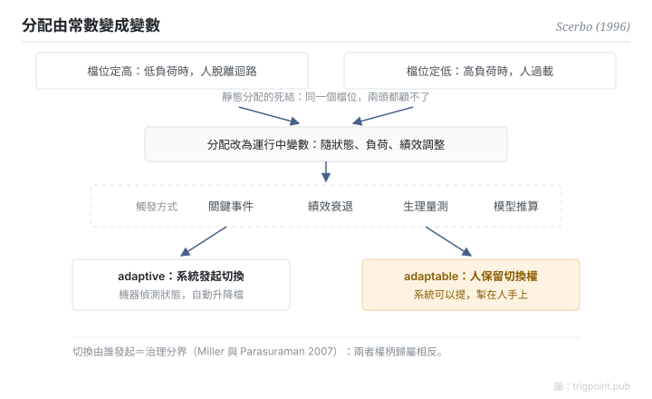

Canonical: https://trigpoint.pub/zh-Hant/collections/hai/adaptive-automation  
Captured: 2026-10-05T03:32:18.464092+08:00

> 公開理論閱讀鏡像。驗證層及 Lab 案例請到原站閱讀。

分工要在設計時定死，還是讓系統在運行中自己調？

# 適應性自動化

adaptive automation · Scerbo (1996)

書目已核 ✓  
Lab 實測 ✓  
人機自動化 · 功能分配

## 三句講透

分工不必在設計時定死：可以在運行中隨負荷、狀態、績效即時升降檔。  
這就是適應性自動化：負荷爆錶時機器接手，閒時交回人手。  
真正的治理問題是：升降檔的決定權，在系統還是在人。

<strong>圖 1</strong> · 適應性自動化的觸發與權柄示意。  
靜態分配無法同時解決兩頭風險；分配改為運行中變數後，真正的治理分界在切換由誰發起。  
adaptive 是系統發起，adaptable 是人保留切換權（Miller 與 Parasuraman 2007）。

## 一、發生什麼事

靜態分級有個死結：檔位定得高，人在低負荷時脫離迴路；定得低，人在高負荷時過載。同一個檔位無法同時應付兩頭。1996 年，Scerbo 整合出理論定式：讓分配隨時間變動[\[1\]](#reference-note-1)。文獻常見的觸發依據包括關鍵事件、績效衰退、生理量測與模型推算等。Kaber 與 Endsley 其後的實證顯示，等級本身仍是績效主因；適應性切換主要影響主觀負荷與次任務表現，對主任務績效與情境覺察影響甚小。該研究的切換依預設排程，並非依操作員即時狀態觸發[\[2\]](#reference-note-2)。兩條路線作用在不同的面。Miller 與 Parasuraman 再切開一條關鍵界線：adaptive 是系統發起切換，adaptable 是人保留切換權，兩者的權力結構相反[\[3\]](#reference-note-3)。

<strong>署名要給對：</strong>「adaptive automation」概念前史早於 Scerbo（如 Rouse 的 adaptive aiding），Scerbo（1996）是理論整合與定式者，並非字面首創。把 adaptive 與 adaptable 之分用於委派設計、最常被引用的來源是 Miller 與 Parasuraman（2007）；這條分野在更早的文獻已見（如 Oppermann 1994），各作者對 adaptive 的定義也不一致，引用時要註明用的是哪一種。

## 二、為什麼這對你重要

「讓系統自己判斷何時接手」聽起來最智能，但它同時意味着人交出了切換權。對一人工作室來說，這條界線是治理核心：自動化面可以有排程、有觸發、有建議，但升降檔那一下由誰來按，決定了出事時責任和覺知在哪裏。判斷需要人輸入的環節，切換權就不應該留在系統手上。

適用邊界：adaptive 指系統發起切換，adaptable 指人保留切換權，兩者不可互換；會動不必然比靜態好，實證中適應性切換主要影響的是主觀負荷，而非主任務績效與情境覺察；正典定義句本頁引不出來。

## 修正記錄

- 2026-09-27 · 原寫 Kaber 與 Endsley 2004 顯示「適應性調節的效果隨切換週期而異」，並稱「切換時機設計不當反而增加協調成本」。對照該文全文 Table 3 與結論段：切換週期對三級情境覺察皆無顯著主效應，適應性切換主要影響主觀負荷與次任務表現，對主任務績效與情境覺察影響甚小；原文未見支持「增加協調成本」之結果。已改寫結果句、刪去該句，並補註該研究以預設排程切換。

## 參考文獻

<strong>如何閱讀來源註記</strong> 「書目經…核對」指作者、年份、題名與出版項已確認；不代表該來源的主張已被核對。「對照全文核實」指主張已與來源文本本身比對。「依多源一致轉述」指主張建立於多份彼此一致、轉述該來源的資料，而非原文件本身。 定義版本：2026-09-20。

- \[1\] Scerbo, M. W. (1996). Theoretical Perspectives on Adaptive Automation. In R. Parasuraman & M. Mouloua (Eds.), Automation and Human Performance: Theory and Applications (pp. 37–63). Mahwah, NJ: Lawrence Erlbaum Associates. https://doi.org/10.1201/9781315137957
- \[2\] Kaber, D. B., & Endsley, M. R. (2004). The Effects of Level of Automation and Adaptive Automation on Human Performance, Situation Awareness and Workload in a Dynamic Control Task. Theoretical Issues in Ergonomics Science, 5(2), 113–153. https://doi.org/10.1080/1463922021000054335
- \[3\] Miller, C. A., & Parasuraman, R. (2007). Designing for Flexible Interaction Between Humans and Automation: Delegation Interfaces for Supervisory Control. Human Factors, 49(1), 57–75. https://doi.org/10.1518/001872007779598037

## 知識圖譜

- [<em>對照 ▸</em>自動化等級（LOA）](levels-of-automation.md)
- [<em>應用於 ▸</em>脫離迴路失能](out-of-the-loop.md)

引用格式：Trigpoint，〈適應性自動化〉，trigpoint.pub/zh-Hant/collections/hai/adaptive-automation · © Strategitect Limited. · 內容最後修訂 2026-09-28

## 來源註記

**[1]** Scerbo, M. W. (1996). Theoretical Perspectives on Adaptive Automation. In Parasuraman & Mouloua (Eds.), Automation and Human Performance: Theory and Applications (pp. 37–63). Erlbaum. 書目經多源交叉核對。要旨依多源一致轉述。

**[2]** Kaber, D. B., & Endsley, M. R. (2004). The Effects of Level of Automation and Adaptive Automation on Human Performance, Situation Awareness and Workload in a Dynamic Control Task. Theoretical Issues in Ergonomics Science, 5(2), 113–153. 主張已對照全文核實。

**[3]** Miller, C. A., & Parasuraman, R. (2007). Designing for Flexible Interaction Between Humans and Automation. Human Factors, 49(1), 57–75. 書目經雙源核對。adaptive 與 adaptable 之分依多源一致轉述。

---

[English](../../../en/collections/hai/adaptive-automation.md) · [简体中文](../../../zh-Hans/collections/hai/adaptive-automation.md)

[Index](../../README.md) · [Original page](https://trigpoint.pub/zh-Hant/collections/hai/adaptive-automation) · [Citation and versions](../../../READING.md)

[Original SVG](assets/adaptive-automation.svg) · Display copy adds a white background only.
