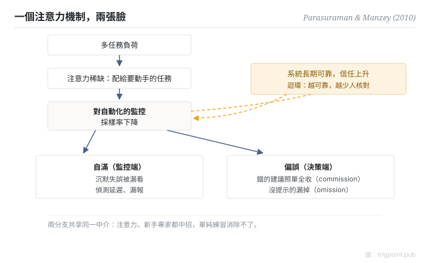

Canonical: https://trigpoint.pub/zh-Hant/collections/hai/automation-complacency  
Captured: 2026-10-05T03:32:18.574770+08:00

> 公開理論閱讀鏡像。驗證層及 Lab 案例請到原站閱讀。

監控時漏看，決策時盲從：兩個現象，同一個注意力機制。

# 自動化自滿與偏誤

automation complacency & bias · Parasuraman & Manzey (2010)

摘要已核 ✓  
Lab 實測 ✓  
人機自動化 · 信任與依賴

## 三句講透

自滿與偏誤是同一個注意力機制的兩張臉：注意力從自動化輸出撤走，監控端漏看沉默失誤（自滿），決策端盲從系統建議（偏誤）。  
它來自多任務下注意力的分配方式，長期練習也消除不了。

<strong>圖 1</strong> · 自滿與偏誤的共同注意力機制示意。  
多任務負荷令注意力稀缺，對自動化的監控採樣率下降，監控端漏看沉默失誤（自滿），決策端盲從提示（偏誤）。  
系統越可靠，信任越高，採樣率跌得越快，形成自我強化迴環。  
原論文另畫一條負回饋（自動化失效的經歷會壓低自滿傾向），本圖從略。  
示意重繪自 Parasuraman 與 Manzey（2010）整合模型。

## 一、發生什麼事

兩種失誤一個出在監控端、一個出在決策端，看起來毫不相干。2010 年，Parasuraman 與 Manzey 回顧多年實證研究，把兩個一直分開講的現象整合成單一模型[\[1\]](#reference-note-1)。機制鏈是這樣：多任務負荷令注意力稀缺，人把注意力配給要動手的任務，對自動化的監控採樣率隨之下降。自滿分支：沉默失誤被漏看，偵測延遲。偏誤分支：把系統提示當捷思，替代自己的資訊搜尋，錯的建議照單全收（commission），沒提示的就漏掉（omission）。可靠度越高的系統，信任越高，採樣率跌得越狠：一個自我強化的迴環。論文推定另有一條方向相反的迴環：經歷過自動化失效，信任與自滿傾向就會回落。新手專家都中招，長時間的練習消除不了它；論文提到變動任務優先級的訓練，以及親身經歷自動化失效，或許能減輕效應。

<strong>署名要給對：</strong>「automation bias」一詞在文中的定義出自 Mosier 與 Skitka（1996）；Parasuraman 與 Manzey 的貢獻是 2010 年的注意力整合模型。complacency 一詞更早見於 NASA 航空安全通報系統的事件編碼項（Billings 等，1976），Wiener（1981）曾討論其定義；Parasuraman 與 Riley（1997）則是「自動化誤用」框架的參照。三個座標分清楚，引用才給得對。

## 二、為什麼這對你重要

自動化輸出的品質越穩定，你核對它的頻率就越低，這條曲線在你身上一樣成立。有效的干預主要落在設計層：強制驗證步驟、抽查機制、變動的核對節奏，或者把關鍵決策鎖回人手。靠「提醒自己保持警惕」去對抗一個注意力結構，勝算很低。

適用邊界：偏誤特指不完美決策輔助下的 commission 與 omission 錯誤，不等於一般過度信任；本頁機制以摘要核對為主，只有幾處對過全文，需要精確參數的設計不能以此為據。

## 參考文獻

<strong>如何閱讀來源註記</strong> 「書目經…核對」指作者、年份、題名與出版項已確認；不代表該來源的主張已被核對。「與摘要一致」指主張與論文摘要相符；不含逐句對照全文。 定義版本：2026-09-20。

- \[1\] Parasuraman, R., & Manzey, D. H. (2010). Complacency and Bias in Human Use of Automation: An Attentional Integration. Human Factors: The Journal of the Human Factors and Ergonomics Society, 52(3), 381–410. https://doi.org/10.1177/0018720810376055
- \[2\] Mosier, K. L., & Skitka, L. J. (1996). Human Decision Makers and Automated Decision Aids: Made for Each Other? In R. Parasuraman & M. Mouloua (Eds.), Automation and Human Performance: Theory and Applications (pp. 201–220). Mahwah, NJ: Lawrence Erlbaum Associates. https://doi.org/10.1201/9781315137957
- \[3\] Parasuraman, R., & Riley, V. (1997). Humans and Automation: Use, Misuse, Disuse, Abuse. Human Factors, 39(2), 230–253. https://doi.org/10.1518/001872097778543886
- \[4\] Billings, C. E., Lauber, J. K., Funkhouser, H., Lyman, G., & Huff, E. M. (1976). Aviation Safety Reporting System (Technical Report TM-X-3445). Moffett Field, CA: NASA Ames Research Center. https://ntrs.nasa.gov/citations/19760026757 (as cited in Parasuraman & Manzey, 2010)
- \[5\] Wiener, E. L. (1981). Complacency: Is the term useful for air safety? In Proceedings of the 26th Corporate Aviation Safety Seminar (pp. 116–125). (as cited in Parasuraman & Manzey, 2010)

## 知識圖譜

- [<em>前置 ▸</em>警覺遞減](vigilance-decrement.md)

引用格式：Trigpoint，〈自動化自滿與偏誤〉，trigpoint.pub/zh-Hant/collections/hai/automation-complacency · © Strategitect Limited. · 內容最後修訂 2026-09-28

## 來源註記

**[1]** Parasuraman, R., & Manzey, D. H. (2010). Complacency and Bias in Human Use of Automation: An Attentional Integration. Human Factors, 52(3), 381–410. 書目經官方記錄核對。要旨與摘要一致。

---

[English](../../../en/collections/hai/automation-complacency.md) · [简体中文](../../../zh-Hans/collections/hai/automation-complacency.md)

[Index](../../README.md) · [Original page](https://trigpoint.pub/zh-Hant/collections/hai/automation-complacency) · [Citation and versions](../../../READING.md)

[Original SVG](assets/automation-complacency.svg) · Display copy adds a white background only.
