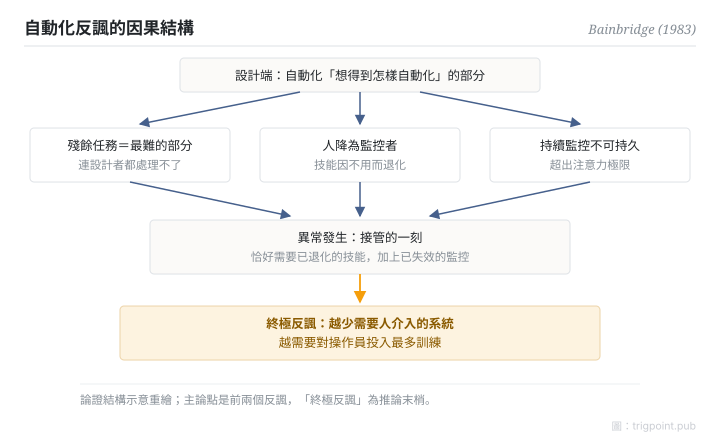

Canonical: https://trigpoint.pub/zh-Hant/collections/hai/ironies-of-automation  
Captured: 2026-10-05T03:32:19.362518+08:00

> 公開理論閱讀鏡像。驗證層及 Lab 案例請到原站閱讀。

把人排除在迴路外，最難的殘餘工作卻仍要人接手。

# 自動化反諷

ironies of automation · Bainbridge (1983)

已對照來源本身 ✓  
人機自動化 · 奠基悖論

## 三句講透

自動化想取代不可靠的人，結果把最難、最關鍵的殘餘工作留給一個技能正在退化的人。  
自動化越成功，人的角色越吃力。

<strong>圖 1</strong> · 自動化反諷的因果結構。  
設計端把「想得到怎樣自動化」的部分自動化，殘餘的難題、退化的技能、不可能的持續監控，全部壓在異常接管的一刻。  
示意重繪自 Bainbridge（1983）論證結構。

## 一、發生什麼事

要讓系統更可靠，最自然的做法是減少人的參與。1983 年，UCL 心理學者 Bainbridge 用一篇五頁短文，戳穿了自動化設計的核心假設[\[1\]](#reference-note-1)。設計者視操作員為不可靠，想把人排除在系統之外，她指出這種態度帶著兩個反諷。第一，設計者自己的失誤，可能就是運作問題的一大來源。第二，設計者能自動化的，只是「想得到怎樣自動化」的部分：剩下的，恰好是連設計者都處理不了的難題，而這些難題全數落回操作員身上。

同時，人被降為監控者：長期不落手，操作技能隨之退化；持續監控本身又超出人的注意力極限，連「偵測到該接管」這一步都靠不住。等到異常真正發生，系統同時需要已退化的技能和已失效的監控。

談到操作員訓練時，她另加一句帶著「或許」的推論：越成功、越少需要人介入的自動化系統，可能反而最需要在操作員訓練上投入。

<strong>署名要給對：</strong>「Ironies of Automation」由 Bainbridge 一人命名兼完成整套論證（1983），歸屬罕見地乾淨。文中「持續監控約半小時就失效」一句，Bainbridge 引的是 Mackworth（1950）的研究報告；「警覺遞減」節點引的是 Mackworth 1948 年的實驗論文。兩處年份不同，是因為引的是不同出版物。主論點是開頭兩個反諷；「越成功可能越需要訓練」是談訓練時帶限定詞的推論，引用時不要倒置。

## 二、為什麼這對你重要

把工作交給 AI agent 之後，你的角色不會消失，只會變形：由執行者變成異常處理者。而異常處理恰恰要求你對這件工作保持手感。所以委派設計要問的不是「這步能不能自動化」，而是「自動化之後，留給人的那部分，人還做不做得來」。

給自己留一條定期落手的通道，不是低效，是維持接管能力的成本。全自動跑得越順，這條通道越值錢。

適用邊界：本文是因果論證，沒有給出該撥到哪一檔的答案；文中的半小時數字只能當量級參考。

## 參考文獻

<strong>如何閱讀來源註記</strong> 「書目經…核對」指作者、年份、題名與出版項已確認；不代表該來源的主張已被核對。「對照全文核實」指主張已與來源文本本身比對。「轉引自」指本頁未讀原文，引註取自所列來源。 定義版本：2026-09-20。

- \[1\] Bainbridge, L. (1983). Ironies of Automation. Automatica, 19(6), 775–779. https://doi.org/10.1016/0005-1098(83)90046-8
- \[2\] Mackworth, N. H. (1950). Researches on the Measurement of Human Performance. 轉引自 Bainbridge (1983)。

引用格式：Trigpoint，〈自動化反諷〉，trigpoint.pub/zh-Hant/collections/hai/ironies-of-automation · © Strategitect Limited. · 內容最後修訂 2026-09-28

## 來源註記

**[1]** Bainbridge, L. (1983). Ironies of Automation. Automatica, 19(6), 775–779. 書目經多源交叉核對。主張已對照全文核實。

---

[English](../../../en/collections/hai/ironies-of-automation.md) · [简体中文](../../../zh-Hans/collections/hai/ironies-of-automation.md)

[Index](../../README.md) · [Original page](https://trigpoint.pub/zh-Hant/collections/hai/ironies-of-automation) · [Citation and versions](../../../READING.md)

[Original SVG](assets/ironies-of-automation.svg) · Display copy adds a white background only.
