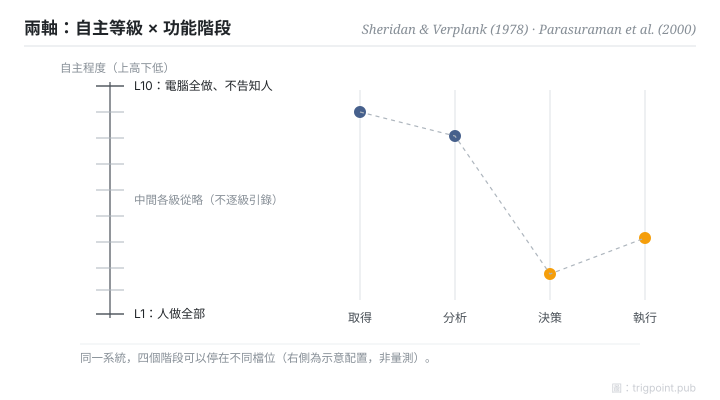

Canonical: https://trigpoint.pub/zh-Hant/collections/hai/levels-of-automation  
Captured: 2026-10-05T03:32:19.389519+08:00

> 公開理論閱讀鏡像。驗證層及 Lab 案例請到原站閱讀。

「自動化就是開或者不開」：沒這麼簡單。

# 自動化等級

levels of automation · Sheridan & Verplank (1978) · Parasuraman, Sheridan & Wickens (2000)

書目已核 ✓  
Lab 實測 ✓  
人機自動化 · 功能分配

## 三句講透

自動化程度是連續刻度：由「人做全部」到「機器全做、不告知人」。  
而且刻度要逐階段分開撥：資訊取得、資訊分析、決策選擇、動作執行，各自可以停在不同檔位。  
單一開關的想像，正是大多數自動化設計錯誤的起點。

<strong>圖 1</strong> · 兩軸模型示意重繪：十級刻度（Sheridan & Verplank 1978）× 四階段（Parasuraman、Sheridan 與 Wickens 2000）。  
中間各級文字從略：原報告表格位置未一手核對，不逐級引錄原文。  
右側檔位為示意配置，非量測。

## 一、發生什麼事

把自動化當成開關，會漏掉一件事：同一個系統的不同階段，可以停在不同檔位。1978 年，Sheridan 與 Verplank 在一份海底遙控作業研究報告中提出十級自主量表：第一級人做全部，第十級電腦全做且不告知人[\[1\]](#reference-note-1)。2000 年，Parasuraman、Sheridan 與 Wickens 補上第二條軸：自動化作用於四類資訊處理階段（取得、分析、決策、執行），每一階段可以獨立選擇等級[\[2\]](#reference-note-2)。代價面也有實證：Endsley 與 Kaber（1999）讓 30 名受試者在動態控制任務中操作不同等級的自動化，發現績效受益主要來自執行階段的自動化，而且只限正常運作；人一旦被移出執行階段，系統失效後的恢復表現就受損。人與電腦共同產生選項，績效比單靠任何一方更差。決策階段（在選項中做選擇）的自動化則帶來較低的負荷與較高的情境覺知，績效只略有改善[\[3\]](#reference-note-3)。所以「自動化到哪一級」是逐階段的權衡設計，不是越高越好。

<strong>署名要給對：</strong>十級量表出自 Sheridan 與 Verplank 的 1978 年報告，亦見引為 Sheridan 1992，引用時要給對年份。四階段的骨架承自人類資訊處理模型傳統（Wickens 為代表人物，兼 2000 年論文共同作者），並非 2000 年憑空發明；兩軸整合才是 Parasuraman、Sheridan 與 Wickens 的貢獻。

## 二、為什麼這對你重要

給 AI agent 配權時，最有用的一個動作是把工作拆成四段再問：資訊蒐集可以全自動嗎？分析可以嗎？決策呢？執行呢？多數場景的答案並不一致：蒐集和分析可以撥到高檔，決策和不可逆的執行留在低檔。一刀切的「信任 AI」或「不信任 AI」，在這個框架下根本無從操作。

適用邊界：往上撥是取捨。同一項實驗中，執行階段自動化在正常運作下提升績效，卻讓失效後的恢復受損；人機共同產生選項也拉低績效。十級刻度為 1978 年海底遙控作業而寫，套用前先確認場景可比。

## 參考文獻

<strong>如何閱讀來源註記</strong> 「書目經…核對」指作者、年份、題名與出版項已確認；不代表該來源的主張已被核對。 定義版本：2026-09-20。

- \[1\] Sheridan, T. B., & Verplank, W. L. (1978). Human and Computer Control of Undersea Teleoperators. Cambridge, MA: MIT Man-Machine Systems Laboratory. https://doi.org/10.21236/ADA057655
- \[2\] Parasuraman, R., Sheridan, T. B., & Wickens, C. D. (2000). A Model for Types and Levels of Human Interaction with Automation. IEEE Transactions on Systems, Man, and Cybernetics, Part A, 30(3), 286–297. https://doi.org/10.1109/3468.844354
- \[3\] Endsley, M. R., & Kaber, D. B. (1999). Level of automation effects on performance, situation awareness and workload in a dynamic control task. Ergonomics, 42(3), 462–492. https://doi.org/10.1080/001401399185595

## 知識圖譜

- [<em>對照 ▸</em>功能分配（Fitts List）](fitts-list.md)
- [<em>對照 ▸</em>適應性自動化](adaptive-automation.md)
- [<em>下游 ▸</em>脫離迴路失能](out-of-the-loop.md)
- [<em>被應用 ▸</em>心智負荷（NASA-TLX）](mental-workload-nasa-tlx.md)

引用格式：Trigpoint，〈自動化等級〉，trigpoint.pub/zh-Hant/collections/hai/levels-of-automation · © Strategitect Limited. · 內容最後修訂 2026-09-28

## 來源註記

**[1]** Sheridan, T. B., & Verplank, W. L. (1978). Human and Computer Control of Undersea Teleoperators. MIT Man-Machine Systems Laboratory. 書目經官方記錄核對。出處經跨模型雙查核實。本頁不逐級引錄原文。

**[2]** Parasuraman, R., Sheridan, T. B., & Wickens, C. D. (2000). A Model for Types and Levels of Human Interaction with Automation. IEEE Transactions on Systems, Man, and Cybernetics, Part A, 30(3), 286–297. 書目經官方記錄核對。出處經跨模型雙查核實。

**[3]** Endsley, M. R., & Kaber, D. B. (1999). Level of automation effects on performance, situation awareness and workload in a dynamic control task. Ergonomics, 42(3), 462–492. 書目經官方記錄核對。出處經跨模型雙查核實。實驗結果句依該文摘要。

---

[English](../../../en/collections/hai/levels-of-automation.md) · [简体中文](../../../zh-Hans/collections/hai/levels-of-automation.md)

[Index](../../README.md) · [Original page](https://trigpoint.pub/zh-Hant/collections/hai/levels-of-automation) · [Citation and versions](../../../READING.md)

[Original SVG](assets/levels-of-automation.svg) · Display copy adds a white background only.
